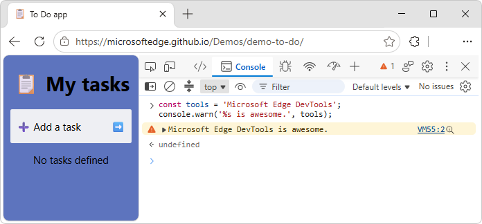
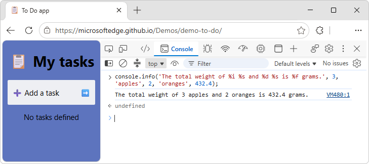
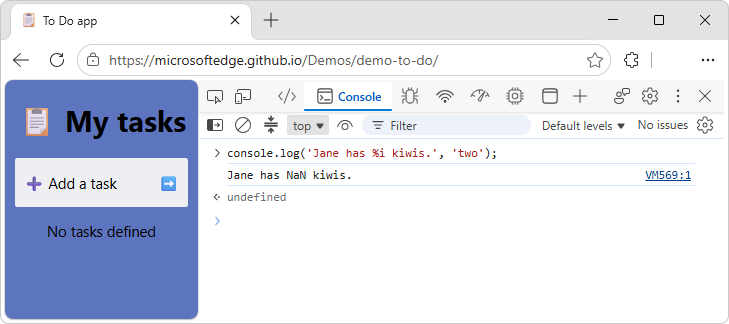
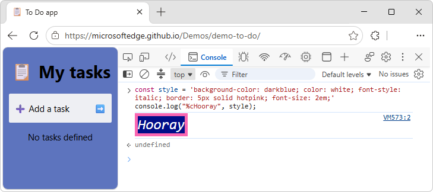
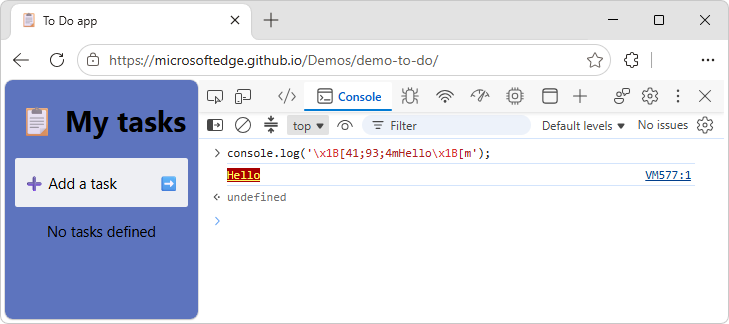
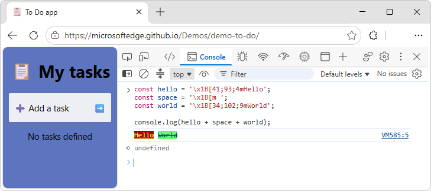

<!-- Copyright Jecelyn Yeen

   Licensed under the Apache License, Version 2.0 (the "License");
   you may not use this file except in compliance with the License.
   You may obtain a copy of the License at

       https://www.apache.org/licenses/LICENSE-2.0

   Unless required by applicable law or agreed to in writing, software
   distributed under the License is distributed on an "AS IS" BASIS,
   WITHOUT WARRANTIES OR CONDITIONS OF ANY KIND, either express or implied.
   See the License for the specific language governing permissions and
   limitations under the License.  -->
# Format and style messages in the Console
<!-- https://developer.chrome.com/docs/devtools/console/format-style -->

todo: in each section:
* check formatting
* make sure all links are present
* make sure pngs show edge

You can use the **Console** tool to format and style messages by using JavaScript commands.

To learn how to log messages to the Console, see [Log messages in the Console tool](./console-log.md).

This guide assumes that you understand the fundamentals of web development, such as how to use JavaScript to add interactivity to a page.

**Detailed contents:**
* [Format console messages](#format-console-messages)
   * [Format specifiers](#format-specifiers)
   * [Apply multiple format specifiers](#apply-multiple-format-specifiers)
   * [Understand type conversions](#understand-type-conversions)
      * [Invalid type conversion](#invalid-type-conversion)
* [Style console messages](#style-console-messages)
   * [Style console messages by using CSS `%c` format specifiers](#style-console-messages-by-using-css-c-format-specifiers)
      * [The `data:` URL schema](#the-data-url-schema)
   * [Style console messages by using ANSI escape sequences](#style-console-messages-by-using-ansi-escape-sequences)
      * [Simple example of ANSI escape sequences](#simple-example-of-ansi-escape-sequences)
      * [Color codes](#color-codes)
      * [Styling codes](#styling-codes)
      * [Example of ANSI escape sequences with multiple stylings](#example-of-ansi-escape-sequences-with-multiple-stylings)
* [See also](#see-also)


<!-- ====================================================================== -->
## Format console messages
<!-- https://developer.chrome.com/docs/devtools/console/format-style#format -->

You can use format specifiers to format the console messages.  Format specifiers begin with a percent character (`%`) and terminate with a "type character" (such as `s`), which indicates the type of data (such as integer or float).

For example:

1. Go to a webpage, such as the [To Do app](https://microsoftedge.github.io/Demos/demo-to-do/) demo.

1. Right-click the webpage, and then select **Inspect**.

   DevTools opens.

1. In the **Activity bar**, select the  **Console** tool.

1. Enter the following console command:

   ```javascript
   const tools = 'Microsoft Edge DevTools';
   console.warn('%s is awesome.', tools);
   ```

   The console command produces the message: `Microsoft Edge DevTools is awesome.`

   

See also:
* [2.2.1. Summary of formatting specifiers](https://console.spec.whatwg.org/#formatting-specifiers) in _Console: Living Standard_.


<!-- ------------------------------ -->
#### Format specifiers
<!-- heading not in upstream -->
<!-- https://developer.chrome.com/docs/devtools/console/format-style#format -->

DevTools supports the following format specifiers:

| Specifier | Output |
|---|---|
| `%s` | Formats the value as a string. |
| `%i` or `%d` | Formats the value as an integer. |
| `%f` | Formats the value as a floating point value. |
| `%o` | Formats the value as an expandable DOM element. |
| `%O` | Formats the value as an expandable JavaScript object. |
| `%c` | Applies CSS style rules to the output string as specified by the second parameter. |

See also:
* [2.2.1. Summary of formatting specifiers](https://console.spec.whatwg.org/#formatting-specifiers) in _Console: Living Standard_.


<!-- ------------------------------ -->
#### Apply multiple format specifiers
<!-- https://developer.chrome.com/docs/devtools/console/format-style#multiple-specifiers -->

You can use more than one format specifier in a message.

For example:

1. Go to a webpage, such as the [To Do app](https://microsoftedge.github.io/Demos/demo-to-do/) demo.

1. Right-click the webpage, and then select **Inspect**.

   DevTools opens.

1. In the **Activity bar**, select the  **Console** tool.

1. Enter the following console command:

   ```javascript
   console.info('The total weight of %i %s and %d %s is %f grams.', 3, 'apples', 2, 'oranges', 432.4);
   ```

   The console command produces the message: `The total weight of 3 apples and 2 oranges is 432.4 grams.`

   


<!-- ------------------------------ -->
#### Understand type conversions
<!-- https://developer.chrome.com/docs/devtools/console/format-style#conversion -->

The output message is converted according to the format specifier.

For example:

1. Go to a webpage, such as the [To Do app](https://microsoftedge.github.io/Demos/demo-to-do/) demo.

1. Right-click the webpage, and then select **Inspect**.

   DevTools opens.

1. In the **Activity bar**, select the  **Console** tool.

1. Enter the following console command:

   ```javascript
   console.log('I have %i apples and %d oranges.', 2, 3.5);
   ```

   The console command produces the message: "I have 2 apples and 3 oranges."

   

   Instead of logging 3.5 oranges, the output is 3 oranges.  The `%d` indicates to convert the value to an integer.


<!-- ------------------------------ -->
###### Invalid type conversion
<!-- heading not in upstream -->
<!-- https://developer.chrome.com/docs/devtools/console/format-style#conversion -->

If the type conversion is invalid, it returns `NaN` (Not-A-Number).

For example:

1. Go to a webpage, such as the [To Do app](https://microsoftedge.github.io/Demos/demo-to-do/) demo.

1. Right-click the webpage, and then select **Inspect**.

   DevTools opens.

1. In the **Activity bar**, select the  **Console** tool.

1. Enter the following console command:

   ```javascript
   console.log('Jane has %i kiwis.', 'two');
   ```

   The console command produces the message `Jane has NaN kiwis.`

   

   The `%i` indicates to convert the value to an integer, but the provided argument is a string instead.  Thus it returns `NaN` (Not-A-Number).


<!-- ====================================================================== -->
## Style console messages
<!-- https://developer.chrome.com/docs/devtools/console/format-style#style_console_messages -->

There are two ways to style console messages in DevTools:
* By using CSS `%c` format specifiers.
* By using ANSI escape sequences.


<!-- ------------------------------ -->
#### Style console messages by using CSS `%c` format specifiers
<!-- Style with format specifier  https://developer.chrome.com/docs/devtools/console/format-style#style-specifier -->

You can use the %c format specifier to style the console messages with CSS.

For example:

1. Go to a webpage, such as the [To Do app](https://microsoftedge.github.io/Demos/demo-to-do/) demo.

1. Right-click the webpage, and then select **Inspect**.

   DevTools opens.

1. In the **Activity bar**, select the  **Console** tool.

1. Enter the following console command:

   ```javascript
   const style = 'background-color: darkblue; color: white; font-style: italic; border: 5px solid hotpink; font-size: 2em;'
   console.log("%cHooray", style);
   ```

   The console command produces the message `Hooray` with CSS styles applied:

   


<!-- ---------- -->
###### The `data:` URL schema
<!-- heading not upstream -->

To prevent data leaks and bypasses of security policies, in this format, the `url()` CSS function supports only the `data:` URL schema.

For example, you can set a background image as follows:

`css background: url(data:image/png;base64,iVBORw...);`

where `iVBORw...` is a base64-encoded PNG image.

See also:
* [data: URLs](https://developer.mozilla.org/docs/Web/HTTP/Basics_of_HTTP/Data_URLs) at MDN.


<!-- ------------------------------ -->
#### Style console messages by using ANSI escape sequences
<!-- Style with ANSI escape sequences  https://developer.chrome.com/docs/devtools/console/format-style#style-ansi -->

You can style console messages by using ANSI escape sequences (without having to use any Node.js libraries), by using the syntax:

`\x1B[𝘗1;…;𝘗nm`

where:
* 𝘗1 to 𝘗n are valid subsequences of Select Graphic Rendition (SGR) parameters.
* Any of the parameters `𝘗1` to `𝘗n` can be omitted, in which case its value is assumed to be zero.
* `\x1B[m` is the shorthand for `\x1B[0m`, in which the display attribute will be reset.

Node.js developers often colorize log messages by using ANSI escape sequences, often with the help of some Node.js styling libraries, such as:
* [chalk](https://www.npmjs.com/package/chalk)
* [colors](https://www.npmjs.com/package/colors)
* [ansi-colors](https://www.npmjs.com/package/ansi-colors)
* [kleur](https://www.npmjs.com/package/kleur)

See also:
* [ANSI escape code](https://en.wikipedia.org/wiki/ANSI_escape_code) at Wikipedia.
   * [Select Graphic Rendition parameters](https://en.wikipedia.org/wiki/ANSI_escape_code#SGR_(Select_Graphic_Rendition)_parameters) in _ANSI escape code_ at Wikipedia.
* [Node.js](https://nodejs.org)


<!-- ---------- -->
###### Simple example of ANSI escape sequences
<!-- heading not upstream; content is upstream -->
<!-- Style with ANSI escape sequences  https://developer.chrome.com/docs/devtools/console/format-style#style-ansi -->

Example of formatting console messages by using ANSI escape sequences:

1. Go to a webpage, such as the [To Do app](https://microsoftedge.github.io/Demos/demo-to-do/) demo.

1. Right-click the webpage, and then select **Inspect**.

   DevTools opens.

1. In the **Activity bar**, select the  **Console** tool.

1. Enter the following console command:

   ```javascript
   console.log('\x1B[41;93;4mHello\x1B[m');
   ```

   The console command produces a `Hello` message with red background, yellow text, underlined:

   


<!-- ---------- -->
###### Color codes
<!-- heading not upstream; content is upstream -->
<!-- Style with ANSI escape sequences  https://developer.chrome.com/docs/devtools/console/format-style#style-ansi -->

DevTools supports the following color codes:

_todo: check format of rendered first row: add backticks?_

| Foreground | Background | Light theme | Dark theme |
|---|---|---|---|
| 30 | 40 | #00000 | #00000 |
| 31 | 41 | #AA0000 | #ed4e4c |
| 32 | 42 | #00AA00 | #01c800 |
| 33 | 43 | #AA5500 | #d2c057 |
| 34 | 44 | #0000AA | #2774f0 |
| 35 | 45 | #AA00AA | #a142f4 |
| 36 | 46 | #00AAAA | #12b5cb |
| 37 | 47 | #AAAAAA | #cfd0d0 |
| 90 | 100 | #555555 | #898989 |
| 91 | 101 | #FF5555 | #f28b82 |
| 92 | 102 | #55FF55 | #01c801 |
| 93 | 103 | #FFFF55 | #ddfb55 |
| 94 | 104 | #5555FF | #669df6 |
| 95 | 105 | #FF55FF | #d670d6 |
| 96 | 106 | #55FFFF | #84f0ff |
| 97 | 107 | #FFFFFF | #FFFFFF |


<!-- ---------- -->
###### Styling codes
<!-- heading not upstream; content is upstream -->
<!-- Style with ANSI escape sequences  https://developer.chrome.com/docs/devtools/console/format-style#style-ansi -->

DevTools supports the following styling codes:

| Parameter(s) | Meaning |
|---|---|
| 0 | Reset all display attributes. |
| 1 | `font-weight: bold` |
| 2 | `font-weight: lighter` |
| 3 | `font-style: italic` |
| 4 | Add underline to `text-decoration` property. |
| 9 | Add line-through to `text-decoration` property. |
| 22 | Reset `font-weight` property. |
| 23 | Reset `font-style` property. |
| 24 | Remove underline from `text-decoration` property. |
| 29 | Remove line-through from `text-decoration` property. |
| `38;2;𝑅;𝐺;𝐵` | `color: rgb(𝑅,𝐺,𝐵)` |
| 39 | Reset `color` property. |
| `48;2;𝑅;𝐺;𝐵` | `background: rgb(𝑅,𝐺,𝐵)` |
| 49 | Reset `background` property. |
| 53 | Add overline to `text-decoration` property. |
| 55 | Remove overline from `text-decoration` property. |


<!-- ---------- -->
###### Example of ANSI escape sequences with multiple stylings
<!-- heading not upstream; content is upstream -->
<!-- Style with ANSI escape sequences  https://developer.chrome.com/docs/devtools/console/format-style#style-ansi -->

Here's a more complex example of formatting console messages by using ANSI escape sequences, with multiple stylings:

1. Go to a webpage, such as the [To Do app](https://microsoftedge.github.io/Demos/demo-to-do/) demo.

1. Right-click the webpage, and then select **Inspect**.

   DevTools opens.

1. In the **Activity bar**, select the  **Console** tool.

1. Enter the following console command:

   ```javascript
   const hello = '\x1B[41;93;4mHello';
   const space = '\x1B[m ';
   const world = '\x1B[34;102;9mWorld';

   console.log(hello + space + world);
   ```

   The console command produces a `Hello World` message that has three different styles:

    todo show edge


<!-- ====================================================================== -->
## See also
<!-- all links in article -->

* [Log messages in the Console tool](./console-log.md)

Spec:
* [2.2.1. Summary of formatting specifiers](https://console.spec.whatwg.org/#formatting-specifiers) in _Console: Living Standard_.

MDN:
* [data: URLs](https://developer.mozilla.org/docs/Web/HTTP/Basics_of_HTTP/Data_URLs) at MDN.

Node.js:
* [Node.js](https://nodejs.org)
* [chalk](https://www.npmjs.com/package/chalk)
* [colors](https://www.npmjs.com/package/colors)
* [ansi-colors](https://www.npmjs.com/package/ansi-colors)
* [kleur](https://www.npmjs.com/package/kleur)

Wikipedia:
* [ANSI escape code](https://en.wikipedia.org/wiki/ANSI_escape_code)
   * [Select Graphic Rendition parameters](https://en.wikipedia.org/wiki/ANSI_escape_code#SGR_(Select_Graphic_Rendition)_parameters) in _ANSI escape code_.

GitHub:
* [To Do app](https://microsoftedge.github.io/Demos/demo-to-do/) demo.
   * [/demo-to-do/](https://github.com/MicrosoftEdge/Demos/tree/main/demo-to-do/) - source code.


<!-- ====================================================================== -->
> [!NOTE]
> Portions of this page are modifications based on work created and [shared by Google](https://developers.google.com/terms/site-policies) and used according to terms described in the [Creative Commons Attribution 4.0 International License](https://creativecommons.org/licenses/by/4.0).
> The original page is found [here](https://developer.chrome.com/docs/devtools/console/format-style) and is authored by Jecelyn Yeen.

[](https://creativecommons.org/licenses/by/4.0)
This work is licensed under a [Creative Commons Attribution 4.0 International License](https://creativecommons.org/licenses/by/4.0).
