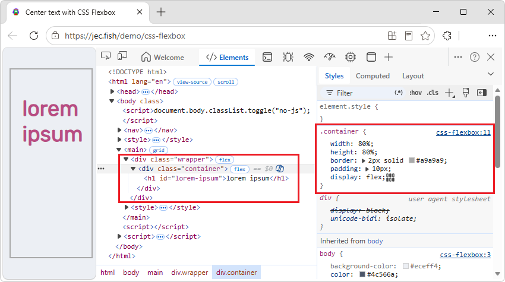
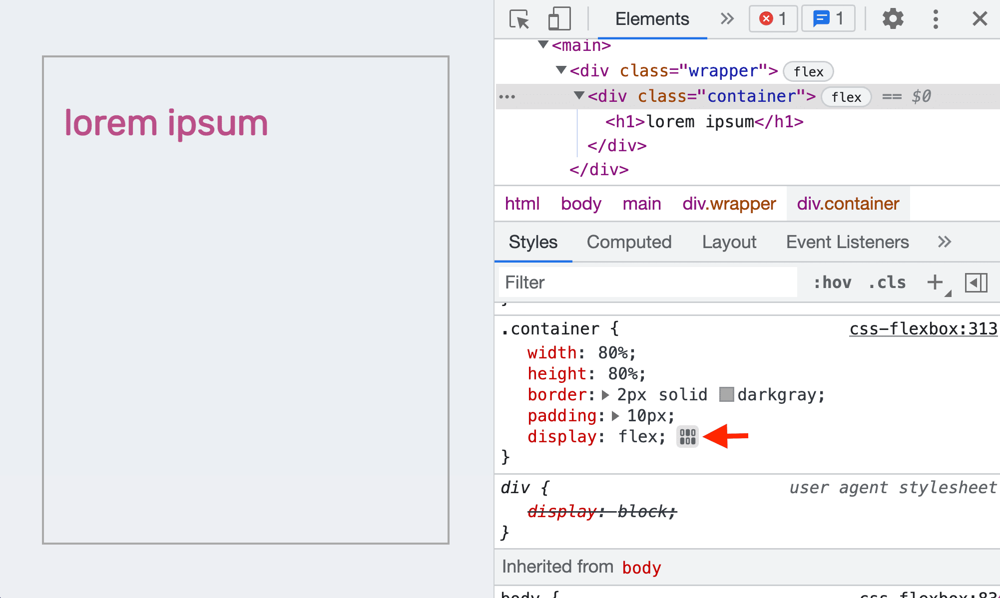
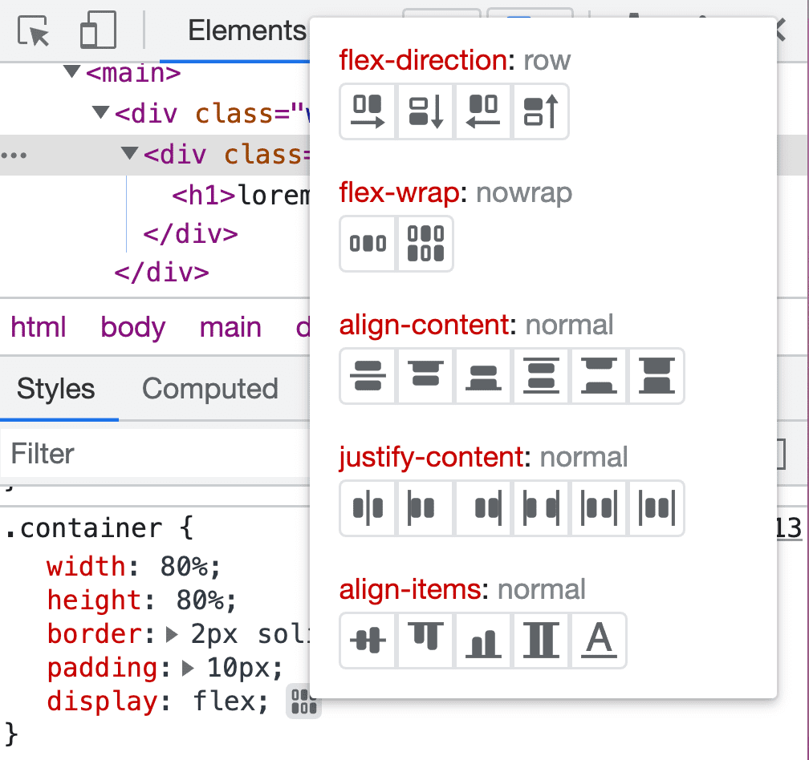
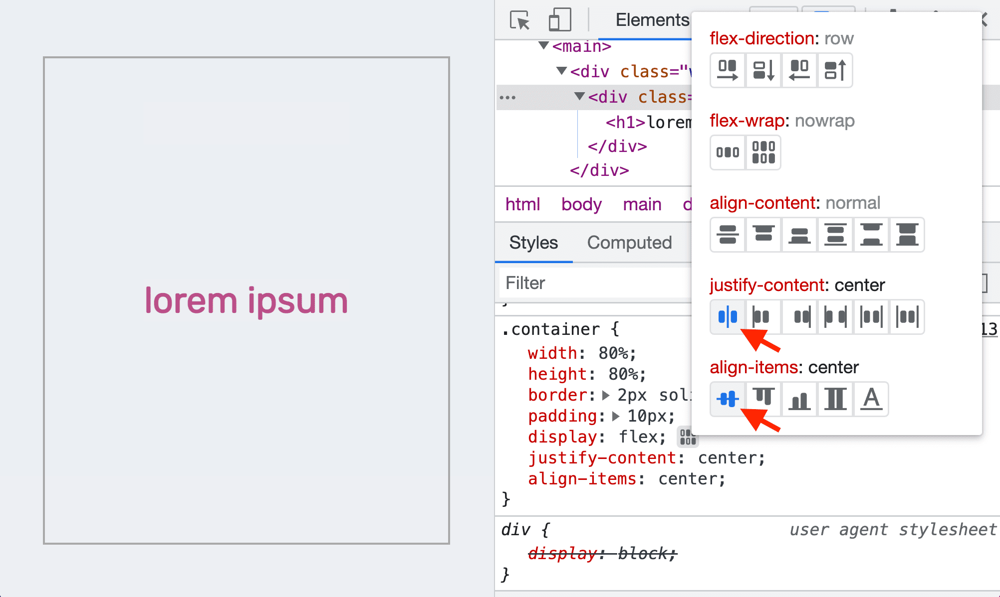
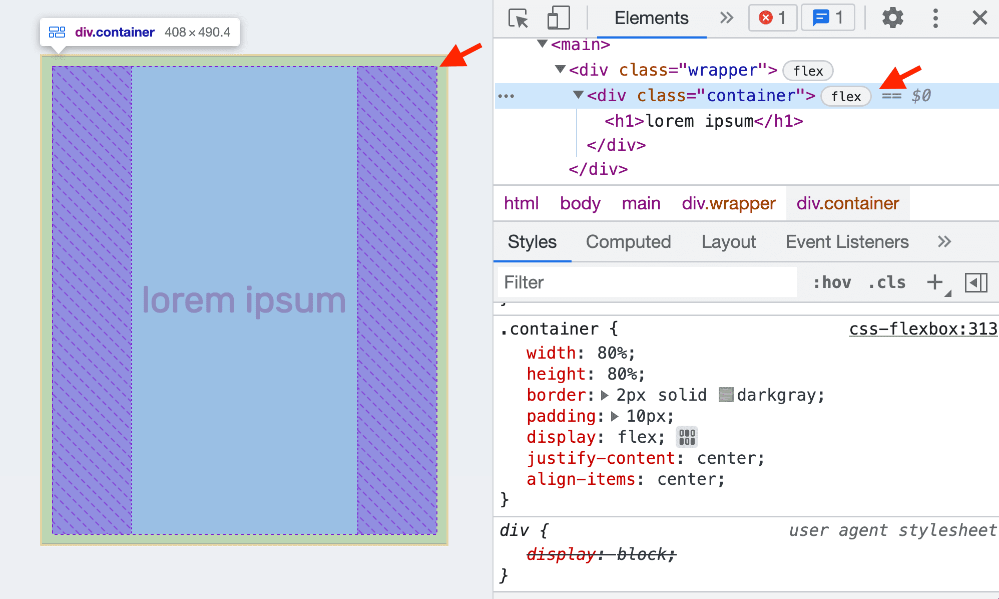
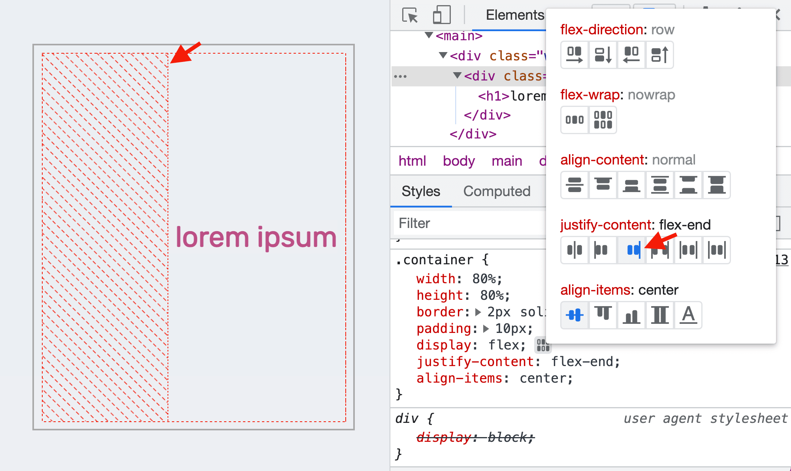
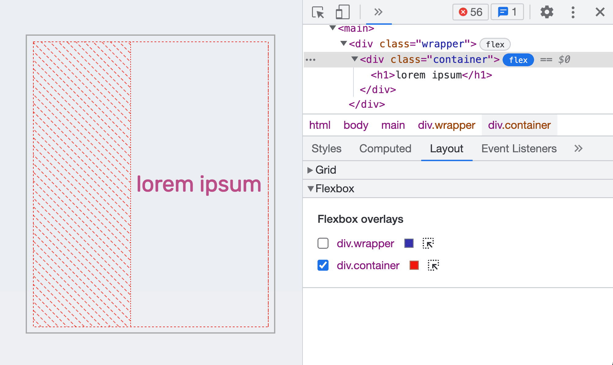
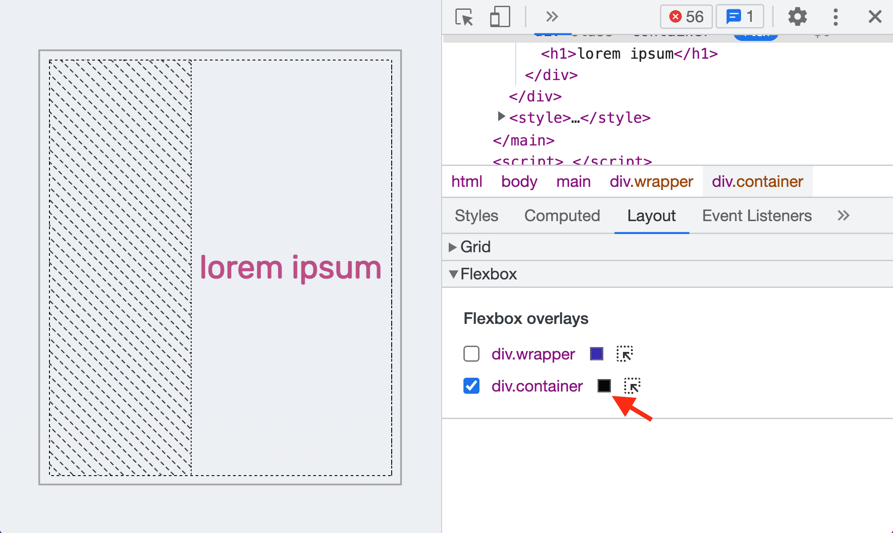
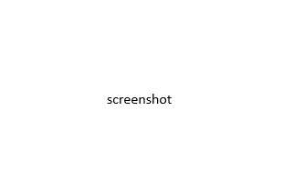

# Inspect and debug CSS flexbox layouts
<!-- https://developer.chrome.com/docs/devtools/css/flexbox -->
<!-- Copyright Jecelyn Yeen

   Licensed under the Apache License, Version 2.0 (the "License");
   you may not use this file except in compliance with the License.
   You may obtain a copy of the License at

       https://www.apache.org/licenses/LICENSE-2.0

   Unless required by applicable law or agreed to in writing, software
   distributed under the License is distributed on an "AS IS" BASIS,
   WITHOUT WARRANTIES OR CONDITIONS OF ANY KIND, either express or implied.
   See the License for the specific language governing permissions and
   limitations under the License.  -->

This guide shows you how to discover flexbox elements on a page, as well as inspect and modify the flexbox layouts in the **Elements** tool.

The screenshots appearing in this article are from this webpage: [Centering a text element with Flexbox](http://jec.fish/demo/css-flexbox). todo Demos repo demo(s) 

todo:
* \Demos\css-gap-decorations\README.md
   * CSS Gap Decorations demos -- Draws line decorations within gaps in CSS Grid, **Flexbox**, and Multi-column layouts.
   * [/css-gap-decorations/]( https://github.com/MicrosoftEdge/Demos/tree/main/css-gap-decorations )
   * [CSS Gap Decorations demos]( https://microsoftedge.github.io/Demos/css-gap-decorations/ )

todo:
1. dup the article using upstream demos, links, pngs
1. convert demos to local
1. convert pngs to local
1. convert links to local

<!-- ====================================================================== -->
## The `flex` badge in the DOM tree
<!-- Discover CSS flexbox  https://developer.chrome.com/docs/devtools/css/flexbox#discover -->

When an HTML element on a page has `display: flex` or `display: inline-flex` applied to it, a **flex** badge is displayed next to the element in the DOM tree in the **Elements** tool.

To view the `flex` badge:

1. Open a webpage, such as the [foo] demo.

1. Right-click the webpage, and then select **Inspect**.

   DevTools opens, with the **Elements** tool selected.

   

See also:
* [Inspect, edit, and debug HTML and CSS with the Elements tool](../elements/elements-tool.md)

<!-- ====================================================================== -->
## Modify layout by using the flexbox editor
<!-- Modify layouts with the flexbox editor  https://developer.chrome.com/docs/devtools/css/flexbox#modify -->

You can modify a flexbox layout visually by using the **flexbox editor**.

For example, you can center the text `<h1>` of the [Center text with CSS Flexbox](http://jec.fish/demo/css-flexbox) demo within its container, `
`.

To modify layout by using the **flexbox editor**:

1. Open a webpage, such as the [Center text with CSS Flexbox](http://jec.fish/demo/css-flexbox) demo.

1. Right-click the webpage, and then select **Inspect**.

   DevTools opens, with the **Elements** tool selected.

1. Inspect the container element.

   In the **Styles** tab of the **Elements** tool, the **flexbox editor** button is shown next to the `display: flex` declaration:

    _todo show edge_

1. Click the **flexbox editor** button.

   The **flexbox editor** opens, displaying a list of flexbox properties.  Each property's value options are displayed as icon buttons:

    _todo show edge_

1. Click the `justify-content: center` button.

1. Click the `align-items: center` button.

   The text is now centered on the screen:

    _todo show edge_

   In the **Styles** tab, the `justify-content: center` and `align-items: center` declarations are added.

<!-- ====================================================================== -->
## Examine the flexbox layout
<!-- https://developer.chrome.com/docs/devtools/css/flexbox#examine -->

To visualize the layout, hover over the flexbox element in the **Elements** tool.  To toggle the display of the flexbox overlay, click the **flex** badge.

To examine a flexbox layout:

1. Open a webpage, such as the [Center text with CSS Flexbox](http://jec.fish/demo/css-flexbox) demo.

1. Right-click the webpage, and then select **Inspect**.

   DevTools opens, with the **Elements** tool selected.

   The overlay appears over the element, laid out with dotted lines to show the position of its content and items:

    _todo show edge_

1. Click the **flex** badge.

   The flexbox overlay is displayed (or hidden):

    _todo show edge_

1. Change the value to `justify-content: flex-end`.

   The overlay is changed accordingly:  _todo: specify_

    _todo show edge_

   The icons in the **flex editor** are context-aware.  It _todo: what is "it"?_ changes according to the layout direction.  For example, when you change the `flex-direction` to `column`, the icons in the **flex editor** are rotated accordingly, and the overlay is updated:

    _todo png for video_

<!-- ====================================================================== -->
## Adjust the flexbox overlay color
<!-- https://developer.chrome.com/docs/devtools/css/flexbox#layout -->

To adjust the flexbox overlay color:

1. Open a webpage, such as the [Center text with CSS Flexbox](http://jec.fish/demo/css-flexbox) demo.

1. Right-click the webpage, and then select **Inspect**.

   DevTools opens, with the **Elements** tool selected.

1. Click the **Layout** tab in the **Elements** tool, and then scroll down to the **Flexbox** section.

   All of the flexbox elements are displayed:

    _todo show edge_

1. You can toggle the overlay of each flexbox element by selecting the checkbox next to it.  It is the same as you click on the badge in the **DOM tree**.

1. You can change the color of the overlay, by clicking on the color icon next to it.

   The color of the `container` overlay changes to black:

    _todo show edge_

1. Click the selector icon next to it.

   The DOM tree navigates to the flexbox element:

    _todo png for video_

<!-- ====================================================================== -->
> [!NOTE]
> Portions of this page are modifications based on work created and [shared by Google](https://developers.google.com/terms/site-policies) and used according to terms described in the [Creative Commons Attribution 4.0 International License](https://creativecommons.org/licenses/by/4.0).
> The original page is found [here](https://developer.chrome.com/docs/devtools/css/flexbox) and is authored by Jecelyn Yeen.

This work is licensed under a [Creative Commons Attribution 4.0 International License](https://creativecommons.org/licenses/by/4.0).
