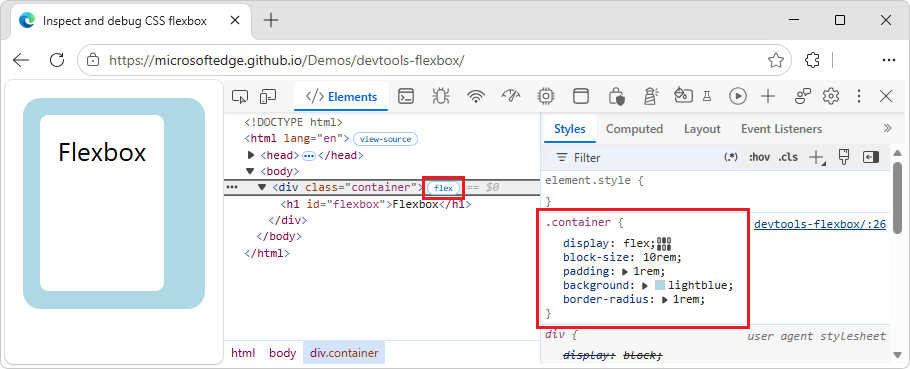
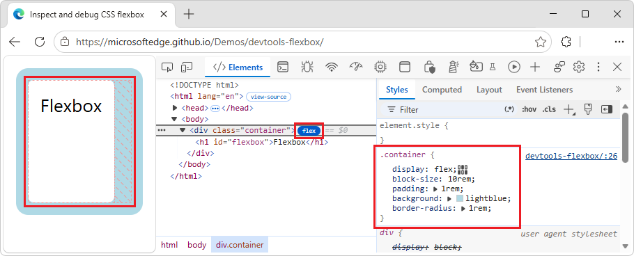
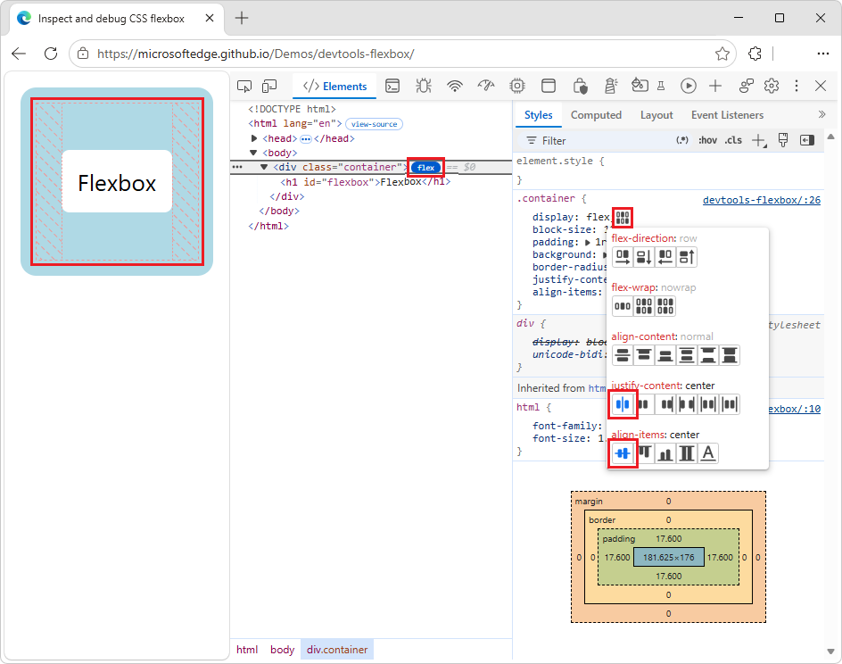
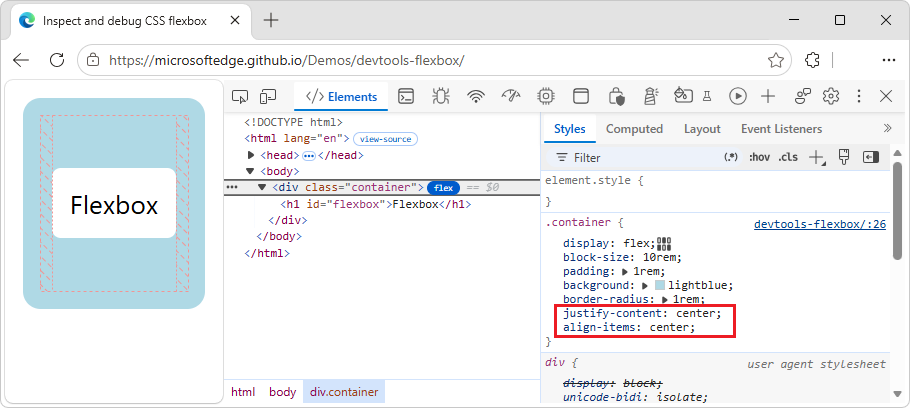
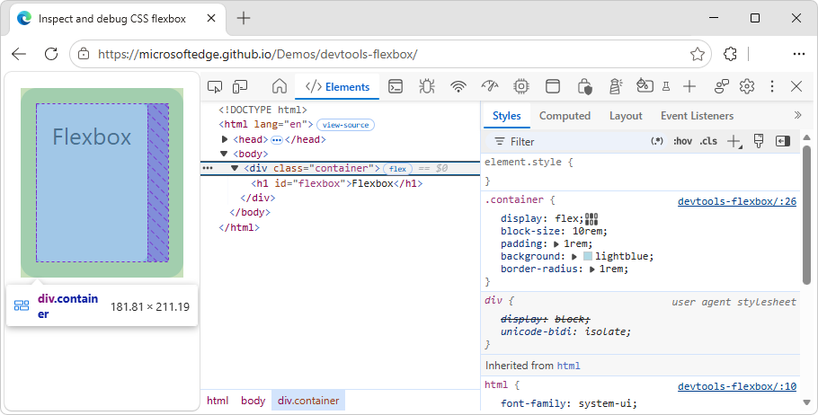
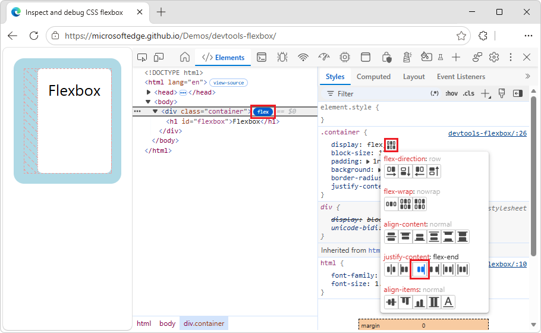
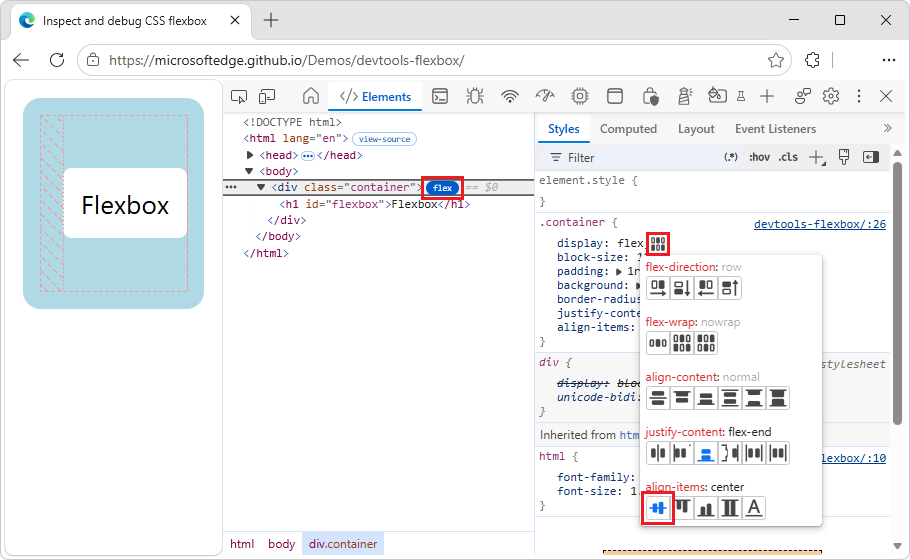
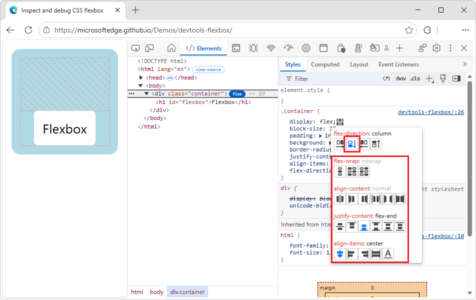
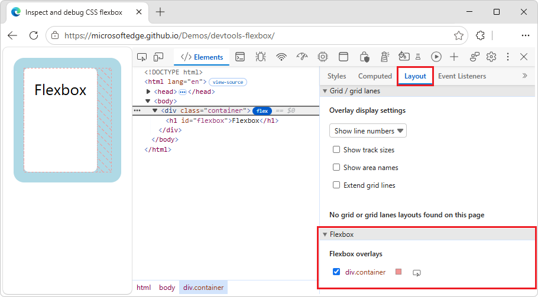
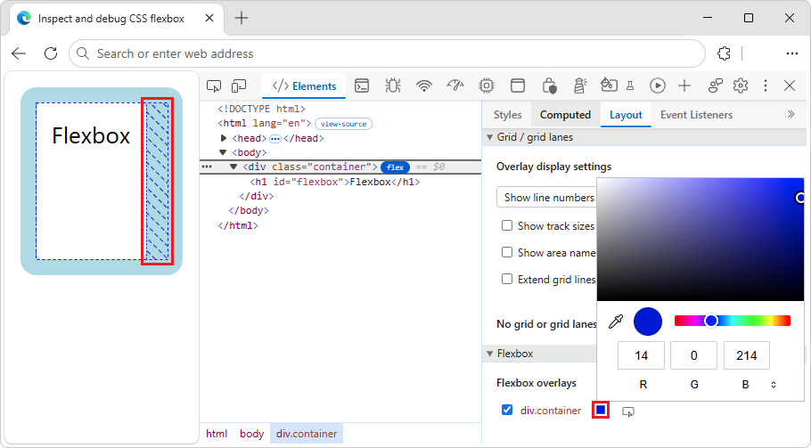

# Inspect and debug CSS flexbox layout
<!-- Inspect and debug CSS flexbox layouts  https://developer.chrome.com/docs/devtools/css/flexbox -->
<!-- Copyright Jecelyn Yeen

   Licensed under the Apache License, Version 2.0 (the "License");
   you may not use this file except in compliance with the License.
   You may obtain a copy of the License at

       https://www.apache.org/licenses/LICENSE-2.0

   Unless required by applicable law or agreed to in writing, software
   distributed under the License is distributed on an "AS IS" BASIS,
   WITHOUT WARRANTIES OR CONDITIONS OF ANY KIND, either express or implied.
   See the License for the specific language governing permissions and
   limitations under the License.  -->

This guide shows you how to discover flexbox elements on a page, as well as inspect and modify the flexbox layouts in the **Elements** tool.

<!-- ====================================================================== -->
## Use the `flex` badge to display the flexbox overlay
<!-- Discover CSS flexbox  https://developer.chrome.com/docs/devtools/css/flexbox#discover -->

When an HTML element on a page has `display: flex` or `display: inline-flex` applied to it, a `flex` badge () is displayed next to the element in the DOM tree in the **Elements** tool.  Clicking the `flex` badge displays the flexbox overlay in the webpage.

To display the flexbox overlay:

1. Open a webpage, such as the [Inspect and debug CSS flexbox](https://microsoftedge.github.io/Demos/devtools-flexbox/) demo.

1. Right-click the **Flexbox** box, and then select **Inspect**.

   DevTools opens, with the **Elements** tool selected.  Next to the `
` element is the `flex` badge ():

   

1. Click the `flex` badge.

   The flexbox overlay is displayed in the webpage:

   

See also:
* [Inspect, edit, and debug HTML and CSS with the Elements tool](../elements/elements-tool.md)

<!-- ====================================================================== -->
## Modify layout visually by using the flexbox editor
<!-- Modify layouts with the flexbox editor  https://developer.chrome.com/docs/devtools/css/flexbox#modify -->

You can modify a flexbox layout visually, rather than through code, by using the **flexbox editor**.

For example, you can center a flexbox element within its container, as follows.

To modify layout by using the **flexbox editor**:

1. Open a webpage, such as the [Inspect and debug CSS flexbox](https://microsoftedge.github.io/Demos/devtools-flexbox/) demo.

1. Right-click the **Flexbox** box, and then select **Inspect**.

   DevTools opens, with the **Elements** tool selected.  In the DOM tree, next to the `
` element, the `flex` badge is displayed.

1. Click the `flex` badge ().

   The flexbox overlay is displayed in the webpage.

1. In the **Styles** tab of the **Elements** tool, in the `.container` rule, next to the `display: flex;` CSS property, click the **Open flexbox editor** button ().

   The **flexbox editor** opens, displaying a list of flexbox properties.  Each property's value option is displayed as an icon button.

1. In the `justify-content:` section, click the **Add justify-content: center** button.

1. Click the `align-items: center` button.

1. Click away from the flexbox editor.

   The flexbox editor closes, and the **Flexbox** box is now centered within its container:

   

   In the **Styles** tab, the `justify-content: center` and `align-items: center` declarations are added:

   

1. In the DOM tree, click the `flex` badge () again.

   The flexbox overlay is removed from the webpage.

See also:
* [Select an element](./reference.md#select-an-element) in _CSS features reference_.

<!-- ====================================================================== -->
## Additional aspects of the flexbox editor
<!-- Examine the flexbox layout  https://developer.chrome.com/docs/devtools/css/flexbox#examine -->

To momentarily visualize the layout, hover over the flexbox element in the **Elements** tool.  Or, to show or hide the flexbox overlay, click the `flex` badge ().

In the webpage, the flexbox overlay is displayed over the page element, laid out with dotted lines to show the positions of the element's content.

To examine a flexbox layout:

1. Open a webpage, such as the [Inspect and debug CSS flexbox](https://microsoftedge.github.io/Demos/devtools-flexbox/) demo.

1. Right-click the **Flexbox** box, and then select **Inspect**.

   DevTools opens, with the **Elements** tool selected.  In the DOM tree, next to the `
` element, the `flex` badge () is displayed.

1. In the DOM tree, hover over the `
` element.

   In the webpage, the flexbox overlay appears over the page element (as long as you hover), laid out with dotted lines to show the positions of the element's content:

   

1. Click the `flex` badge ().

   The flexbox overlay is displayed in the webpage, without having to hover over the DOM tree:

   

1. In the **Styles** tab of the **Elements** tool, in the `.container` rule, next to the `display: flex;` CSS property, click the **Open flexbox editor** button ().

   The **flexbox editor** opens.

1. In the `justify-content:` section, click the **Add justify-content: flex-end** button.

   In the webpage, the flexbox layout and flexbox overlay now show the flexbox horizontally aligned to the right side of its container:

   

1. In the `align-items:` section, click the **Add align-items: center** button.

   In the webpage, the flexbox layout and flexbox overlay now show the flexbox vertically aligned in the center of its container:

   

1. In the `flex-direction:` section, select the `column` button.

   The icons in the **flexbox editor** are context-aware; the icons in the flexbox editor rotate according to the layout direction.

   In the webpage, the flexbox is now aligned to the bottom of its container, and the flexbox overlay is updated:

   

1. Click the `flex` badge again.

   The flexbox overlay is removed from the webpage.

<!-- ====================================================================== -->
## Adjust the color of the flexbox overlay
<!-- Adjust the flexbox overlay color  https://developer.chrome.com/docs/devtools/css/flexbox#layout -->

You can adjust the color of the flexbox overlay, by using a streamlined version of the **Color Picker**.

To adjust the color of the flexbox overlay:

1. Open a webpage, such as the [Inspect and debug CSS flexbox](https://microsoftedge.github.io/Demos/devtools-flexbox/) demo.

1. Right-click the **Flexbox** box, and then select **Inspect**.

   DevTools opens, with the **Elements** tool selected.  Next to the `
` element is the `flex` badge ().

1. In the **Elements** tool, click the **Layout** tab, and then scroll down to the **Flexbox** section.

   Each flexbox element of the page is listed, with a checkbox, color swatch, and **Show element in the Elements panel** button () next to it:

   

1. Select the `div.container` checkbox.

   * In the DOM tree, the `flex` badge changes color, to indicate that it's selected; selecting this checkbox is the same as selecting the `flex` badge in the DOM.
   * In the webpage, the flexbox overlay is displayed.

1. Next to `div.container`, click the **Choose the overlay color for this element** (color swatch) button.

   A streamlined version of the **Color Picker** opens.

1. Select a color, such as dark blue.

   The color of the `container` overlay changes to the selected color:

   

1. Next to `div.container`, select the **Show element in the Elements panel** button ().

   In the DOM tree, the container element is selected.

See also:
* [Change colors with the Color Picker](./reference.md#change-colors-with-the-color-picker) in _CSS features reference_.

<!-- ====================================================================== -->
## See also
<!-- all links in article -->

* [Inspect, edit, and debug HTML and CSS with the Elements tool](../elements/elements-tool.md)
* [Select an element](./reference.md#select-an-element) in _CSS features reference_.
* [Change colors with the Color Picker](./reference.md#change-colors-with-the-color-picker) in _CSS features reference_.

GitHub:
* [Inspect and debug CSS flexbox](https://microsoftedge.github.io/Demos/devtools-flexbox/) - demo.
   * [/devtools-flexbox/](https://github.com/MicrosoftEdge/Demos/tree/main/devtools-flexbox/) - source code.

<!-- ====================================================================== -->
> [!NOTE]
> Portions of this page are modifications based on work created and [shared by Google](https://developers.google.com/terms/site-policies) and used according to terms described in the [Creative Commons Attribution 4.0 International License](https://creativecommons.org/licenses/by/4.0).
> The original page is found [here](https://developer.chrome.com/docs/devtools/css/flexbox) and is authored by Jecelyn Yeen.

This work is licensed under a [Creative Commons Attribution 4.0 International License](https://creativecommons.org/licenses/by/4.0).
