<!-- Copyright Sofia Emelianova

   Licensed under the Apache License, Version 2.0 (the "License");
   you may not use this file except in compliance with the License.
   You may obtain a copy of the License at

       https://www.apache.org/licenses/LICENSE-2.0

   Unless required by applicable law or agreed to in writing, software
   distributed under the License is distributed on an "AS IS" BASIS,
   WITHOUT WARRANTIES OR CONDITIONS OF ANY KIND, either express or implied.
   See the License for the specific language governing permissions and
   limitations under the License.  -->
# Find invalid, overridden, inactive, and other CSS
<!-- https://developer.chrome.com/docs/devtools/css/issues -->

This guide assumes that you're familiar with inspecting CSS in Microsoft Edge DevTools.  To learn the basics, see [Get started viewing and changing CSS](./index.md).

**Detailed contents:**
* [Inspect the CSS you author](#inspect-the-css-you-author)
* [Understand CSS in the Styles tab](#understand-css-in-the-styles-tab)
   * [Find the CSS selectors which matched and didn't match the element](#find-the-css-selectors-which-matched-and-didnt-match-the-element)
   * [Detect invalid CSS declarations and values](#detect-invalid-css-declarations-and-values)
   * [Detect overridden CSS properties](#detect-overridden-css-properties)
   * [Detect inactive CSS properties](#detect-inactive-css-properties)
   * [Differentiate inherited and non-inherited CSS properties](#differentiate-inherited-and-non-inherited-css-properties)
   * [Reveal individual longhand CSS property values](#reveal-individual-longhand-css-property-values)
   * [View CSS properties that can't be edited](#view-css-properties-that-cant-be-edited)
   * [Inspect an element that isn't styled the way you expect](#inspect-an-element-that-isnt-styled-the-way-you-expect)
* [Understand CSS in the Computed tab](#understand-css-in-the-computed-tab)
   * [See final and inherited CSS values and where they are declared](#see-final-and-inherited-css-values-and-where-they-are-declared)
   * [See CSS values calculated at runtime](#see-css-values-calculated-at-runtime)
   * [Display non-inherited and custom properties](#display-non-inherited-and-custom-properties)
* [Search for duplicates](#search-for-duplicates)
* [Find unused CSS](#find-unused-css)
* [See also](#see-also)

<!-- ====================================================================== -->
## Inspect the CSS you author
<!-- https://developer.chrome.com/docs/devtools/css/issues#styles -->

This article describes how to use the **Element** tool to understand why CSS sometimes doesn't apply to an element as expected.

Suppose that you just added some CSS to an element and you want to verify that the new styles are applied properly.  However, when you refresh the page to test your changes, your changes don't appear.

The first thing to do is to inspect the element and make sure that your new CSS code is actually applied to the element.  See [Select an element](./reference.md#select-an-element) in _CSS features reference_.

Sometimes, you'll see your new CSS code in the **Elements** > **Styles** tab, but the rules and properties that you added are displayed in a dimmed font, are non-editable, are crossed out, or have a **Warning** or **Hint** button next to them.

The examples in this article are from the [Find CSS issues](https://microsoftedge.github.io/Demos/devtools-css-issues/) demo.  Source code: [/devtools-css-issues/](https://github.com/MicrosoftEdge/Demos/tree/main/devtools-css-issues/).

<!-- ====================================================================== -->
## Understand CSS in the Styles tab
<!-- Understand CSS in the Styles pane  https://developer.chrome.com/docs/devtools/css/issues#css-in-styles -->

The **Styles** tab recognizes many kinds of CSS issues and highlights them in different ways.  The following sections describe these CSS issues.

<!-- ------------------------------ -->
#### Find the CSS selectors which matched and didn't match the element
<!-- Matched and unmatched selectors  https://developer.chrome.com/docs/devtools/css/issues#selectors -->

The **Styles** tab shows matched selectors in regular text, and unmatched selectors in dimmed text:

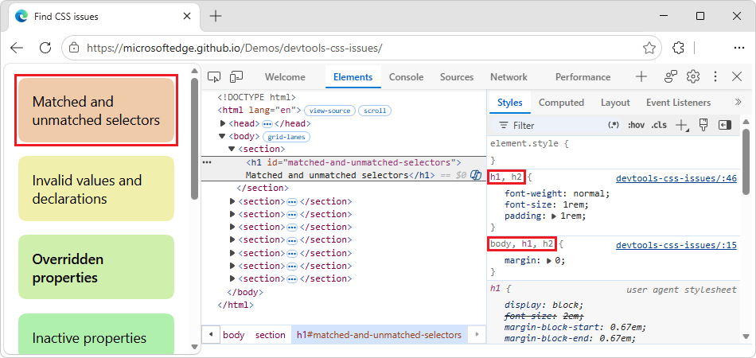

<!-- ------------------------------ -->
#### Detect invalid CSS declarations and values
<!-- Invalid values and declarations  https://developer.chrome.com/docs/devtools/css/issues#invalid -->

The **Styles** tab crosses out and displays a **Warning** icon () next to the following:
* An entire CSS declaration (property and value), when the CSS property is invalid or unknown.
* Just the value, when the CSS property is valid but the value is invalid.

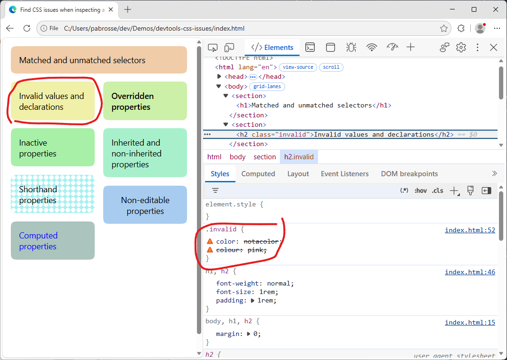

<!-- ------------------------------ -->
#### Detect overridden CSS properties
<!-- Overridden  https://developer.chrome.com/docs/devtools/css/issues#overridden -->

The **Styles** tab crosses out properties that are overridden by other properties according to the cascading order:

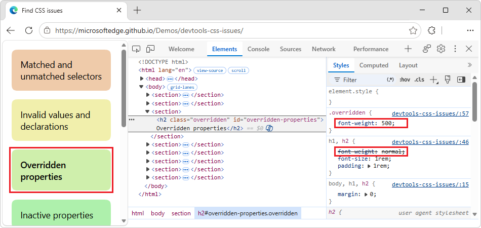

In this example, the `font-weight: 500;` property that's defined in the `.overridden` rule overrides the `font-weight: normal;` property that's defined in the `h1, h2` rule.  According to the CSS cascading order, the `.overridden` rule takes precedence over the `h1, h2` rule.

The class name `.overridden` is arbitrary; this specific class name is not required.

See also:
* [Cascading order](https://developer.mozilla.org/docs/Web/CSS/Guides/Cascade/Introduction#cascading_order) in _Introduction to the CSS cascade_ at MDN.

<!-- ------------------------------ -->
#### Detect inactive CSS properties
<!-- Inactive  https://developer.chrome.com/docs/devtools/css/issues#inactive -->

The **Styles** tab displays in dimmed text and puts an **Information** button () next to a property that's valid but has no effect because of other properties.

These dimmed properties are inactive because of CSS logic, not because of the cascading order.

The dimmed inactive properties differ from dimmed non-inherited properties; see [Differentiate inherited and non-inherited CSS properties](#differentiate-inherited-and-non-inherited-css-properties), below.

Inactive properties have an **Information** button ().  To get a hint about what went wrong, hover over the **Information** button:

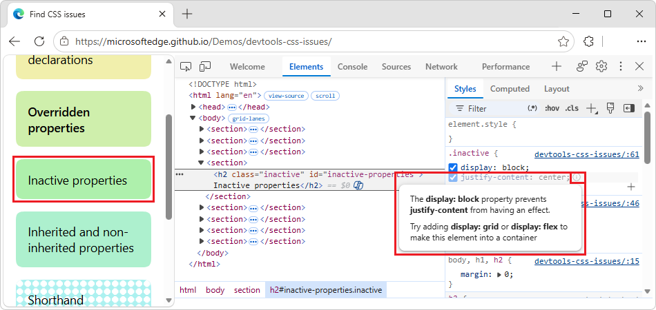

In this example, the `display: block;` property disables the `justify-content` property that controls flex or grid layouts.

<!-- ------------------------------ -->
#### Differentiate inherited and non-inherited CSS properties
<!-- Inherited and non-inherited  https://developer.chrome.com/docs/devtools/css/issues#inherited-and-non-inherited -->

In the **Styles** tab, under an **Inherited from \<element-name\>** section, the way that CSS properties are displayed depends on their default inheritance mechanism:
* CSS properties that are inherited by default, such as `color`, are shown in regular text.
* CSS properties that are not inherited by default, such as `padding`, are shown in dimmed text.

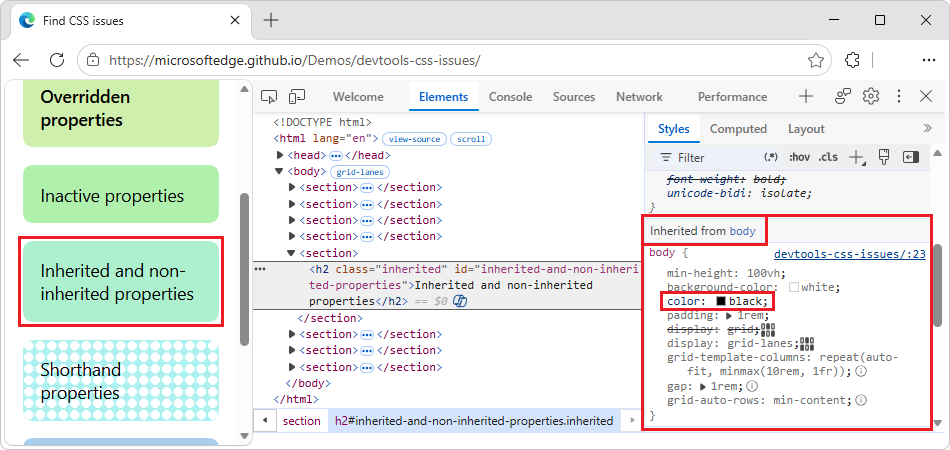

The dimmed non-inherited properties differ from dimmed inactive properties; see [Detect inactive CSS properties](#detect-inactive-css-properties), above.  Non-inherited properties don't have an **Information** button (), and are shown in the corresponding sections.

Overriding default inheritance doesn't affect the way the **Styles** tab displays the properties: dimmed or not.

See also:
* [Inheritance](https://developer.mozilla.org/docs/Web/CSS/Guides/Cascade/Inheritance) at MDN.
   * [Overriding inheritance, an example](https://developer.mozilla.org/docs/Web/CSS/Guides/Cascade/Inheritance#overriding_inheritance_an_example) in _Inheritance_ at MDN.

<!-- ------------------------------ -->
#### Reveal individual longhand CSS property values
<!-- Shorthand  https://developer.chrome.com/docs/devtools/css/issues#shorthand -->

Shorthand (concise) properties let you set multiple CSS properties at once and can make your stylesheet more readable.  However, due to the short nature of such properties, you might miss a longhand (precise) property that overrides a property implied by the shorthand.

The **Styles** tab displays shorthand properties as dropdown lists () that contain all the properties that are shortened:

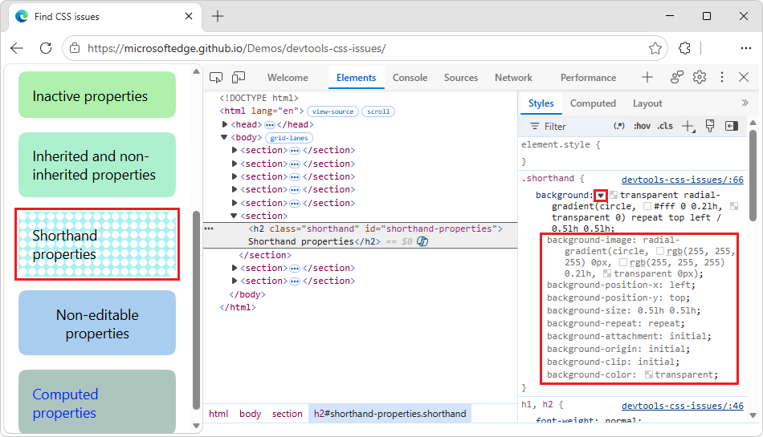

See also:
* [Shorthand properties](https://developer.mozilla.org/docs/Web/CSS/Guides/Cascade/Shorthand_properties) at MDN.

<!-- ------------------------------ -->
#### View CSS properties that can't be edited
<!-- Non-editable  https://developer.chrome.com/docs/devtools/css/issues#non-editable -->

The **Styles** tab displays properties that can't be edited in _italic text_.  For example, the CSS from the following sources can't be edited:

* `user agent stylesheet`—Microsoft Edge's default stylesheet:

   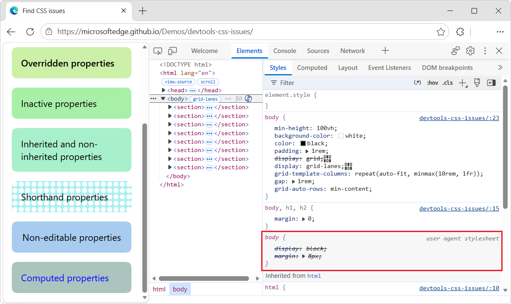

* Style-related HTML attributes on the element, such as height, width, or color.  You can edit them in the DOM tree and this updates the CSS in the **Styles** tab, but not the other way around.

   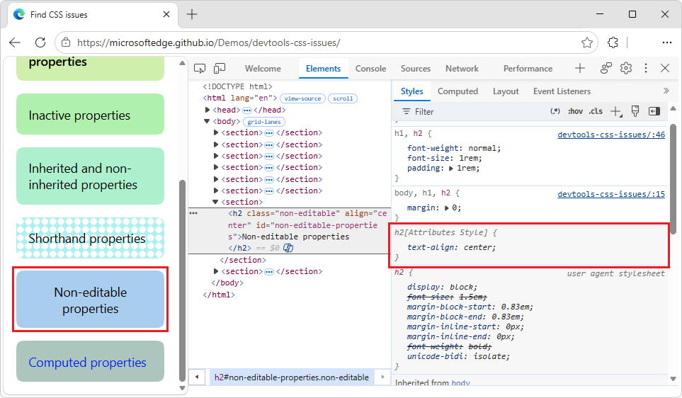

   In the above example, the `align` HTML attribute on an `<h2>` element is set to `center`.  This updates the corresponding property under `h2[Attributes Style]` in the **Styles** tab.

<!-- ------------------------------ -->
#### Inspect an element that isn't styled the way you expect
<!-- Inspect an element that still isn't styled the way you think  https://developer.chrome.com/docs/devtools/css/issues#computed -->

To try to find what goes wrong, you may want to check:

* CSS documentation and selector specificity in the tooltips in the **Styles** tab.  See also:
   * [View CSS documentation](./reference.md#view-css-documentation) in _CSS features reference_.
   * [View selector specificity](./reference.md#view-selector-specificity) in _CSS features reference_.
* The **Computed** tab in the **Elements** tool, to see the "final" CSS that's applied to an element, and compare that to the CSS rules that you declared.  See also:
   * [View only the CSS that's actually applied to an element](./reference.md#view-only-the-css-thats-actually-applied-to-an-element) in _CSS features reference_.

The **Styles** tab in the **Elements** tool displays the exact set of CSS rules as they are written in various stylesheets.  In contrast, the **Elements** > **Computed** tab lists the resolved CSS values that Microsoft Edge uses to render an element:
* CSS that's derived from inheritance.  See [Inheritance](https://developer.mozilla.org/docs/Web/CSS/Guides/Cascade/Inheritance) at MDN.
* Cascade winners.  See [Introduction to the CSS cascade](https://developer.mozilla.org/docs/Web/CSS/Guides/Cascade/Introduction) at MDN.
* Longhand properties (precise), not shorthand (concise).
* Computed values.  For example, `font-size: 14px` instead of `font-size: 70%`.

<!-- ====================================================================== -->
## Understand CSS in the Computed tab
<!-- Understand CSS in the Computed pane  https://developer.chrome.com/docs/devtools/css/issues#css-in-computed -->

Use the **Computed** tab to understand where the final values of an element's CSS properties come from, as explained in the following sections.

<!-- ------------------------------ -->
#### See final and inherited CSS values and where they are declared
<!-- Declared and inherited  https://developer.chrome.com/docs/devtools/css/issues#declared -->

The **Computed** tab lists the properties declared in any stylesheet in regular font, both element's own and inherited.  To see the source of a CSS property, click the Expand button () next to a CSS property:

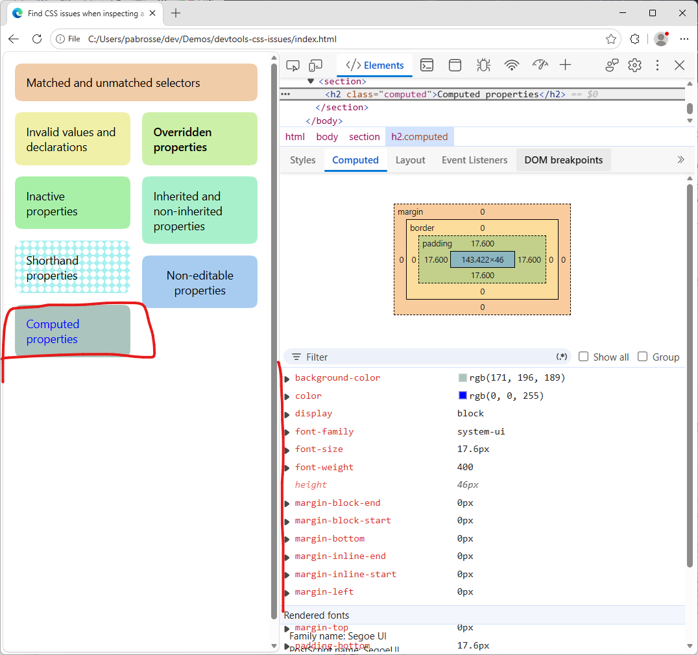

To see the declaration in the **Styles** tab, hover over the expanded property and click the right-arrow button ():

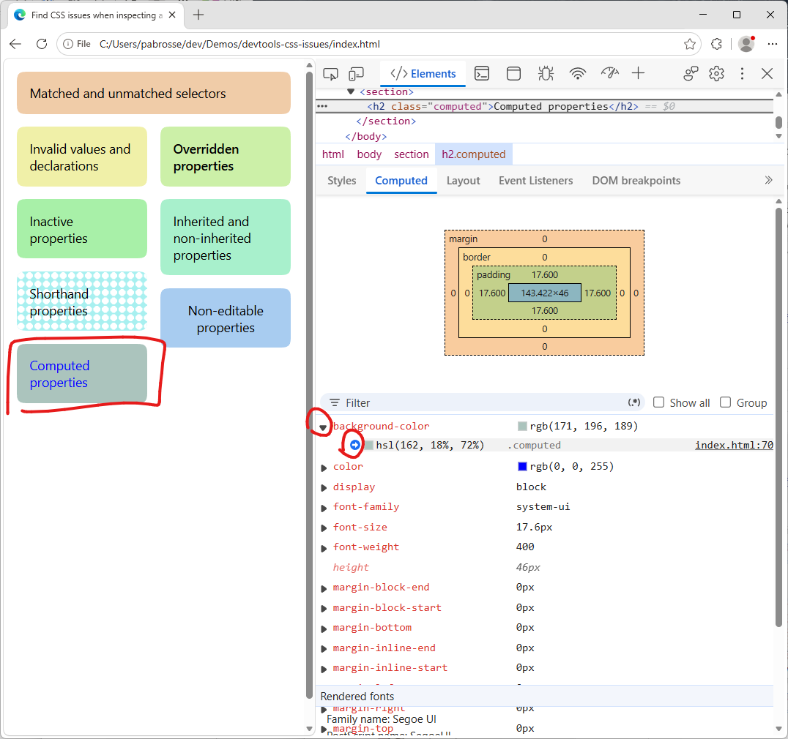

To see the declaration in the **Sources** pane, click the link to the source file:

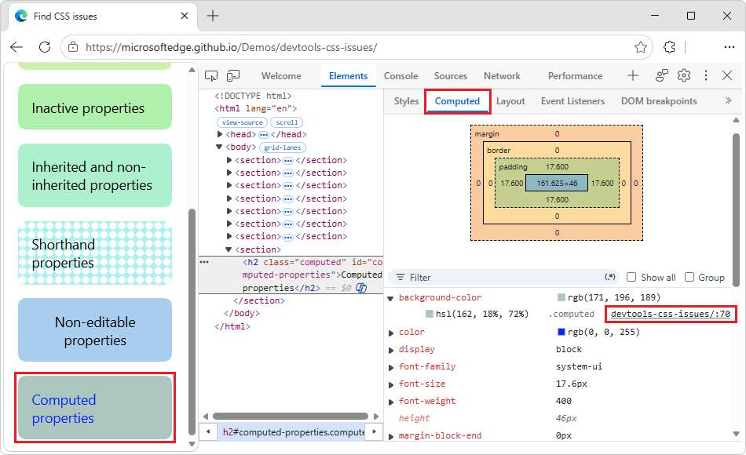

For properties with multiple sources, the **Computed** tab shows the cascade winner first:

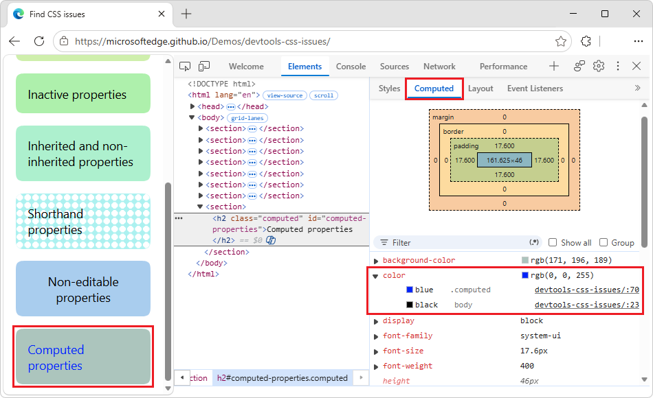

See also:
* [Cascading order](https://developer.mozilla.org/docs/Web/CSS/Guides/Cascade/Introduction#cascading_order) in _Introduction to the CSS cascade_ at MDN.

<!-- ------------------------------ -->
#### See CSS values calculated at runtime
<!-- Runtime  https://developer.chrome.com/docs/devtools/css/issues#runtime -->

The **Computed** tab lists property values that are calculated at runtime in dimmed text:

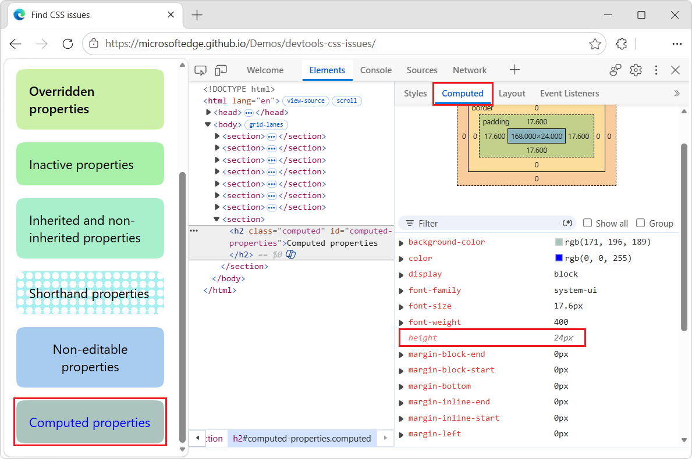

In this example, Microsoft Edge calculated the following for the `<h2>` element:
* `height`: The element's height, in pixels, based on the element's content and internal padding.
* `width`: The element's width, in pixels, based on the element's content and internal padding.

<!-- ------------------------------ -->
#### Display non-inherited and custom properties
<!-- Non-inherited and custom  https://developer.chrome.com/docs/devtools/css/issues#inherited-and-default -->

To make the **Computed** tab show _all_ properties and their values, select the **Show all** checkbox.  Showing all properties includes:
* Initial values for non-inherited properties in dimmed text.
* Custom properties—with a `--` prefix in regular text.  Such properties are inherited by default.

Overriding default inheritance doesn't affect whether the **Computed** tab displays the properties as dimmed or regular text.

See also:
* [Overriding inheritance, an example](https://developer.mozilla.org/docs/Web/CSS/Guides/Cascade/Inheritance#overriding_inheritance_an_example) in _Inheritance_ at MDN.

To break this long list into categories, select the **Group** checkbox:

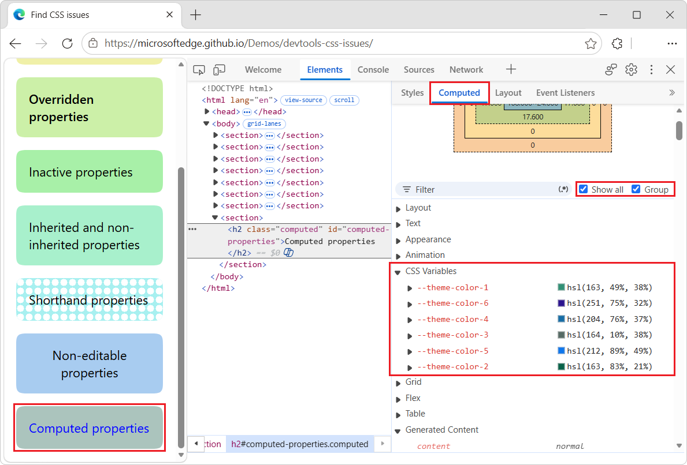

Expand the various group sections to view the related CSS properties.  For example:
* Expand **Animation** to view the initial values of animation-related CSS properties, such as `animation-delay`, which are non-inherited properties.
* Expand **CSS Variables**, to view all custom properties.

<!-- ====================================================================== -->
## Search for duplicates
<!-- https://developer.chrome.com/docs/devtools/css/issues#filter -->

To investigate a specific CSS property and its potential duplicates, type that CSS property name in the **Filter** textbox.  You can do this both in the **Styles** and **Computed** tabs.

The **Filter** text box in the **Styles** tab:

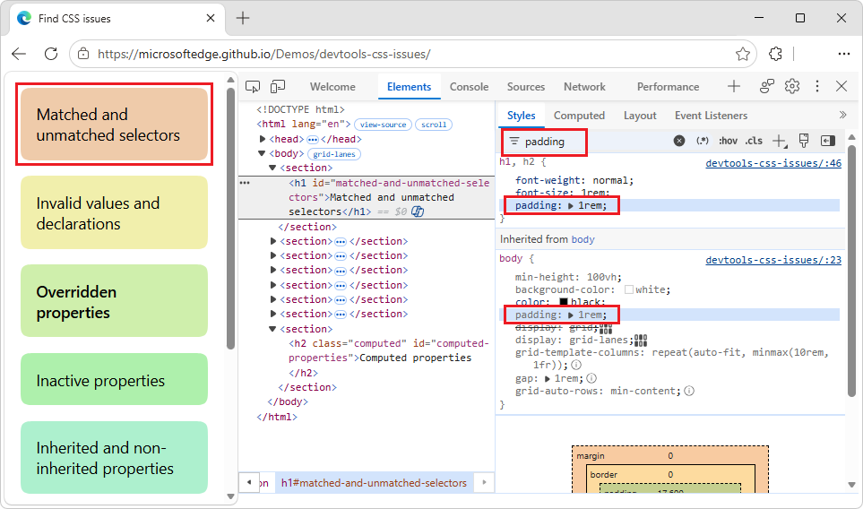

The **Filter** text box in the **Computed** tab:

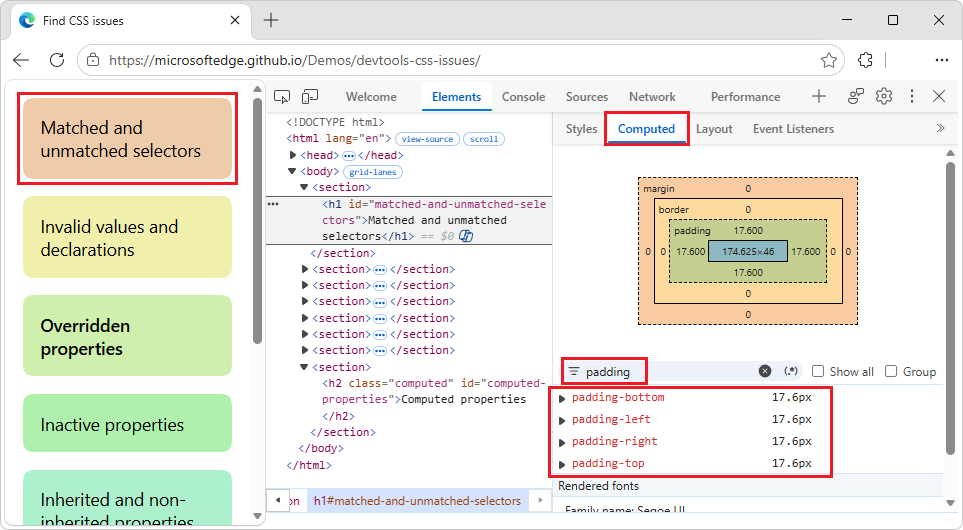

See also:
* [Search and filter an element's CSS](./reference.md#search-and-filter-an-elements-css) in _CSS features reference_.

<!-- ====================================================================== -->
## Find unused CSS
<!-- https://developer.chrome.com/docs/devtools/css/issues#coverage -->

See [Find unused JavaScript and CSS code with the Coverage tool](../coverage/index.md).

<!-- ====================================================================== -->
## See also
<!-- not in upstream -->
<!-- all links in article -->

* [Get started viewing and changing CSS](./index.md).
* [CSS features reference](./reference.md)<!-- link not in article -->
   * [Select an element](./reference.md#select-an-element) in _CSS features reference_.
   * [View CSS documentation](./reference.md#view-css-documentation) in _CSS features reference_.
   * [View selector specificity](./reference.md#view-selector-specificity) in _CSS features reference_.
   * [View only the CSS that's actually applied to an element](./reference.md#view-only-the-css-thats-actually-applied-to-an-element) in _CSS features reference_.
   * [Search and filter an element's CSS](./reference.md#search-and-filter-an-elements-css) in _CSS features reference_.
* [Find unused JavaScript and CSS code with the Coverage tool](../coverage/index.md).

MDN:
* [Introduction to the CSS cascade](https://developer.mozilla.org/docs/Web/CSS/Guides/Cascade/Introduction)
   * [Cascading order](https://developer.mozilla.org/docs/Web/CSS/Guides/Cascade/Introduction#cascading_order) in _Introduction to the CSS cascade_.
* [Inheritance](https://developer.mozilla.org/docs/Web/CSS/Guides/Cascade/Inheritance)
   * [Overriding inheritance, an example](https://developer.mozilla.org/docs/Web/CSS/Guides/Cascade/Inheritance#overriding_inheritance_an_example) in _Inheritance_.
* [Shorthand properties](https://developer.mozilla.org/docs/Web/CSS/Guides/Cascade/Shorthand_properties)

GitHub:
* [Find CSS issues](https://microsoftedge.github.io/Demos/devtools-css-issues/) - demo.
   * [/devtools-css-issues/](https://github.com/MicrosoftEdge/Demos/tree/main/devtools-css-issues/) - source code.

<!-- ====================================================================== -->
> [!NOTE]
> Portions of this page are modifications based on work created and [shared by Google](https://developers.google.com/terms/site-policies) and used according to terms described in the [Creative Commons Attribution 4.0 International License](https://creativecommons.org/licenses/by/4.0).
> The original page is found [here](https://developer.chrome.com/docs/devtools/css/issues) and is authored by Sofia Emelianova.

This work is licensed under a [Creative Commons Attribution 4.0 International License](https://creativecommons.org/licenses/by/4.0).
