<!-- Copyright Sofia Emelianova

   Licensed under the Apache License, Version 2.0 (the "License");
   you may not use this file except in compliance with the License.
   You may obtain a copy of the License at

       https://www.apache.org/licenses/LICENSE-2.0

   Unless required by applicable law or agreed to in writing, software
   distributed under the License is distributed on an "AS IS" BASIS,
   WITHOUT WARRANTIES OR CONDITIONS OF ANY KIND, either express or implied.
   See the License for the specific language governing permissions and
   limitations under the License.  -->
# View the properties of DOM objects
<!-- https://developer.chrome.com/docs/devtools/dom/properties -->

_todo: change pngs to show edge not chrome 11x; find: todo: replace by edge screenshot_

<!-- todo in later pr: link to local doc 2x; find: todo in later pr: update downstream article, link to local doc -->

Use the **Properties** tab in the **Elements** tool to browse and filter properties of DOM objects.

Detailed contents:
* [Open the Properties tab](#open-the-properties-tab)
* [Spot own properties](#spot-own-properties)
* [Find the origin of an inherited property](#find-the-origin-of-an-inherited-property)
* [Filter properties](#filter-properties)
* [Show all properties](#show-all-properties)
* [Understand properties](#understand-properties)
   * [Simple properties](#simple-properties)
   * [Objects and arrays](#objects-and-arrays)
   * [Properties that correspond to DOM nodes](#properties-that-correspond-to-dom-nodes)
   * [Own and inherited properties](#own-and-inherited-properties)
   * [Enumerable and non-enumerable properties](#enumerable-and-non-enumerable-properties)
   * [Methods](#methods)

<!-- ====================================================================== -->
## Open the Properties tab
<!-- https://developer.chrome.com/docs/devtools/dom/properties#view-properties -->

To open the **Properties** tab in the **Elements** tool:

1. Open a webpage, such as the [Properties tab in the Elements tool](https://microsoftedge.github.io/Demos/devtools-properties/) demo.

1. In the **Open the properties tab** box, right-click the **Select me** text box, and then select **Inspect**.

   DevTools opens, with the **Elements** tool selected.

1. Next to the **Styles** tab, click the **Properties** tab.  If the **Properties** tab isn't displayed, click the **More tabs** () button, and then select **Properties** from the dropdown menu.

   The **Properties** tab opens, displaying properties for the `
` element:

   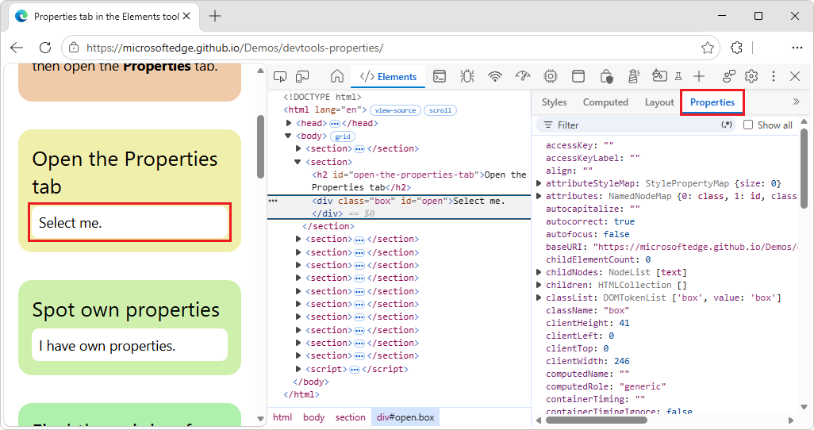

See also:
* [Properties tab in the Elements tool](https://microsoftedge.github.io/Demos/devtools-properties/) - demo.
   * [/devtools-properties/](https://github.com/MicrosoftEdge/Demos/tree/main/devtools-properties/) - source code.

<!-- ====================================================================== -->
## Spot own properties
<!-- https://developer.chrome.com/docs/devtools/dom/properties#spot-own-properties -->

The **Properties** tab in the **Elements** tool sorts and displays the object's own properties first, and in bold font.

To view an element's own properties:

1. Open a webpage, such as the [Properties tab in the Elements tool](https://microsoftedge.github.io/Demos/devtools-properties/) demo.

1. In the **Spot own properties** box, right-click the **I have own properties** text box, and then select **Inspect**.

   DevTools opens, with the **Elements** tool selected.

1. Next to the **Styles** tab, click the **Properties** tab.  If the **Properties** tab isn't displayed, click the **More tabs** () button, and then select **Properties** from the dropdown menu.

   The **Properties** tab opens, displaying properties for the `
` element:

   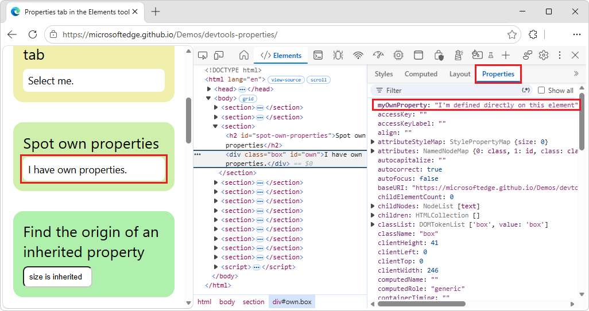

<!-- ====================================================================== -->
## Find the origin of an inherited property
<!-- https://developer.chrome.com/docs/devtools/dom/properties#origin-of-inherited-property -->

The **Properties** tab evaluates accessors on built-in elements and displays them on the object as inherited and in regular font.

To find the origin of an inherited property, expand an object, then its `[[Prototype]]`, then the nested `[[Prototype]]`, and so on.

_todo: selecting the `<html>` node or `<input>` node and then clicking the right-pointing expander triangle doesn't expand to show subnodes_

To find the origin of an inherited property:

1. Open a webpage, such as the [Properties tab in the Elements tool](https://microsoftedge.github.io/Demos/devtools-properties/) demo.

1. In the **Find the origin of an inherited property** box, right-click the **size is inherited** text box, and then select **Inspect**.

   DevTools opens, with the **Elements** tool selected.

1. Next to the **Styles** tab, click the **Properties** tab.  If the **Properties** tab isn't displayed, click the **More tabs** () button, and then select **Properties** from the dropdown menu.

   The **Properties** tab opens, displaying properties for the element `<input class="box" id="inherited" size="10" value="size is inherited">`.

1. Click a right-pointing expander triangle.

1. In the DOM tree, select the `<html>` element.

1. In the **Properties** tab, click a right-pointing expander triangle.

   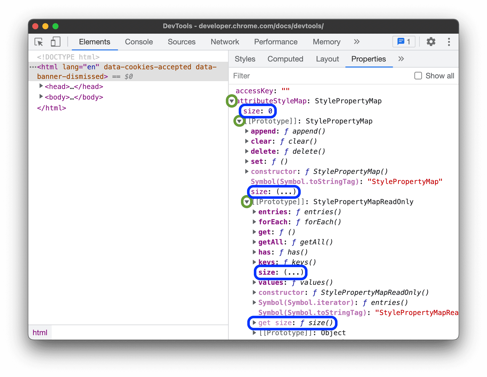 _todo: replace by edge screenshot_

   In this example, you can trace where the inherited `size` property came from, by locating the original own (bold) property on the prototype chain together with the corresponding getter.

   Prototype-specific properties are shown only on prototypes, not on objects.  This makes it easier to diagnose objects.

   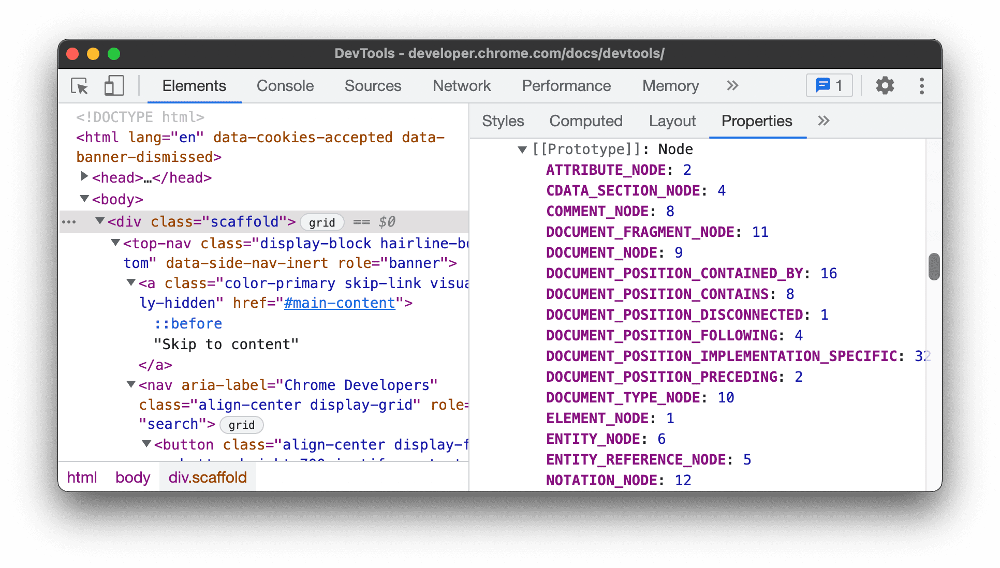 _todo: replace by edge screenshot_

<!-- ====================================================================== -->
## Filter properties
<!-- https://developer.chrome.com/docs/devtools/dom/properties#filter-properties -->

To quickly find a property of an element that's selected in the DOM tree, start typing its name or value in the **Filter** input box.

To filter properties of an element that's selected in the DOM tree:

1. Open a webpage, such as the [Properties tab in the Elements tool](https://microsoftedge.github.io/Demos/devtools-properties/) demo.

1. In the **Filter properties** box, right-click the **Filter my properties** text box, and then select **Inspect**.

   DevTools opens, with the **Elements** tool selected.  In the DOM tree, the element `<a class="box" id="filter" href="#filter" title="A link">` is selected.

1. Next to the **Styles** tab, click the **Properties** tab.  If the **Properties** tab isn't displayed, click the **More tabs** () button, and then select **Properties** from the dropdown menu.

1. In the **Properties** tab, in the **Filter** text box, enter text, such as **false**.

   A list of matching properties of the selected element is displayed:

   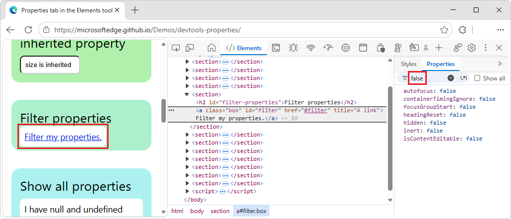

<!-- ====================================================================== -->
## Show all properties
<!-- https://developer.chrome.com/docs/devtools/dom/properties#show-all -->

By default, the **Properties** tab doesn't show properties with `null` and `undefined` values.  To display all properties of a DOM tree node, select the **Show all** checkbox.

To display all properties of an element, including properties that have a `null` or `undefined` value:

1. Open a webpage, such as the [Properties tab in the Elements tool](https://microsoftedge.github.io/Demos/devtools-properties/) demo.

1. In the **Show all properties** box, right-click the **I have null and undefined properties** text box, and then select **Inspect**.

   DevTools opens, with the **Elements** tool selected.  In the DOM tree, the element `<a class="box" id="filter" href="#filter" title="A link">` is selected.

1. Next to the **Styles** tab, click the **Properties** tab.  If the **Properties** tab isn't displayed, click the **More tabs** () button, and then select **Properties** from the dropdown menu.

1. In the **Properties** tab, select the **Show all** checkbox:

   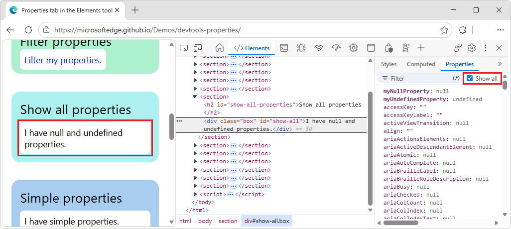

<!-- ====================================================================== -->
## Understand properties
<!-- https://developer.chrome.com/docs/devtools/dom/properties#understand-properties -->

The **Properties** tab in the **Elements** tool shows various kinds of properties.

<!-- ------------------------------ -->
#### Simple properties
<!-- https://developer.chrome.com/docs/devtools/dom/properties#simple-properties -->

Simple properties are `<name>: <value>` pairs.

To display an element's simple properties:

1. Open a webpage, such as the [Properties tab in the Elements tool](https://microsoftedge.github.io/Demos/devtools-properties/) demo.

1. In the **Simple properties** box, right-click the **I have simple properties** text box, and then select **Inspect**.

   DevTools opens, with the **Elements** tool selected.  In the DOM tree, the element `
` is selected.

1. Next to the **Styles** tab, click the **Properties** tab.  If the **Properties** tab isn't displayed, click the **More tabs** () button, and then select **Properties** from the dropdown menu.

   Simple properties are shown in bold text:

   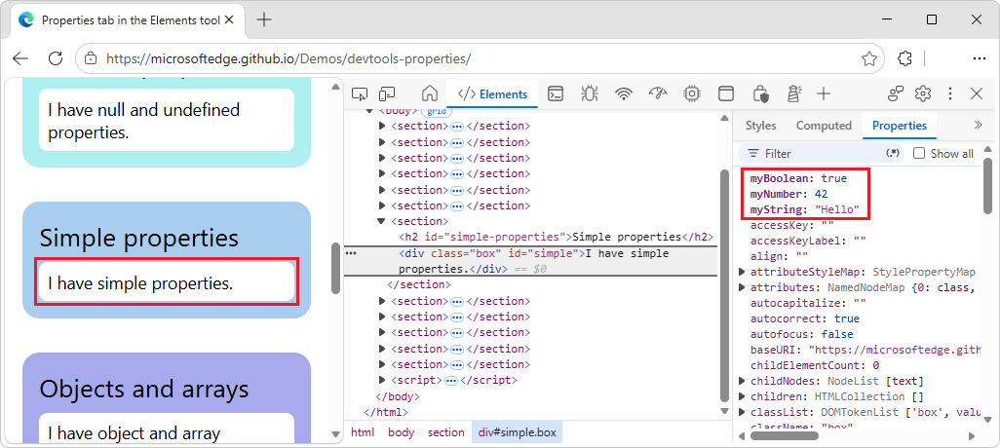

<!-- ------------------------------ -->
#### Objects and arrays
<!-- https://developer.chrome.com/docs/devtools/dom/properties#objects-and-arrays -->

Collapsible properties have an expander button () and are objects (`{}`) or arrays (`[]`):

To display details of a collapsible property (an object or array):

1. Open a webpage, such as the [Properties tab in the Elements tool](https://microsoftedge.github.io/Demos/devtools-properties/) demo.

1. In the **Simple properties** box, right-click the **I have simple properties** text box, and then select **Inspect**.

   DevTools opens, with the **Elements** tool selected.  In the DOM tree, the element `
` is selected.

1. Next to the **Styles** tab, click the **Properties** tab.  If the **Properties** tab isn't displayed, click the **More tabs** () button, and then select **Properties** from the dropdown menu.

   Collapsible properties are shown in bold text, and have an expander triangle:

   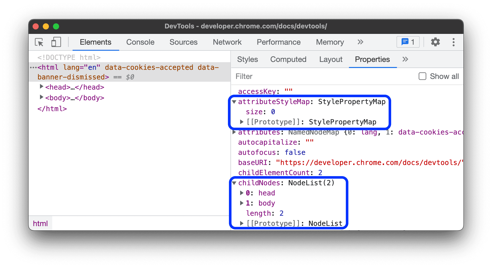 _todo: replace by edge screenshot_

See also:
* [Inspect object properties](https://developer.chrome.com/docs/devtools/console/reference#inspect-object-properties) in _Console features reference_, in Chrome docs.<!--todo in later pr: update downstream article, link to local doc -->

<!-- ------------------------------ -->
#### Properties that correspond to DOM nodes
<!-- https://developer.chrome.com/docs/devtools/dom/properties#dom-nodes -->

Properties that correspond to DOM nodes are links.  To select the relevant node in the DOM tree, click a link:

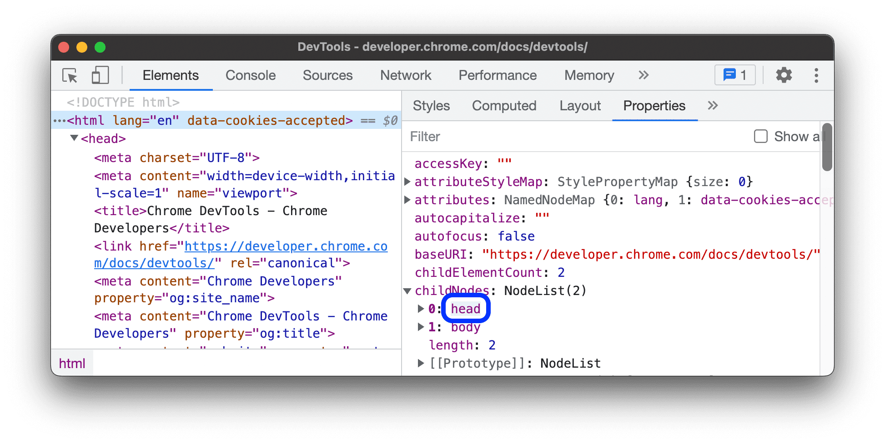 _todo: replace by edge screenshot_

<!-- ------------------------------ -->
#### Own and inherited properties
<!-- https://developer.chrome.com/docs/devtools/dom/properties#own-and-inherited -->

Properties in bold font are the object's own properties; they are defined directly on the object.

Properties in regular font are inherited from the prototype chain.  To display inherited properties, DevTools evaluates relevant accessors on built-in HTML elements.

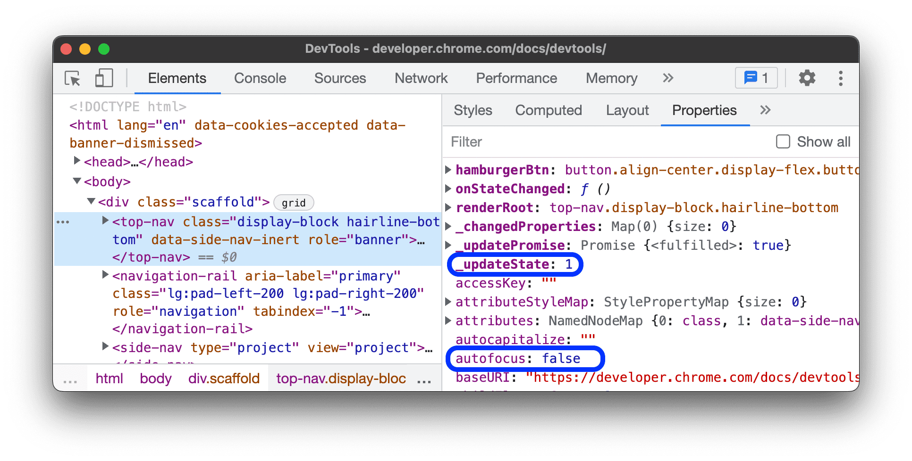 _todo: replace by edge screenshot_

DevTools lists own properties first, to make them easier to spot.

<!-- ------------------------------ -->
#### Enumerable and non-enumerable properties
<!-- https://developer.chrome.com/docs/devtools/dom/properties#enumerable-and-non-enumerable -->

Enumerable properties are bright in color.  Non-enumerable properties are dimmed.

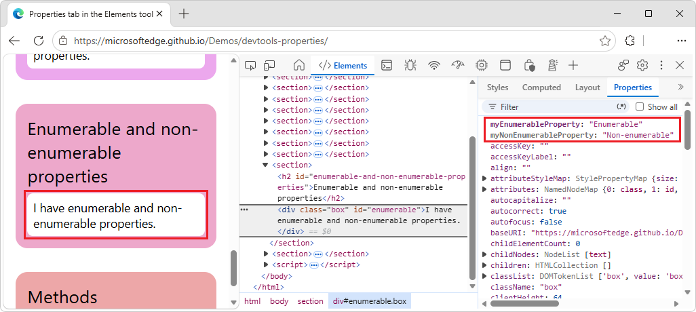 _todo: replace by edge screenshot_

You can iterate over the enumerable properties by using a `for … in` loop or the `Object.keys()` method.

<!-- ------------------------------ -->
#### Methods
<!-- https://developer.chrome.com/docs/devtools/dom/properties#methods -->

Methods are indicated by _f ()_:

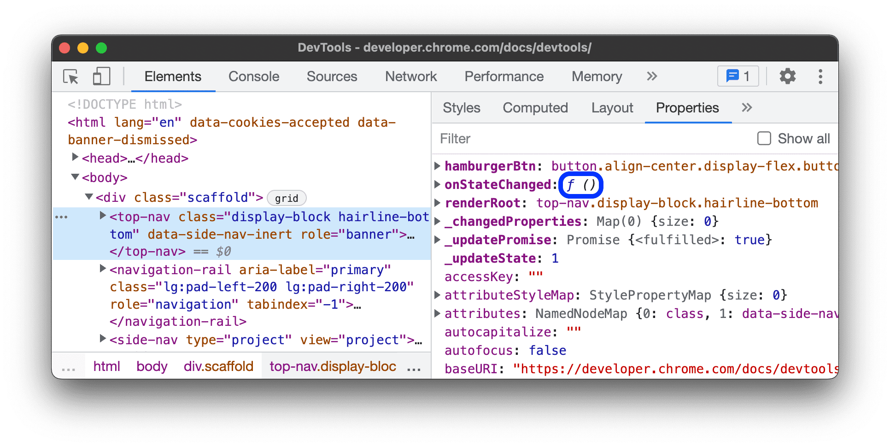 _todo: replace by edge screenshot_

For more information on functions, see [Inspect functions](https://developer.chrome.com/docs/devtools/console/reference#inspect-functions) in _Console features reference_ in the Chrome docs.<!--todo in later pr: update downstream article, link to local doc -->

<!-- ====================================================================== -->
## See also
<!-- all links in article -->

Chrome docs:
* [Inspect object properties](https://developer.chrome.com/docs/devtools/console/reference#inspect-object-properties) in _Console features reference_.<!--todo in later pr: update downstream article, link to local doc -->
* [Inspect functions](https://developer.chrome.com/docs/devtools/console/reference#inspect-functions) in _Console features reference_.<!--todo in later pr: update downstream article, link to local doc -->

GitHub:
* [Properties tab in the Elements tool](https://microsoftedge.github.io/Demos/devtools-properties/) - demo.
   * [/devtools-properties/](https://github.com/MicrosoftEdge/Demos/tree/main/devtools-properties/) - source code.
* [MicrosoftEdge / Demos](https://github.com/MicrosoftEdge/Demos) repo.

<!-- ====================================================================== -->
> [!NOTE]
> Portions of this page are modifications based on work created and [shared by Google](https://developers.google.com/terms/site-policies) and used according to terms described in the [Creative Commons Attribution 4.0 International License](https://creativecommons.org/licenses/by/4.0).
> The original page is found [here](https://developer.chrome.com/docs/devtools/dom/properties) and is authored by Sofia Emelianova.

This work is licensed under a [Creative Commons Attribution 4.0 International License](https://creativecommons.org/licenses/by/4.0).

