<!-- Copyright Sofia Emelianova

   Licensed under the Apache License, Version 2.0 (the "License");
   you may not use this file except in compliance with the License.
   You may obtain a copy of the License at

       https://www.apache.org/licenses/LICENSE-2.0

   Unless required by applicable law or agreed to in writing, software
   distributed under the License is distributed on an "AS IS" BASIS,
   WITHOUT WARRANTIES OR CONDITIONS OF ANY KIND, either express or implied.
   See the License for the specific language governing permissions and
   limitations under the License.  -->
# Badges reference
<!-- https://developer.chrome.com/docs/devtools/elements/badges -->

<!-- todo later: update from developer.chrome.com links to local links -->

In the **Elements** tool, use badges in the DOM tree to show or hide various overlays and speed up DOM tree navigation.

Some badges include a link icon (), indicating that clicking the badge navigates in the DOM.

<!-- ====================================================================== -->
## Show or hide badges
<!-- https://developer.chrome.com/docs/devtools/elements/badges#show-or-hide -->

To show or hide badges:

1. Go to a webpage, such as the [Badges in the Elements tool](https://microsoftedge.github.io/Demos/devtools-badges/) demo.

1. Right-click the webpage, and then select **Inspect**.

   DevTools opens, with the **Elements** tool selected.

1. Right-click anywhere in the DOM tree, and then select one or several badges in the **Badge settings** submenu, so that check marks appear in the submenu:

   

   The **Elements** tool shows the badges next to elements in the DOM tree.

The following sections explain each badge.

See also:
* [Badges in the Elements tool](https://microsoftedge.github.io/Demos/devtools-badges/) - demo.
   * [/devtools-badges/](https://github.com/MicrosoftEdge/Demos/tree/main/devtools-badges/) - source code.

<!-- ====================================================================== -->
## The `view-source` badge
<!-- View-source  https://developer.chrome.com/docs/devtools/elements/badges#view-source -->

To view the source of your page in the **Sources** tool, click the `view-source` badge ().  For example, the `view-source` badge is next to the `<html>` tag at the root of the HTML page.

The `view-source` badge provides an alternative to selecting the **View page source** menuitem in the webpage's right-click menu (context menu).

To use the `view-source` badge ():

1. Go to a webpage, such as the [Badges in the Elements tool](https://microsoftedge.github.io/Demos/devtools-badges/) demo.

1. Right-click the webpage, and then select **Inspect**.

   DevTools opens, with the **Elements** tool selected.

1. In the DOM tree, next to the `<html>` tag, click the `view-source` badge:

   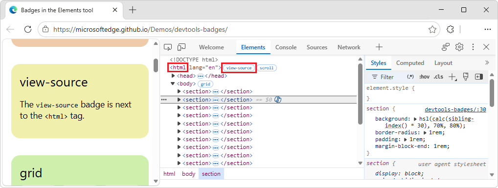

   The **Sources** tool opens, displaying the source file, such as `index.html`:

   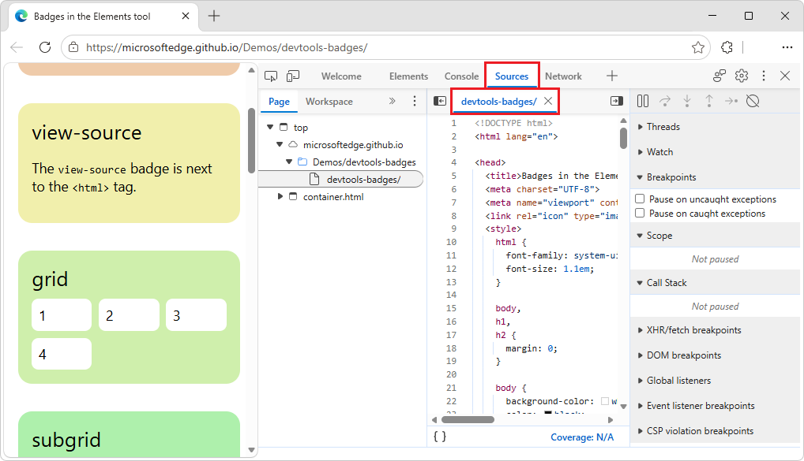

See also:
* [Badges in the Elements tool](https://microsoftedge.github.io/Demos/devtools-badges/) - demo.
   * [/devtools-badges/](https://github.com/MicrosoftEdge/Demos/tree/main/devtools-badges/) - source code.

<!-- ====================================================================== -->
## The `grid` badge
<!-- Grid  https://developer.chrome.com/docs/devtools/elements/badges#grid -->

An HTML element is a _grid container_ if its `display` CSS property is set to `grid` or `inline-grid`.  Such an element has a `grid` badge (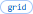) next to it that toggles the corresponding overlay.

To use the `grid` badge ():

1. Go to a webpage, such as the [Badges in the Elements tool](https://microsoftedge.github.io/Demos/devtools-badges/) demo.

1. Right-click the **grid** box, and then select **Inspect**.

   DevTools opens, with the **Elements** tool selected.

1. In the DOM tree, next to the `
` element, click the `grid` badge.

   The `grid` badge changes color, and a grid overlay is displayed on the rendered webpage, showing columns, rows, their numbers, and gaps:

   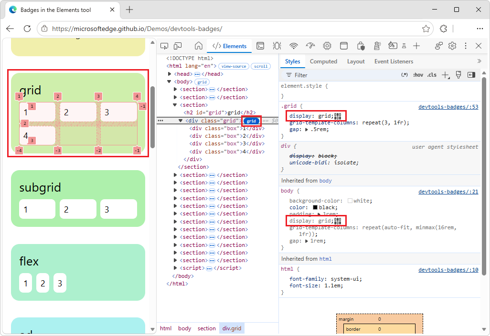

1. In the DOM tree, click the `grid` badge again.

   The grid overlay is removed from the webpage.

See also:
* [Inspect CSS Grid layouts](../css/grid.md)
* [CSS grid layout](https://developer.mozilla.org/docs/Web/CSS/CSS_Grid_Layout) at MDN.

<!-- ====================================================================== -->
## The `subgrid` badge
<!-- Subgrid  https://developer.chrome.com/docs/devtools/elements/badges#subgrid -->

A _subgrid_ is a nested grid that uses the same tracks as its parent grid.  An element is a _subgrid container_ if one or both of its `grid-template-columns`, `grid-template-rows` properties are set to `subgrid`.  Such an element has a `subgrid` badge (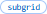) next to it that toggles the corresponding overlay.

To use the `subgrid` badge ():

1. Go to a webpage, such as the [Badges in the Elements tool](https://microsoftedge.github.io/Demos/devtools-badges/) demo.

1. Right-click the **subgrid** box, and then select **Inspect**.

   DevTools opens, with the **Elements** tool selected.

1. In the DOM tree, expand the tree to show the `
` element, and then click the `subgrid` badge.

   The `subgrid` badge changes color, and a subgrid overlay is displayed on the rendered webpage, showing columns, rows, their numbers, and gaps:

   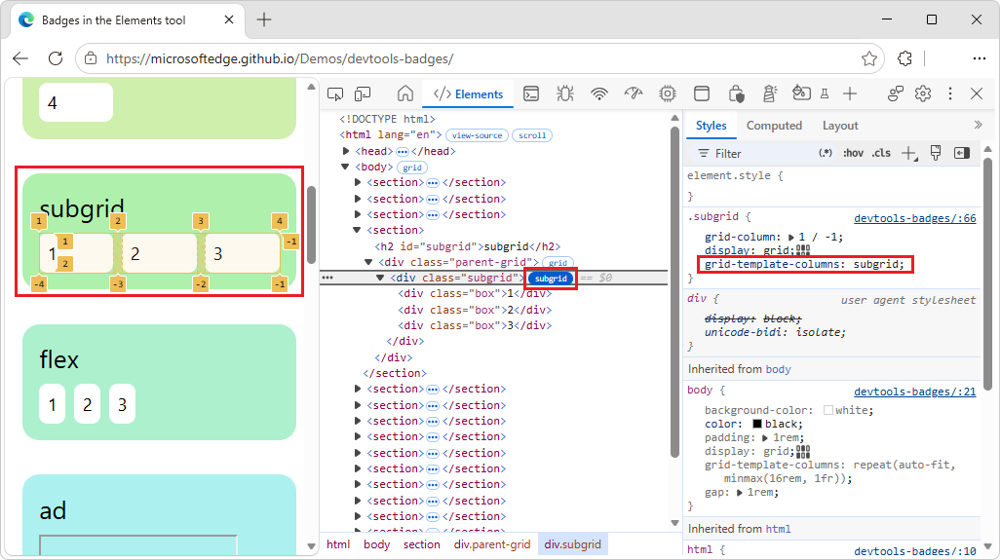

1. In the DOM tree, click the `subgrid` badge again.

   The subgrid overlay is removed from the webpage.

See also:
* [Subgrid](https://developer.mozilla.org/docs/Web/CSS/CSS_grid_layout/Subgrid) at MDN.

<!-- ====================================================================== -->
## The `flex` badge
<!-- Flex  https://developer.chrome.com/docs/devtools/elements/badges#flex -->

An HTML element is a _flex container_ if its `display` CSS property is set to `flex` or `inline-flex`.  Such an element has a `flex` badge () next to it that toggles the corresponding overlay.

To use the `flex` badge ():

1. Go to a webpage, such as the [Badges in the Elements tool](https://microsoftedge.github.io/Demos/devtools-badges/) demo.

1. Right-click the **flex** box, and then select **Inspect**.

   DevTools opens, with the **Elements** tool selected.

1. In the DOM tree, expand the tree to show the `
` element, and then click the `flex` badge.

   The `flex` badge changes color, and a flexbox overlay is displayed on the rendered webpage, showing child element positions:

   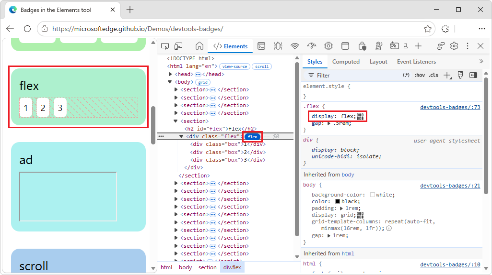

1. In the DOM tree, click the `flex` badge again.

   The flexbox overlay is removed from the webpage.

See also:
* [CSS flexible box layout](https://developer.mozilla.org/docs/Web/CSS/CSS_Flexible_Box_Layout) at MDN.
* [Inspect and debug CSS flexbox](https://developer.chrome.com/docs/devtools/css/flexbox) in Chrome docs.<!-- todo later: update link after https://github.com/MicrosoftDocs/edge-developer/pull/3859 -->
See also:

<!-- ====================================================================== -->
## The `ad` badge
<!-- Ad  https://developer.chrome.com/docs/devtools/elements/badges#ad -->

DevTools can detect some ad frames and tag them.  Such a frame has an `ad` badge () next to it.

A tooltip provides context on why the element was identified as an ad.  The `ad` badge is not clickable.

To use the `ad` badge ():

1. Go to a webpage, such as the [Badges in the Elements tool](https://microsoftedge.github.io/Demos/devtools-badges/) demo.

1. Right-click the **ad** box, and then select **Inspect**.

   DevTools opens, with the **Elements** tool selected.

1. In the DOM tree, expand the tree to show the `<iframe>` element, and then hover over the `ad` badge.

   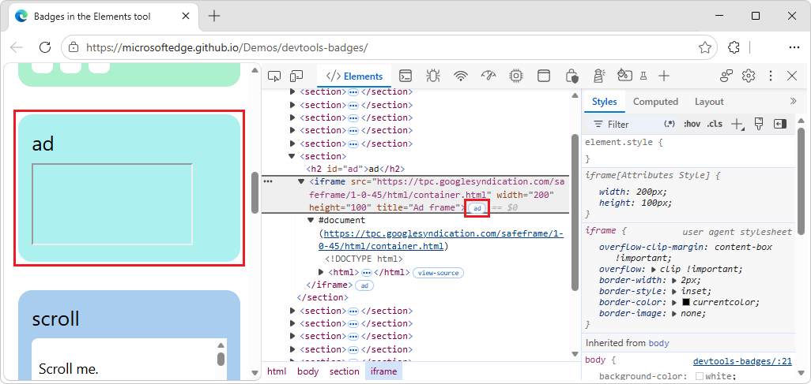

   A tooltip provides context on why the element was identified as an ad.  Possible content of the tooltip:

   * **Script ancestry:** Which scripts were involved in creating the element.

   * **Filter list rules:** The specific rule from a filter list (for example, `EasyList`) that matched the element or the resource it loaded.

You can also use the **Rendering** tab to highlight ad frames in red.  See [Highlight ad frames](https://developer.chrome.com/docs/devtools/rendering/apply-effects#highlight_ad_frames) in _Apply other effects: enable automatic dark theme, emulate focus, and more_, in Chrome docs.<!-- todo later: update link to anchor in https://learn.microsoft.com/microsoft-edge/devtools/rendering/rendering-tool -->

See also:
* [Ad Tagging in Chromium](https://chromium.googlesource.com/chromium/src/+/master/docs/ad_tagging.md)

<!-- ====================================================================== -->
## The `scroll` badge
<!-- Scroll  https://developer.chrome.com/docs/devtools/elements/badges#scroll -->

An HTML element is a _scroll container_ if its `overflow` CSS property is set to `scroll`, or `auto` when there's enough content to cause overflow.  Such an element has a `scroll` badge () next to it.

To view the `scroll` badge ():

1. Go to a webpage, such as the [Badges in the Elements tool](https://microsoftedge.github.io/Demos/devtools-badges/) demo.

1. Right-click the **scroll** box, and then select **Inspect**.

   DevTools opens, with the **Elements** tool selected.

1. In the DOM tree, expand the tree to show the `
` element.

   The `scroll` badge is shown next to the element:

   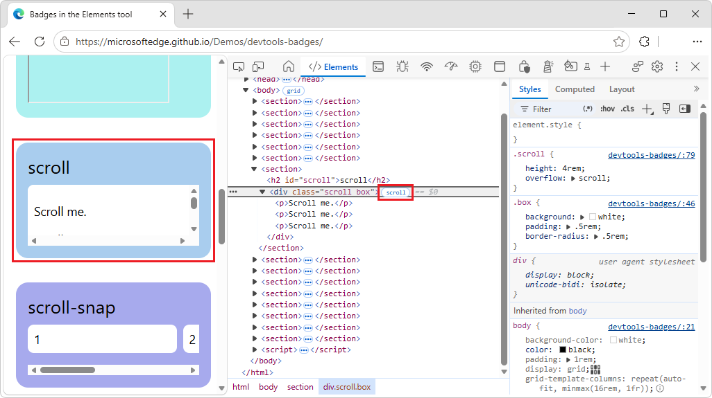

   Clicking the badge doesn't have any effect.

See also:
* [Scroll container](https://developer.mozilla.org/docs/Glossary/Scroll_container) at MDN.

<!-- ====================================================================== -->
## The `scroll-snap` badge
<!-- Scroll-snap  https://developer.chrome.com/docs/devtools/elements/badges#scroll-snap -->

_Scroll containers_ can have CSS properties that configure snap points.  A scroll container element has a `scroll-snap` badge (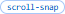) next to it that displays or hides the corresponding overlay.

To use the `scroll-snap` badge ():

1. Go to a webpage, such as the [Badges in the Elements tool](https://microsoftedge.github.io/Demos/devtools-badges/) demo.

1. Right-click the **scroll-snap** box, and then select **Inspect**.

   DevTools opens, with the **Elements** tool selected.

1. In the DOM tree, expand the tree to show the `
` element, and then click the `scroll-snap` badge.

   The `scroll-snap` badge changes color, and a scroll-snap overlay shows element positions and snap points:

   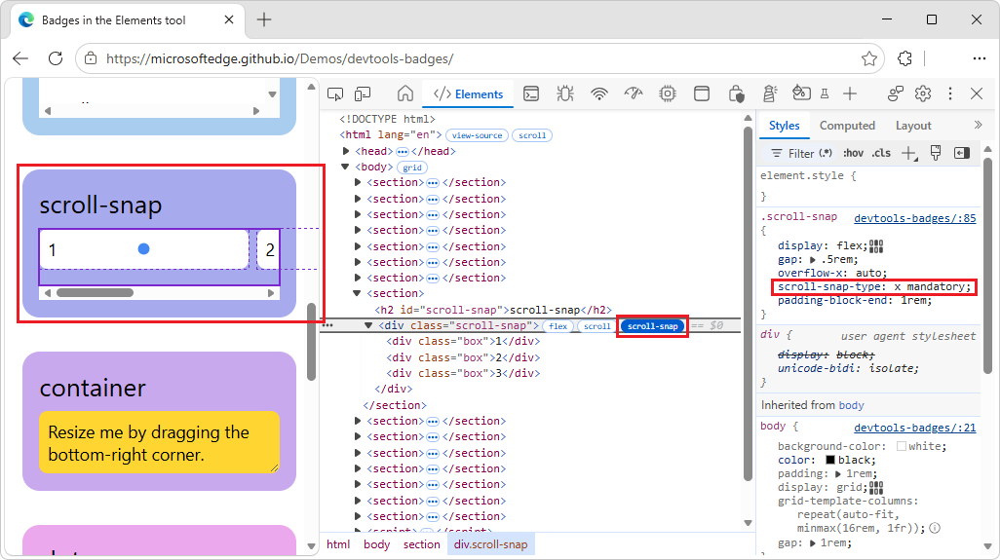

1. In the rendered webpage, drag the horizontal scroll bar to the right.

   The scroll-snap overlay continues to show element positions and snap points.

1. In the DOM tree, click the `scroll-snap` badge again.

   The scroll-snap overlay is removed from the webpage.

See also:
* [CSS scroll snap](https://developer.mozilla.org/docs/Web/CSS/Guides/Scroll_snap) at MDN.

<!-- ====================================================================== -->
## The `size` badge
<!-- Container  https://developer.chrome.com/docs/devtools/elements/badges#container -->

<!-- todo: add `size` badge to demo -->

The `size` badge () is one type of container badge, for `container-type: size`.

See [The `inline-size` badge](#the-inline-size-badge), below.

<!-- ====================================================================== -->
## The `inline-size` badge
<!-- Container  https://developer.chrome.com/docs/devtools/elements/badges#container -->

An HTML element is a _container_ if it has the `container-type` CSS property.  Such an element has a specific type of container badge next to it, that displays or hides the corresponding overlay.

There are two container badges:
* The **inline-size** container badge , for `container-type: inline-size`.
* The **size** container badge , for `container-type: size`.

To use the `inline-size` badge ():

1. Go to a webpage, such as the [Badges in the Elements tool](https://microsoftedge.github.io/Demos/devtools-badges/) demo.

1. Right-click the **container** box, and then select **Inspect**.

   DevTools opens, with the **Elements** tool selected.

1. In the DOM tree, expand the tree to show the `
` element, and then click the `inline-size` badge.

1. In the rendered webpage, within the **container** box, resize the box by dragging its bottom-right corner left or right.

   The layout of the box changes, and the overlay shows the element's position and the position of any child elements:

   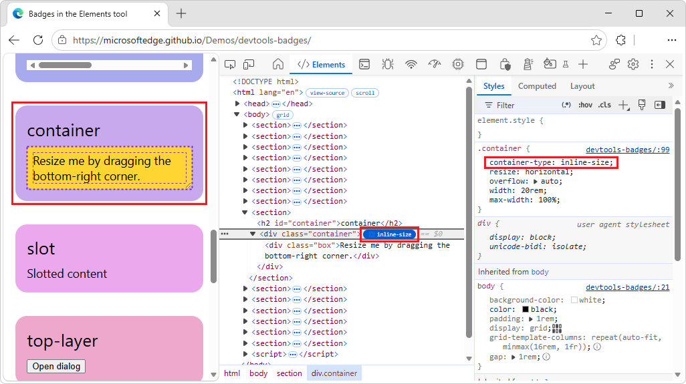

1. In the DOM tree, click the `inline-size` badge again.

   The container overlay is removed from the webpage.

See also:
* [Inspect and debug CSS container queries](../css/container-queries.md)
   * [Highlight a container and its descendants](../css/container-queries.md#highlight-a-container-and-its-descendants) in _Inspect and debug CSS container queries_.
* [CSS container queries](https://developer.mozilla.org/docs/Web/CSS/Guides/Containment/Container_queries) at MDN.

<!-- ====================================================================== -->
## The `slot` badge
<!-- Slot  https://developer.chrome.com/docs/devtools/elements/badges#slot -->

The `<slot>` HTML element is a placeholder that you can fill with your own content.  Together with the `<template>` element, `<slot>` lets you create separate DOM trees and present them together.

* A slot content element has a `slot` badge () next to it that serves as a link to the corresponding `<slot>` element.
* The `slot` badge () has a paired `reveal` badge () that takes you back.

To use the `slot` badge ():

1. Go to a webpage, such as the [Badges in the Elements tool](https://microsoftedge.github.io/Demos/devtools-badges/) demo.

1. Right-click the **slot** box, and then select **Inspect**.

   DevTools opens, with the **Elements** tool selected.

1. In the DOM tree, expand the tree to show the `` element, and then click the `slot` badge ().

   The corresponding `<slot>` element is highlighted in the DOM tree:

   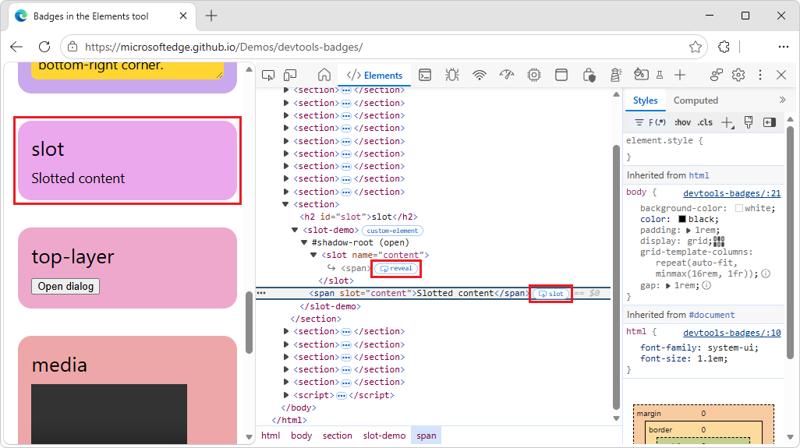

1. Next to the `<slot>` element, click the `reveal` badge ().

   The slot's content is highlighted in the DOM tree.

See also:
* [`<slot>` HTML web component slot element](https://developer.mozilla.org/docs/Web/HTML/Element/slot) at MDN.

<!-- ====================================================================== -->
## The `reveal` badge
<!-- Slot  https://developer.chrome.com/docs/devtools/elements/badges#slot -->

The `reveal` badge () is paired with:
* The `slot` badge ().  See [The slot badge](#the-slot-badge), above.
* The `top-layer` () badge.  See [The `top-layer` badge](#the-top-layer-badge), below.

<!-- ====================================================================== -->
## The `top-layer` badge
<!-- Top-layer  https://developer.chrome.com/docs/devtools/elements/badges#top-layer -->

The `top-layer` badge () helps you understand the concept of the _top layer_ and visualize it.  The top layer renders content on top of all other layers, regardless of `z-index`.  When you open a `<dialog>` element by using the `.showModal()` method, the browser puts it into the top layer.

To help you visualize top layer elements, the **Elements** tool adds a `#top-layer` container to the DOM tree after the closing `</html>` tag.

A top-layer element has a `top-layer (N)` badge () next to it, where `N` is the element's index number.  The badge is a link to the corresponding element in the `#top-layer` container.

The `top-layer` badge () has a paired `reveal` badge () that takes you back.

To use the `top-layer` badge ():

1. Go to a webpage, such as the [Badges in the Elements tool](https://microsoftedge.github.io/Demos/devtools-badges/) demo.

1. In the **top-layer** box, click the **Open dialog** button.

   A dialog opens in the top layer, displaying the message **This dialog is in the top layer.**

1. Right-click the dialog, and then select **Inspect**.

   DevTools opens, with the **Elements** tool selected.  Next to the `<dialog>` element is a `top-layer` badge ().

1. In the DOM tree, expand the `<dialog>` element.

1. In the DOM tree, next to the `<dialog>` element, click the `top-layer` badge ().

   At the bottom of the DOM tree, the corresponding `#top-layer` container node is expanded to show the `dialog` node, which has a `reveal` badge () next to it.

1. Fully expand the `#top-layer` container node.

   Child nodes are displayed:
   * A `dialog` node, with a `reveal` badge () next to it.
      * A `::backdrop` node, with a `reveal` badge () next to it.

   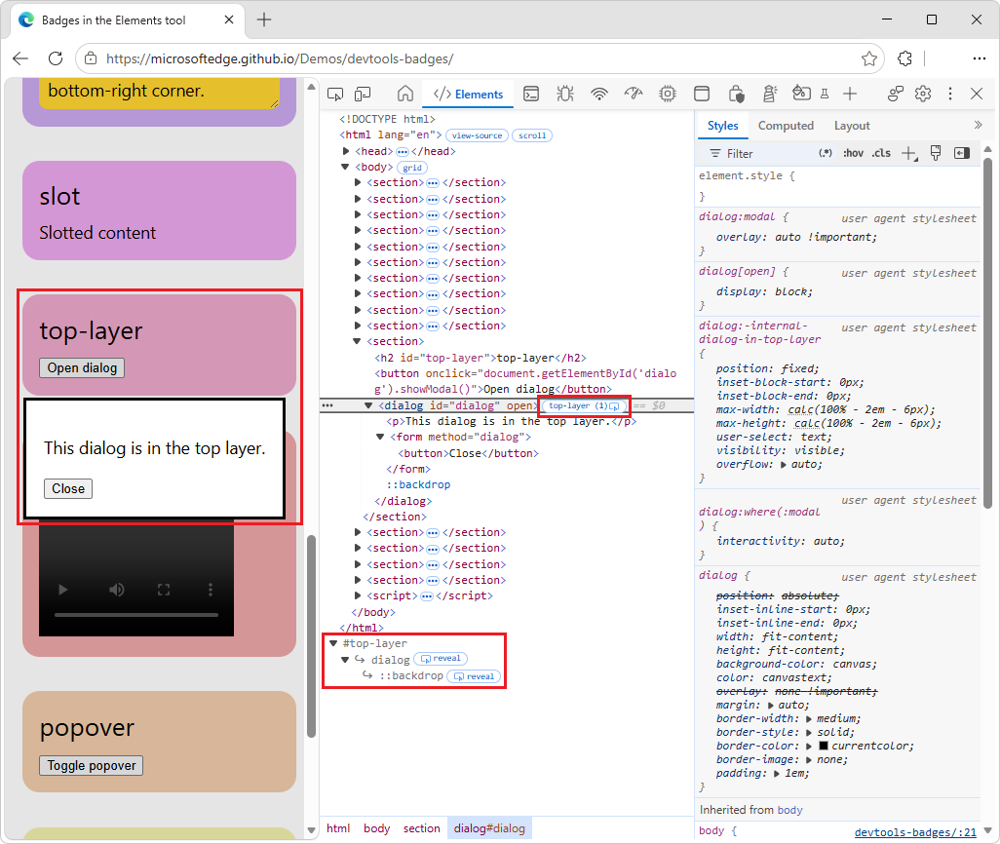

1. Next to the `#top-layer` node's `dialog` node, click the `reveal` badge ().

   The DOM tree highlights the corresponding `<dialog>` element.

1. Next to the `#top-layer` node's child `::backdrop` node, click the `reveal` badge ().

   The DOM tree highlights the corresponding `::backdrop` node within the `<form>` element within the `<dialog>` element.

1. In the rendered webpage, in the **This dialog is in the top layer** dialog, click the **Close** button.

   In the DOM tree, the node changes from `<dialog id="dialog" open>` with a `top-layer` badge () next to it, to a `<dialog id="dialog">` element without a `top-layer` badge () next to it.

See also:
* [Meet the top layer: a solution to z-index:10000](https://developer.chrome.com/blog/what-is-the-top-layer) in the Chrome blog.
* [Using z-index](https://developer.mozilla.org/docs/Web/CSS/CSS_Positioning/Understanding_z_index/Adding_z-index) at MDN.
* [Building a dialog component](https://web.dev/articles/building/a-dialog-component) at web.dev.
* [HTMLDialogElement: showModal() method](https://developer.mozilla.org/docs/Web/API/HTMLDialogElement/showModal) at MDN.

<!-- ====================================================================== -->
## The `media` badge
<!-- Media  https://developer.chrome.com/docs/devtools/elements/badges#media -->

Click the `media` badge (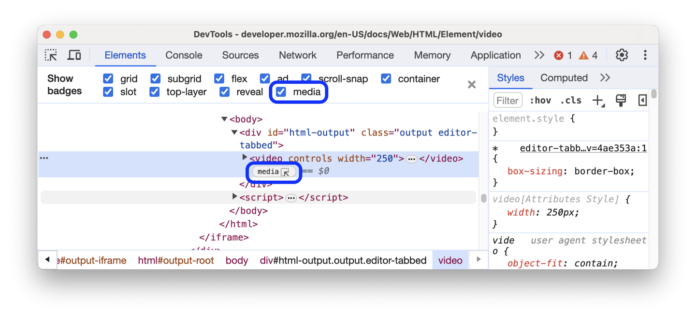) to open the **Media** tool and debug your media.  The `media` badge is turned off by default.  When turned on, the `media` badge appears next to `<audio>` and `<video>` elements.

To turn on the `media` badge (), right-click the DOM tree, and then in the **Badge settings** submenu, select the **Media** menuitem.

To use the `media` badge ():

1. Go to a webpage, such as the [Badges in the Elements tool](https://microsoftedge.github.io/Demos/devtools-badges/) demo.

1. In the **media** box, right-click the media player and then select **Inspect**.

   DevTools opens, with the **Elements** tool selected, with the `<video>` element selected.

1. Right-click the DOM tree, and then in the **Badge settings** submenu, select the **media** menuitem.

   In the DOM tree, the `media` badge () is added next to the `<video>` element:

   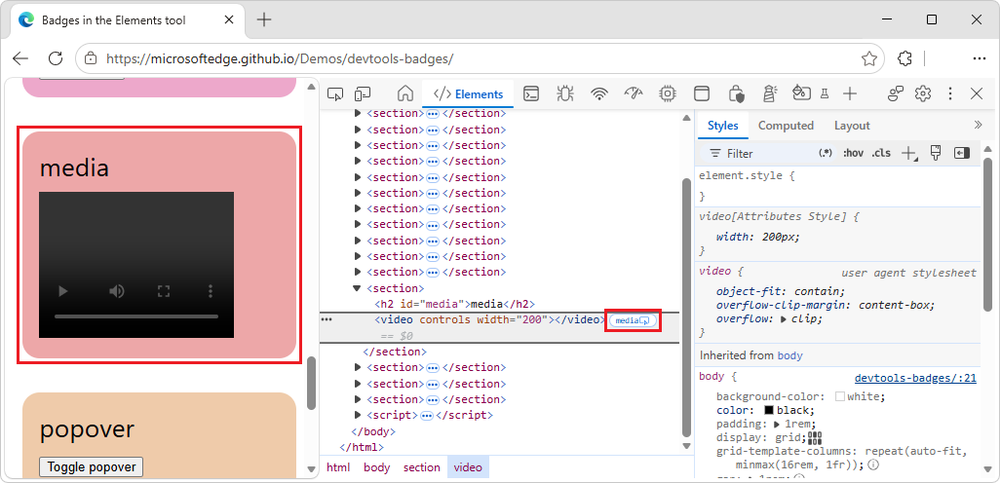

   If you click the `media` badge (), and media player details have been specified in the webpage (unlike in this demo), media player details are displayed.

See also:
* [View and debug media players information (Media tool)](../media/index.md).

<!-- ====================================================================== -->
## The `popover` badge
<!-- Popover  https://developer.chrome.com/docs/devtools/elements/badges#popover -->

A _popover_ is any element that has a `popover` attribute.  A popover is useful for a wide range of interactive patterns, including:
* Tooltips
* Alerts
* Toasts
* And more.

A popover element has a `popover` badge (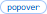) next to it.  Clicking the `popover` badge shows or hides a `top-layer` badge next to it that links to the corresponding element in the `#top-layer` container.

<!-- todo: in Edge Stable 156, clicking the "toggle popover" button in the rendered demo webpage does nothing - selecting the popover badge in the DOM tree causes the popover to be displayed -->

To use the `popover` badge ():

1. Go to a webpage, such as the [Badges in the Elements tool](https://microsoftedge.github.io/Demos/devtools-badges/) demo.

1. In the **popover** box, right-click the **Toggle popover** button, and then select **Inspect**.

   DevTools opens, with the **Elements** tool selected.  In the DOM tree, the `
` element is displayed, with a `popover` badge () next to the element.

1. Click the `popover` badge (), and then move the mouse pointer away from the `
` element.

   The `popover` badge () changes color to indicate that it's selected.  At the bottom of the DOM tree, the `#top-layer` container is displayed:

   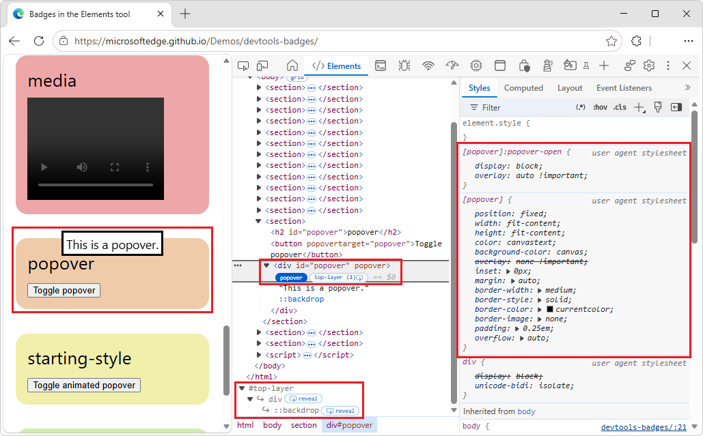

1. In the DOM tree, next to the `popover` badge (), click the `top-layer` badge ().

   At the bottom of the DOM tree, the corresponding `#top-layer` container node is expanded to show the `div` node, which has a `reveal` badge () next to it.

1. Fully expand the `#top-layer` container node.

   Child nodes are displayed:
   * A `div` node, with a `reveal` badge () next to it.
      * A `::backdrop` node, with a `reveal` badge () next to it.

1. Next to the `#top-layer` node's `div` node, click the `reveal` badge ().

   The DOM tree highlights the corresponding `
` element.

1. Next to the `#top-layer` node's child `::backdrop` node, click the `reveal` badge ().

   The DOM tree highlights the corresponding `::backdrop` node within the `
` element.

1. Next to the `
` element, click the `popover` badge (), and then move the mouse pointer away from the element.

   The popover changes color to indicate that it's not selected.  In the rendered webpage, the popover disappears.

See also:
* [The `top-layer` badge](#the-top-layer-badge), above.
* [Popover and dialog](https://web.dev/learn/css/popover-and-dialog) at web.dev.

<!-- ====================================================================== -->
## The `starting-style` badge
<!-- Starting-style  https://developer.chrome.com/docs/devtools/elements/badges#starting-style -->

The `@starting-style` rule defines the initial styles on an element before it's rendered on the page.  This is required for elements that animate-in from `display: none`, because such elements need a state from which to animate in.  Such an element has a `starting-style` badge (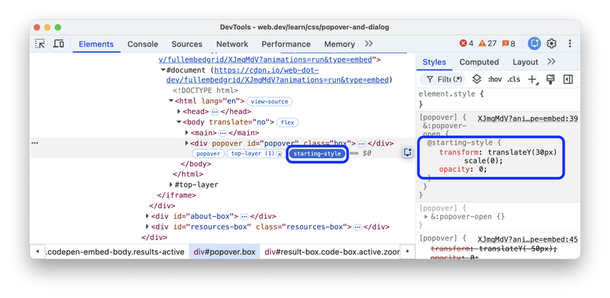) next to it.

The `starting-style` badge toggles the styles in the `@starting-style` rule, so that you can see the animation in action.

To use the `starting-style` badge ():

1. Go to a webpage, such as the [Badges in the Elements tool](https://microsoftedge.github.io/Demos/devtools-badges/) demo.

1. In the **starting-style** box, click the **Toggle animated popover** button.

   A popover dialog fades-in over the course of 1 second, reading: "This popover fades in."

1. Right-click the popover dialog, and then select **Inspect**.

   DevTools opens, with the **Elements** tool selected.  In the DOM tree, the `
` element is selected.  Next to the element is a `starting-style` badge.

1. Click the `starting-style` badge.

   The animated popover fades out.  The `starting-style` badge changes color to indicate that it is selected.  In the **Styles** tab, the `@starting-style` CSS selector is displayed:

   

1. Click the `starting-style` badge again.

   The `starting-style` badge changes color to indicate that it is not selected, and in the **Styles** tab, the `@starting-style` CSS selector is no longer displayed.

1. In the rendered page, click the **Toggle animated popover** button.

   The popover fades out.

See also:
* [Setting up entry effects with @starting-style](https://web.dev/blog/baseline-entry-animations#setting_up_entry_effects_with_starting-style) in _Now in Baseline: animating entry effects_ at web.dev.
* [Animating popovers](https://web.dev/learn/css/popover-and-dialog#animating_popovers) in _Popover and dialog_ at web.dev.

<!-- ====================================================================== -->
## The `custom-element` badge
<!-- Custom-element  https://developer.chrome.com/docs/devtools/elements/badges#custom-element -->

A _custom HTML element_ is identified by either:
* A hyphenated element name, such as `<hello-world>`.
* An `is` attribute added to a built-in element, such as `
`.

A custom HTML element has a `custom-element` badge () next to it in the DOM tree.  Clicking the `custom-element` badge displays the source code for the element.

To use the `custom-element` badge ():

1. Go to a webpage, such as the [Badges in the Elements tool](https://microsoftedge.github.io/Demos/devtools-badges/) demo.

1. Right-click the **custom-element** box, and then select **Inspect**.

   DevTools opens, with the **Elements** tool selected, with the `<hello-world>` or `
` element selected in the DOM tree.  The `<hello-world>` element and the `
` element have a `custom-element` badge next to them:

   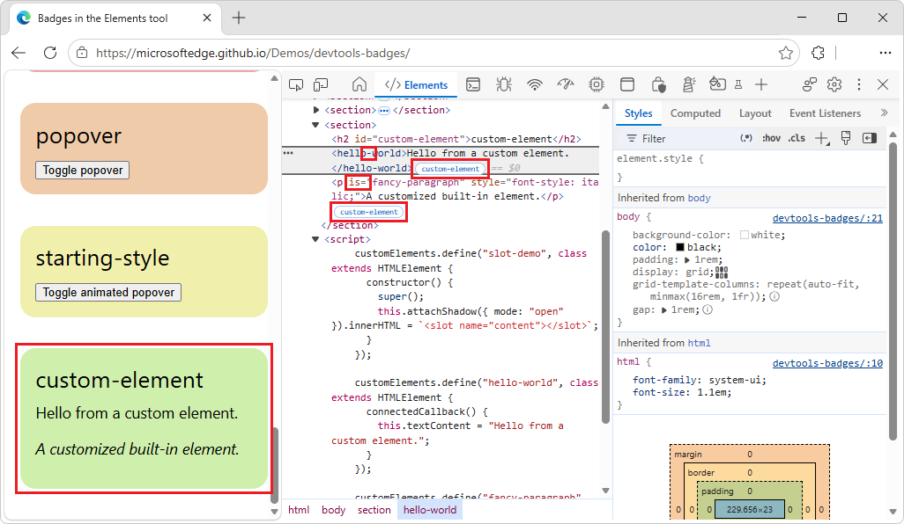

1. Next to the `<hello-world>` element or the `
` element, click the `custom-element` badge.

   The **Sources** tool opens, showing the relevant code:

   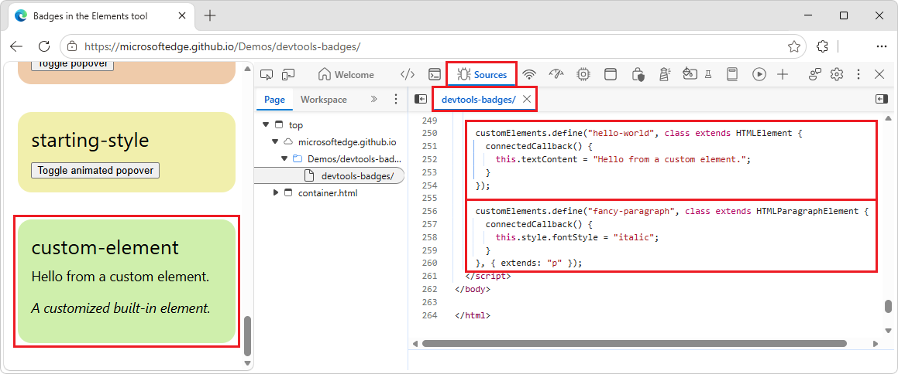

See also:
* [Using custom elements](https://developer.mozilla.org/docs/Web/API/Web_components/Using_custom_elements) at MDN.

<!-- ====================================================================== -->
## See also
<!-- all links in article -->

* [Inspect CSS Grid layouts](../css/grid.md)
* [Inspect and debug CSS container queries](../css/container-queries.md)
* [View and debug media players information (Media tool)](../media/index.md)

Chrome docs:
* [Open the Elements panel to inspect the DOM or CSS](https://developer.chrome.com/docs/devtools/open#inspect) in _Open Chrome DevTools_.
* [Inspect and debug CSS flexbox](https://developer.chrome.com/docs/devtools/css/flexbox)<!-- todo later: update link after https://github.com/MicrosoftDocs/edge-developer/pull/3859 -->
* [Highlight ad frames](https://developer.chrome.com/docs/devtools/rendering/apply-effects#highlight_ad_frames) in _Apply other effects: enable automatic dark theme, emulate focus, and more_.<!-- todo later: update link to anchor in https://learn.microsoft.com/microsoft-edge/devtools/rendering/rendering-tool -->
* [Meet the top layer: a solution to z-index:10000](https://developer.chrome.com/blog/what-is-the-top-layer)

web.dev:
* [Building a dialog component](https://web.dev/articles/building/a-dialog-component)
* [Popover and dialog](https://web.dev/learn/css/popover-and-dialog)
* [Setting up entry effects with @starting-style](https://web.dev/blog/baseline-entry-animations#setting_up_entry_effects_with_starting-style) in _Now in Baseline: animating entry effects_.
* [Animating popovers](https://web.dev/learn/css/popover-and-dialog#animating_popovers) in _Popover and dialog_.

MDN:
* [CSS grid layout](https://developer.mozilla.org/docs/Web/CSS/CSS_Grid_Layout)
* [Subgrid](https://developer.mozilla.org/docs/Web/CSS/CSS_grid_layout/Subgrid)
* [CSS flexible box layout](https://developer.mozilla.org/docs/Web/CSS/CSS_Flexible_Box_Layout)
* [Scroll container](https://developer.mozilla.org/docs/Glossary/Scroll_container)
* [CSS scroll snap](https://developer.mozilla.org/docs/Web/CSS/Guides/Scroll_snap)
* [CSS container queries](https://developer.mozilla.org/docs/Web/CSS/Guides/Containment/Container_queries)
* [`<slot>` HTML web component slot element](https://developer.mozilla.org/docs/Web/HTML/Element/slot)
* [Using z-index](https://developer.mozilla.org/docs/Web/CSS/CSS_Positioning/Understanding_z_index/Adding_z-index)
* [HTMLDialogElement: showModal() method](https://developer.mozilla.org/docs/Web/API/HTMLDialogElement/showModal)
* [Using custom elements](https://developer.mozilla.org/docs/Web/API/Web_components/Using_custom_elements)

Chromium:
* [Ad Tagging in Chromium](https://chromium.googlesource.com/chromium/src/+/master/docs/ad_tagging.md)

GitHub:
* [Badges in the Elements tool](https://microsoftedge.github.io/Demos/devtools-badges/) - demo.
   * [/devtools-badges/](https://github.com/MicrosoftEdge/Demos/tree/main/devtools-badges/) - source code.

<!-- ====================================================================== -->
> [!NOTE]
> Portions of this page are modifications based on work created and [shared by Google](https://developers.google.com/terms/site-policies) and used according to terms described in the [Creative Commons Attribution 4.0 International License](https://creativecommons.org/licenses/by/4.0).
> The original page is found [here](https://developer.chrome.com/docs/devtools/elements/badges) and is authored by Sofia Emelianova.

This work is licensed under a [Creative Commons Attribution 4.0 International License](https://creativecommons.org/licenses/by/4.0).
