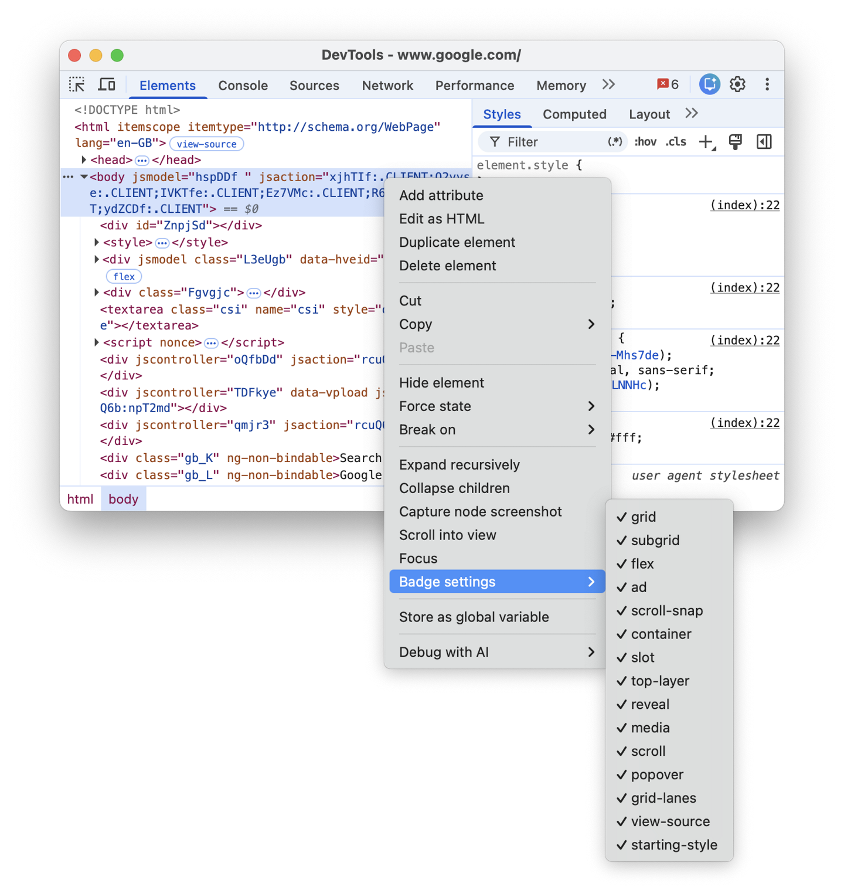
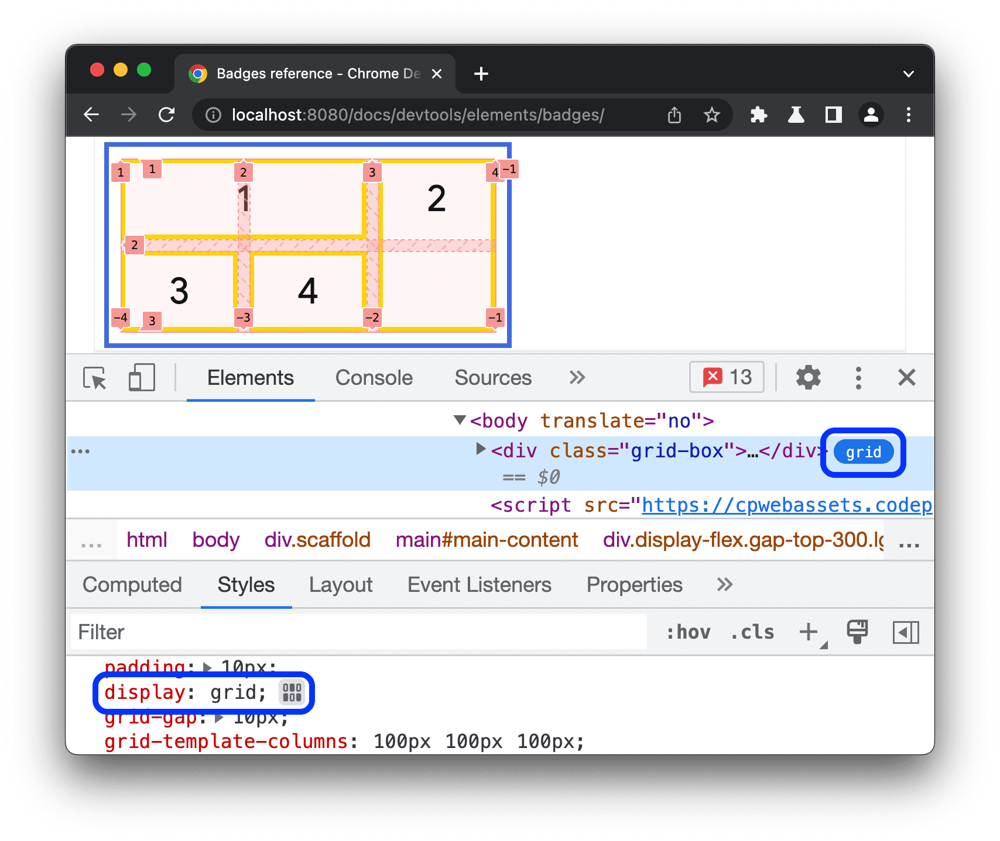
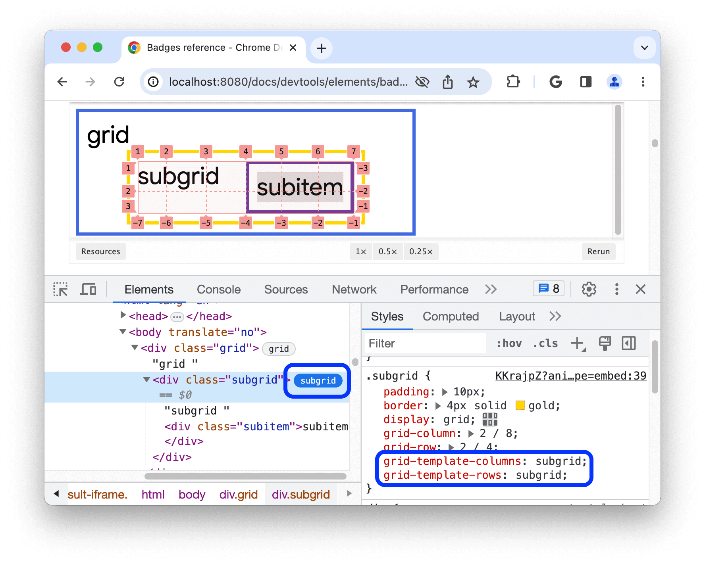
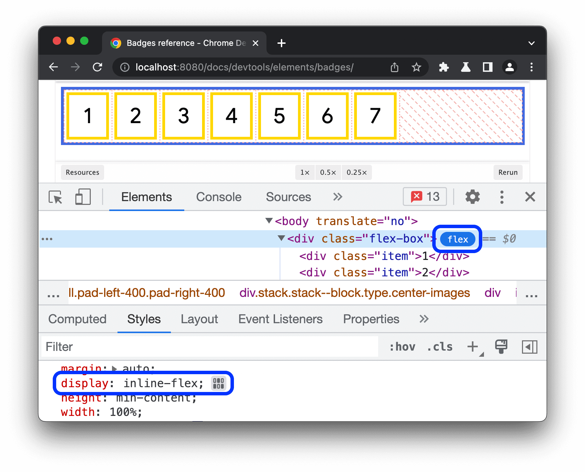
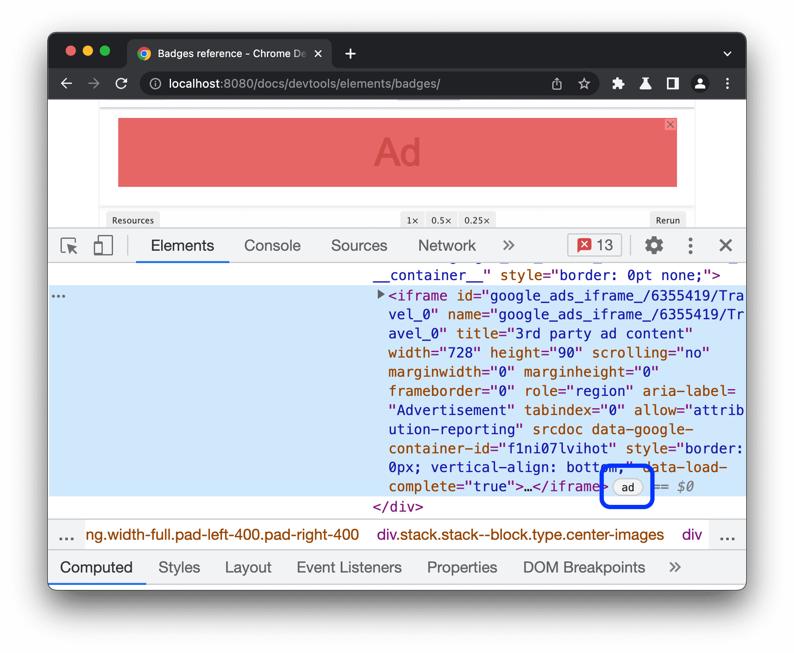
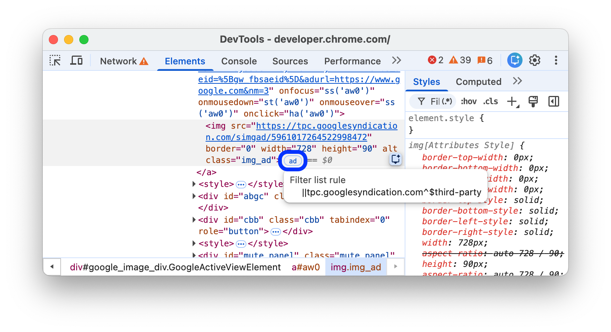
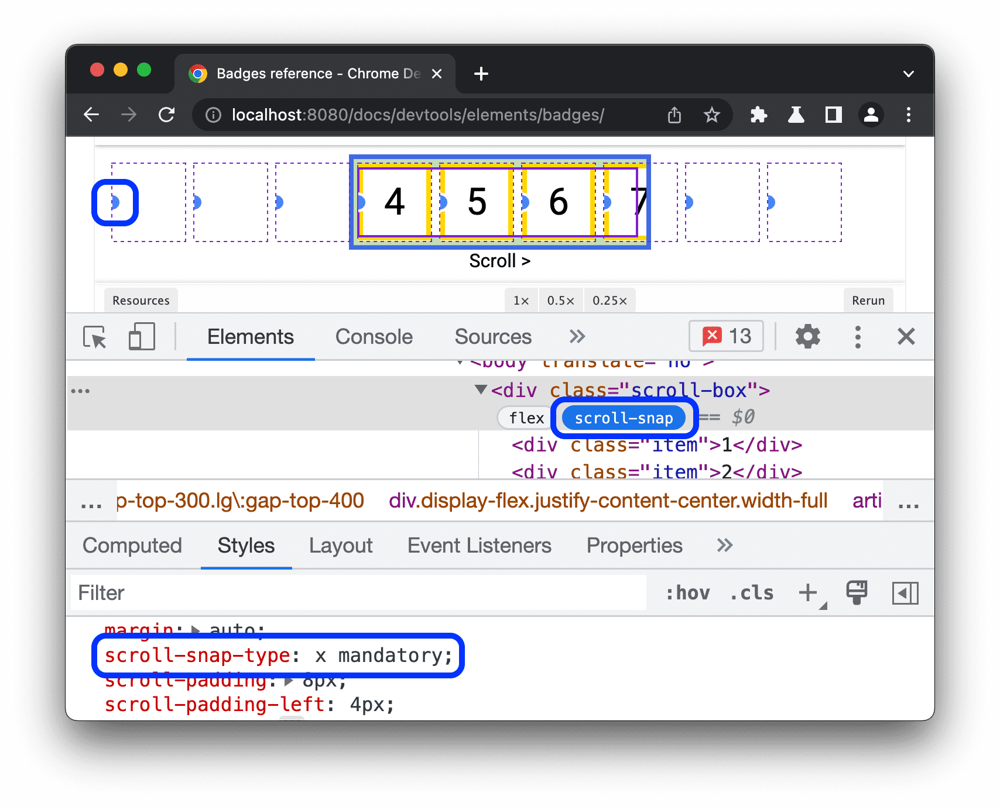
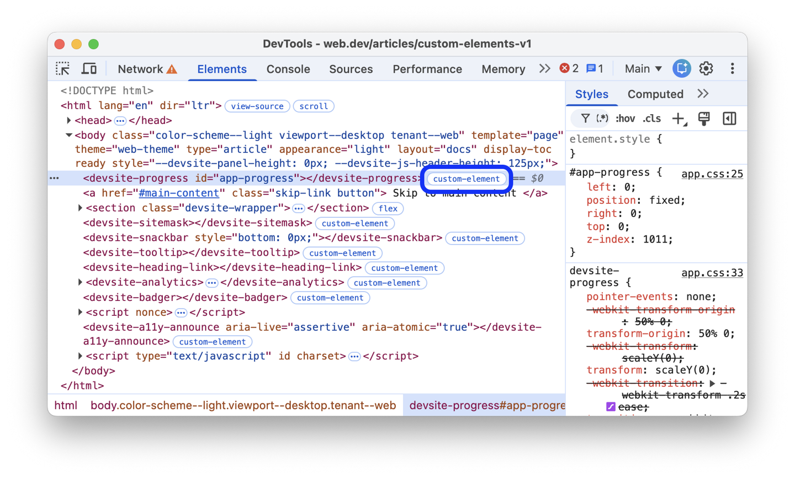

<!-- Copyright Sofia Emelianova

   Licensed under the Apache License, Version 2.0 (the "License");
   you may not use this file except in compliance with the License.
   You may obtain a copy of the License at

       https://www.apache.org/licenses/LICENSE-2.0

   Unless required by applicable law or agreed to in writing, software
   distributed under the License is distributed on an "AS IS" BASIS,
   WITHOUT WARRANTIES OR CONDITIONS OF ANY KIND, either express or implied.
   See the License for the specific language governing permissions and
   limitations under the License.  -->
# Badges reference
<!-- https://developer.chrome.com/docs/devtools/elements/badges -->

_todo in each section:_
* format text
* add links
* create chrome pngs
* change pngs to show edge
* convert inline code examples to demos in Demos repo

Toggle various overlays and speed up DOM tree navigation with this comprehensive reference of badges in the **Elements** tool.

<!-- ====================================================================== -->
## Show or hide badges
<!-- https://developer.chrome.com/docs/devtools/elements/badges#show-or-hide -->

To show or hide certain badges:

1. [Open DevTools](https://developer.chrome.com/docs/devtools/open#elements).

1. Right-click an element in the DOM tree, and then select one or several badges in the **Badge settings** submenu, so that checkmarks appear in the submenu:

    todo edge

The **Elements** tool shows the selected badges next to the appropriate elements in the DOM tree.  The following sections explain each badge.

<!-- ====================================================================== -->
## View-source
<!-- https://developer.chrome.com/docs/devtools/elements/badges#view-source -->

The `view-source` badge is next to the `<html>` tag at the root of the HTML page.  To view the source of your page in the **Sources** tool, click the `view-source` badge:

 todo edge

The `view-source` badge provides an alternative workflow to the **View page source** menuitem in the webpage's context menu (right-click menu), as follows:

1. In Microsoft Edge, right-click a webpage, and then select **Inspect**.

   DevTools opens.

1. In DevTools, select the **Elements** tool.

1. In the DOM tree, next to the `<html>` tag, click the `view-source` badge.

   The **Sources** tool opens.

1. Inspect the page source.

<!-- ====================================================================== -->
## Grid
<!-- https://developer.chrome.com/docs/devtools/elements/badges#grid -->

An HTML element is a _grid container_ if its `display` CSS property is set to `grid` or `inline-grid`.  Such an element has a `grid` badge next to it that toggles the corresponding overlay.

See also:
* [CSS grid layout](https://developer.mozilla.org/docs/Web/CSS/CSS_Grid_Layout) at MDN.

Toggle the overlay on the following preview:

todo: convert inline code to Demos repo dir

1. [Inspect the element](https://developer.chrome.com/docs/devtools/open#inspect) in the preview.

1. In the DOM tree, click the `grid` badge next to the element and observe the overlay:

    todo edge

   The overlay shows columns, rows, their numbers, and gaps.

To learn how to debug grid layout, see [Inspect CSS Grid layouts](../css/grid.md).

<!-- ====================================================================== -->
## Subgrid
<!-- https://developer.chrome.com/docs/devtools/elements/badges#subgrid -->

A _subgrid_ is a nested grid that uses the same tracks as its parent grid.  An element is a _subgrid container_ if one or both of its `grid-template-columns`, `grid-template-rows` properties are set to `subgrid`.  Such an element has a `subgrid` badge next to it that toggles the corresponding overlay.

See also:
* [Subgrid](https://developer.mozilla.org/docs/Web/CSS/CSS_grid_layout/Subgrid) at MDN.

Toggle the overlay on the following preview:

todo: convert inline code to Demos repo dir

1. Inspect the element in the preview.

1. In the DOM tree, click the subgrid badge next to the element and observe the overlay:

    todo edge

The overlay shows columns, rows, their numbers, and gaps of a subgrid.

<!-- ====================================================================== -->
## Flex
<!-- https://developer.chrome.com/docs/devtools/elements/badges#flex -->

An HTML element is a _flex container_ if its `display` CSS property is set to `flex` or `inline-flex`.  Such an element has a `flex` badge next to it that toggles the corresponding overlay.

See also:
* [CSS flexible box layout](https://developer.mozilla.org/docs/Web/CSS/CSS_Flexible_Box_Layout) at MDN.

Toggle the overlay on the following preview:

todo: convert inline code to Demos repo dir

1. [Inspect the element](https://developer.chrome.com/docs/devtools/open#inspect) in the preview.

1. In the DOM tree, click the flex badge next to the element and observe the overlay:

    todo edge

   The overlay shows child element positions.

To learn how to debug flex layouts, see [Inspect and debug CSS flexbox](https://developer.chrome.com/docs/devtools/css/flexbox).

<!-- ====================================================================== -->
## Ad
<!-- https://developer.chrome.com/docs/devtools/elements/badges#ad -->

DevTools can detect some [ad frames and tag them](https://chromium.googlesource.com/chromium/src/+/master/docs/ad_tagging.md). Such a frame has an `ad` badge next to it.

A tooltip provides context on why the element was identified as an ad.  The `ad` badge is not clickable.

See also:
* [Ad Tagging in Chromium](https://chromium.googlesource.com/chromium/src/+/master/docs/ad_tagging.md)

Discover an ad in the following preview:

todo: convert preview to demos repo

1. [Inspect the element](https://developer.chrome.com/docs/devtools/open#inspect) in the preview.

1. In the DOM tree, find an element with the `ad` badge next to it:

    todo edge

1. Hover over the `ad` badge.

   A tooltip provides context on why the element was identified as an ad, such as:

    todo edge

Possible content of the tooltip:

* **Script ancestry:** Which scripts were involved in creating the element.

* **Filter list rules:** The specific rule from a filter list (for example, `EasyList`) that matched the element or the resource it loaded.

You can also use the **Rendering** tab to [highlight ad frames](https://developer.chrome.com/docs/devtools/rendering/apply-effects#highlight_ad_frames) in red.

<!-- ====================================================================== -->
## Scroll
<!-- https://developer.chrome.com/docs/devtools/elements/badges#scroll -->

An HTML element is a scroll container if its overflow CSS property is set to scroll, or auto when there's enough content to cause overflow. Such elements have scroll badges next to them.

Scroll badge on a DOM tree node.

<!-- ====================================================================== -->
## Scroll-snap
<!-- https://developer.chrome.com/docs/devtools/elements/badges#scroll-snap -->

_Scroll containers_ can have CSS properties that configure snap points.  A scroll container element has a `scroll-snap` badge next to it that displays or hides the corresponding overlay.

See also:
* [CSS scroll snap](https://developer.mozilla.org/docs/Web/CSS/Guides/Scroll_snap) at MDN.

Toggle the overlay on the following preview:

todo: convert preview to demos repo

1. [Inspect the element](https://developer.chrome.com/docs/devtools/open#inspect) in the preview.

1. In the DOM tree, click the `scroll-snap` badge next to the element.

1. Scroll the element to the right.

   The scroll-snap overlay is displayed:

    todo edge

The overlay shows element positions and snap points.

<!-- ====================================================================== -->
## Container
<!-- https://developer.chrome.com/docs/devtools/elements/badges#container -->

An HTML element is a [container](https://developer.mozilla.org/docs/Web/CSS/CSS_Container_Queries) if it has the container-type CSS property.  Such an element has a `container` badge next to it that displays or hides the corresponding overlay.

See also:
* [CSS container queries](https://developer.mozilla.org/docs/Web/CSS/Guides/Containment/Container_queries)

<!-- todo: no such flag
Note: CSS container queries is an experimental feature. To enable its support in DevTools, under chrome://flags, set the Enable CSS Container Queries experiment to Enabled. Otherwise, the next preview doesn't work. -->

todo: convert preview code to demos repo

1. Toggle the overlay on the preview.<!-- 1. Go to `edge://flags`, and then set the **Enable CSS Container Queries** experiment to **Enabled**.  _todo: no such flag_ -->

1. Inspect the element in the preview.

1. In the DOM tree, click the container badge next to the element.

1. Try resizing the element by dragging its bottom-right corner and observe the layout change and overlay.

    todo png

   The overlay shows child element positions.

To learn how to debug container queries, see [Inspect and debug CSS container queries] todo link.

<!-- ====================================================================== -->
## Slot
<!-- https://developer.chrome.com/docs/devtools/elements/badges#slot -->

The `<slot>` HTML element is a placeholder that you can fill with your own content.  Together with the `<template>` element, `<slot>` lets you create separate DOM trees and present them together.

A slot content element has a  _todo edge_ `slot` badge next to it that serves as a link to the corresponding `<slot>` element.

_todo: define slot vs slot content_

<!-- moved "key point" up -->
The  `slot` badge has a paired  `reveal` badge that takes you back.

Discover the  _todo edge_ `slot` badge in the following preview:

todo: convert inline code to Demos repo dir

1. Inspect the element in the preview.

1. In the DOM tree, click the  `slot` badge next to the element.

   The corresponding `<slot>` element is highlighted:

   

1. Click the  `reveal` badge.

   The slot's content is highlighted.

<!-- ====================================================================== -->
## Top-layer
<!-- https://developer.chrome.com/docs/devtools/elements/badges#top-layer -->

The `top-layer` badge helps you understand the concept of the top layer and visualize it. The top layer renders content on top of all other layers, regardless of z-index. When you open a `<dialog>` element using the .showModal() method, the browser puts it into the top layer.

To help you visualize top layer elements, the **Elements** tool adds a #top-layer container to the DOM tree after the closing `</html>` tag.

Top layer elements have ink_selectiontop-layer (N) badges next to them, where N is the element's index number. The badges are links to the corresponding elements in the #top-layer container.

Discover the ink_selectiontop-layer (N) badge in the following preview:

todo: convert inline code to Demos repo dir

In the preview, click Open dialog.
Inspect the dialog.
In the DOM tree, click the ink_selectiontop-layer (1) badge next to the `<dialog>` element. The **Elements** tool takes you to the corresponding element in the #top-layer container after the closing `</html>` tag. The top-layer container and badge.
Key point: The ink_selectiontop-layer (N) badge has a paired ink_selectionreveal badge that takes you back.
Get back to the `<dialog>` element by clicking the ink_selectionreveal badge next to the element or its ::backdrop.

<!-- ====================================================================== -->
## Media
<!-- https://developer.chrome.com/docs/devtools/elements/badges#media -->

The media badge is turned off by default. When turned on, it appears next to `<audio>` and `<video>` elements.  Click this badge to open the **Media** tool and debug your media.

The media badge turned on in badge settings and displayed next to the video element.

For more information, see Debug media players with the **Media** tool.

<!-- ====================================================================== -->
## Popover
<!-- https://developer.chrome.com/docs/devtools/elements/badges#popover -->

A popover is any element with a popover attribute.  A popover is useful for a wide range of interactive patterns, including:
* Tooltips
* Alerts
* Toasts
* And more.

A popover element has a `popover` badge next to it.

The `popover` badge toggles a `top-layer` badge next to it that links to the corresponding elements in the `#top-layer` container.  See [Top-layer](https://developer.chrome.com/docs/devtools/elements/badges#top-layer), above.

todo: convert preview to demos repo

Discover the `popover` badge in the following preview:

1. In the preview, click TOGGLE POPOVER.

1. Inspect the popover that appears.

1. In the DOM tree, click the `popover` badge next to the `
` element.

   The **Elements** tool displays the `top-layer` badge.

   ![The "popover" badge next to the element with a "popover" attribute] 

Follow the steps in the `Top layer section.

See also:
 https://web.dev/learn/css/popover-and-dialog.

<!-- ====================================================================== -->
## Starting-style
<!-- https://developer.chrome.com/docs/devtools/elements/badges#starting-style -->

The [`@starting-style` rule](https://web.dev/blog/baseline-entry-animations#setting_up_entry_effects_with_starting-style) defines the initial styles on an element before it's rendered on the page.  This is required for elements that animate in from display: none, because such elements need a state from which to animate in.  Such elements have `starting-style` badges next to them.

This badge toggles the styles in the `@starting-style` rule, so you can see the animation in action.

Discover the `starting-style` badge in the following preview:

todo: convert inline code to Demos repo dir

1. In the preview, click OPEN POPOVER.

1. [Inspect the popover](https://developer.chrome.com/docs/devtools/open#inspect) that appears.

1. In the DOM tree, toggle the starting-style badge next to the `
` element.

   ![The starting-style badge next to the element with the `@starting-style` rule] todo png

   Observe the animation in action and the styles being applied in the **Styles** tab of the **Elements** tool.

See also:
* [Animating popovers](https://web.dev/learn/css/popover-and-dialog#animating_popovers) in _Popover and dialog_ at web.dev.

<!-- ====================================================================== -->
## Custom-element
<!-- https://developer.chrome.com/docs/devtools/elements/badges#custom-element -->

For a customized built-in element, a custom HTML element is identified by a hyphenated tag name or an `is="..."` attribute, .
<!-- todo: clarify upstream, orig:
Custom HTML elements 
identified by hyphenated tag names or is="..." attributes 
for customized built-in elements 
have custom-element badges next to them in the DOM tree.
-->

See also:
* [Using custom elements](https://developer.mozilla.org/docs/Web/API/Web_components/Using_custom_elements)

A custom HTML element has a `custom-element` badge next to it in the DOM tree.

1. Click the badge to go to the relevant code in the Sources panel.

    todo edge

<!-- ====================================================================== -->
## See also
<!-- todo: all links in article -->

* [Testing all badges in DevTools for contrast issues](https://microsoftedge.github.io/Demos/devtools-contrast-bugfix/) - demo.<!-- link not in article -->
   * [/devtools-contrast-bugfix/](https://github.com/MicrosoftEdge/Demos/tree/main/devtools-contrast-bugfix/) - source code.<!-- link not in article -->

<!-- ====================================================================== -->
> [!NOTE]
> Portions of this page are modifications based on work created and [shared by Google](https://developers.google.com/terms/site-policies) and used according to terms described in the [Creative Commons Attribution 4.0 International License](https://creativecommons.org/licenses/by/4.0).
> The original page is found [here](https://developer.chrome.com/docs/devtools/elements/badges) and is authored by Sofia Emelianova.

This work is licensed under a [Creative Commons Attribution 4.0 International License](https://creativecommons.org/licenses/by/4.0).
