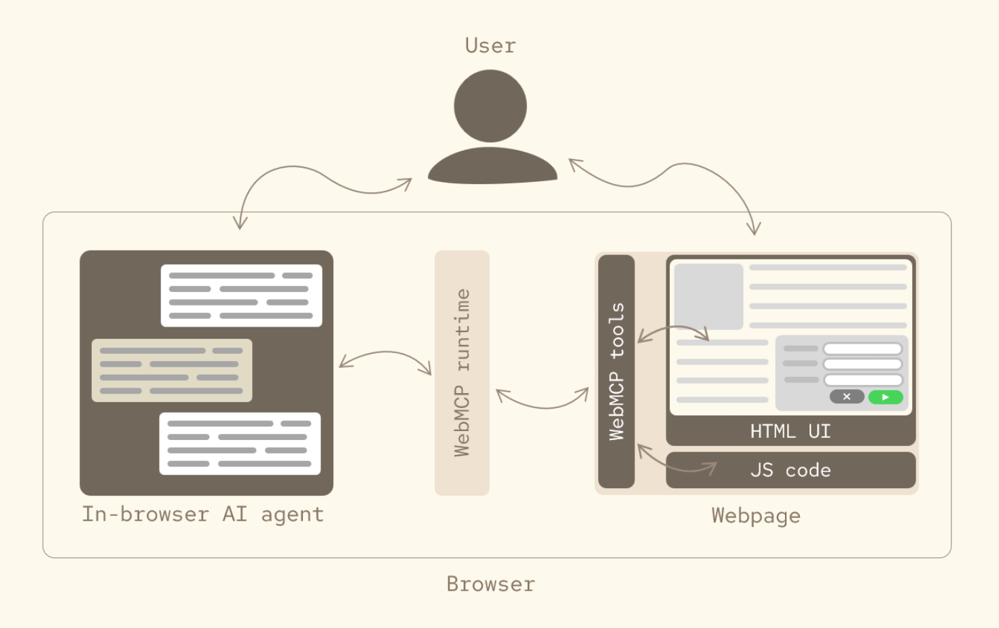
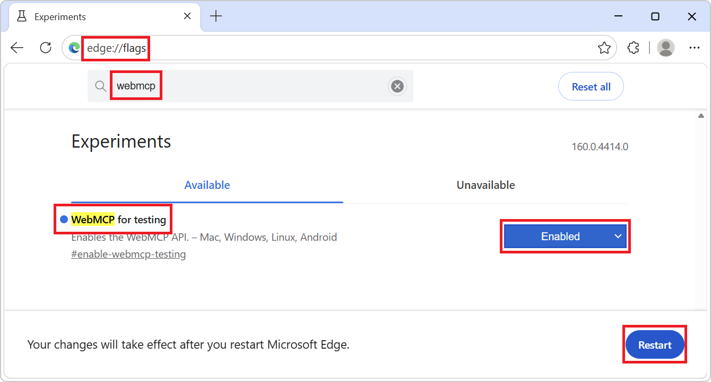
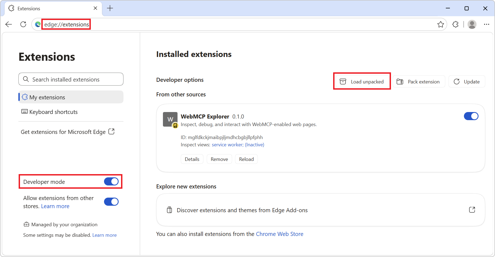
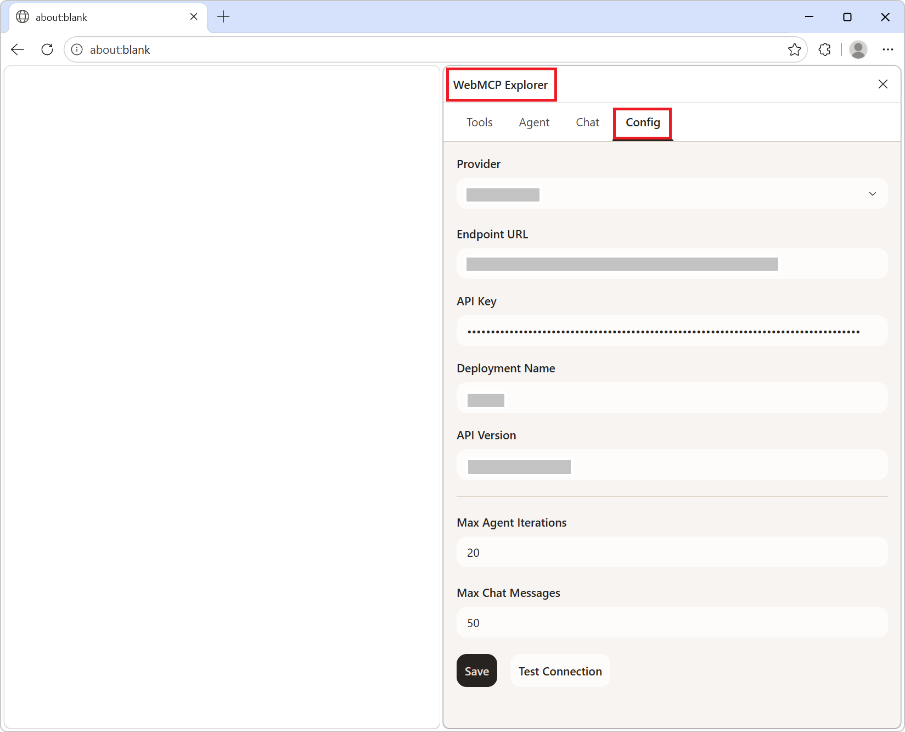
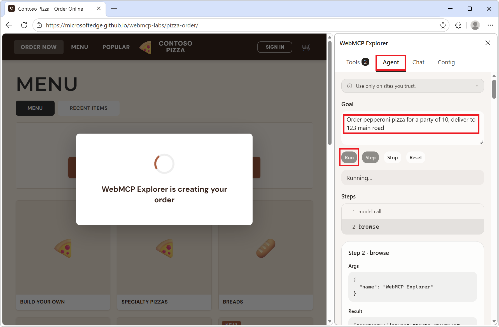
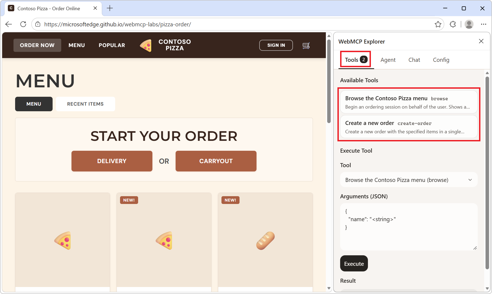

# Expose site actions to AI agents with WebMCP

Use WebMCP to expose a webpage's actions as tools that AI agents can use to complete tasks for end users.  For example, a flight booking site can expose a tool to search for flights.  An agent can then call that tool, instead of finding and operating the site's search controls.

WebMCP is a web API, but it doesn't run an AI model for the site.  Instead, it connects the site's existing functionality to agents that interact with the site through the browser.  This is different from AI web APIs for sites, which run AI models from the site's JavaScript code.  See [AI for the web](./index.md).

[WebMCP](https://webmachinelearning.github.io/webmcp/) is a proposed web standard in the W3C Web Machine Learning Community Group.  The API is experimental, and its design and implementation might change.

**Detailed contents:**

* [Benefits of WebMCP](#benefits-of-webmcp)
* [How WebMCP connects a site and an agent](#how-webmcp-connects-a-site-and-an-agent)
* [Scope and lifetime of tools](#scope-and-lifetime-of-tools)
* [Availability of WebMCP](#availability-of-webmcp)
* [Enable WebMCP locally](#enable-webmcp-locally)
* [Enable WebMCP on your live site by registering for the WebMCP origin trial](#enable-webmcp-on-your-live-site-by-registering-for-the-webmcp-origin-trial)
* [Inspect and test tools in Microsoft Edge DevTools](#inspect-and-test-tools-in-microsoft-edge-devtools)
* [Test tools with WebMCP Explorer](#test-tools-with-webmcp-explorer)
* [Choose a WebMCP API](#choose-a-webmcp-api)
* [Generate tool definitions by using your AI coding tool](#generate-tool-definitions-by-using-your-ai-coding-tool)
* [Define WebMCP tools by using the HTML form API](#define-webmcp-tools-by-using-the-html-form-api)
    * [Register an HTML form as a tool](#register-an-html-form-as-a-tool)
    * [How form controls become tool parameters](#how-form-controls-become-tool-parameters)
    * [Control form submission by an agent](#control-form-submission-by-an-agent)
    * [Customize a form tool's return value](#customize-a-form-tools-return-value)
* [Define WebMCP tools by using the JavaScript API](#define-webmcp-tools-by-using-the-javascript-api)
    * [Register a JavaScript tool](#register-a-javascript-tool)
    * [Describe tool behavior with annotations](#describe-tool-behavior-with-annotations)
    * [Unregister a JavaScript tool](#unregister-a-javascript-tool)
    * [Handle cancellation of a tool call](#handle-cancellation-of-a-tool-call)
    * [Share, discover, and execute tools across origins](#share-discover-and-execute-tools-across-origins)
* [Security best practices for WebMCP tools](#security-best-practices-for-webmcp-tools)
    * [Protect user actions and sessions](#protect-user-actions-and-sessions)
    * [Help agents defend against prompt injection](#help-agents-defend-against-prompt-injection)
    * [Control data and origin boundaries](#control-data-and-origin-boundaries)
* [Send feedback](#send-feedback)
* [See also](#see-also)


<!-- ====================================================================== -->
## Benefits of WebMCP

Without WebMCP, an agent might need to analyze screenshots or HTML and CSS code to find the controls that complete a task.  Changes to the page's layout can make those interactions less reliable.

WebMCP provides the following benefits:

* **Reuse existing code:** Expose existing client-side functions or HTML forms as tools.
* **Describe actions explicitly:** Give each tool a description and structured input parameters, so that the agent doesn't need to infer the action from the page's layout.
* **Share the page's context:** Tools run in the current webpage and can use the same client-side state as the rest of the page, including the end user's signed-in state.
* **Keep actions visible:** Tools can update the page, so that the end user and the agent work in the same interface.

WebMCP defines the tools that the site exposes.  It doesn't prevent an agent from interacting with the site's other controls.


<!-- ====================================================================== -->
## How WebMCP connects a site and an agent

WebMCP runs in the browser and connects three parts:

* **The webpage:** Registers tools by using JavaScript or by adding attributes to HTML forms.
* **Microsoft Edge:** Tracks the registered tools, makes them available to agents, and runs a tool on the page when an agent calls it.
* **The agent:** Selects a tool and provides input parameters to complete a task for the end user.

The following diagram shows how the agent and webpage communicate through the browser's WebMCP runtime:



An agent can be built into the browser, provided by a browser extension, or hosted in a webpage, such as a chat widget.  By default, an in-page agent can access tools from its own origin, not tools from other origins.

Registering tools doesn't install or configure an agent.  To test the tools with an agent, use [WebMCP Explorer](#test-tools-with-webmcp-explorer), as described below.


<!-- ====================================================================== -->
## Scope and lifetime of tools

WebMCP tools belong to the webpage that registers them:

* Tools are scoped to the registering document, so each new page must register its own tools.
* A page can update its registered tools when its application state changes.  For example, a single-page application can register and unregister tools when the displayed content changes.
* Tools have the same access as the page's other client-side code.  They don't bypass the site's authentication or authorization checks.
* WebMCP requires a secure context, such as HTTPS or localhost.
* By default, cross-origin iframes can't register tools.  To delegate the `tools` Permissions Policy feature to an iframe, add `allow="tools"` to that iframe.

Only delegate access to trusted embedded content.  The iframe permission doesn't, by itself, expose all tools across origins.


<!-- ====================================================================== -->
## Availability of WebMCP

WebMCP is available for testing in Microsoft Edge version 159 or later:

* For local development, enable the **WebMCP for testing** flag on the development device.
* For a live site, register for the WebMCP origin trial and add its token to the site.

The origin trial runs for a limited time.  For its current expiration date, see [WebMCP](https://developer.microsoft.com/microsoft-edge/origin-trials/trials/0b76fe60-b266-458e-a285-04e375c0c31a) at the Microsoft Edge Origin Trials website.

Keep the site's normal controls available, so that the site works without WebMCP or an agent.


<!-- ====================================================================== -->
## Enable WebMCP locally

To enable WebMCP on a development device:

1. Make sure you're using Microsoft Edge version 159 or later.

1. In Microsoft Edge, open a new tab or window, and then go to `edge://flags`.

1. In the search box, at the top of the page, enter **webmcp**.

   The page is filtered to show the matching flag.

1. Under **WebMCP for testing**, select **Enabled**:

   

1. Restart Microsoft Edge.

This flag enables WebMCP only on the device where the flag is set.  To enable WebMCP for end users of a live site, see [Enable WebMCP on your live site by registering for the WebMCP origin trial](#enable-webmcp-on-your-live-site-by-registering-for-the-webmcp-origin-trial), below.


<!-- ====================================================================== -->
## Enable WebMCP on your live site by registering for the WebMCP origin trial

An origin trial enables WebMCP on registered sites without requiring end users to set the testing flag.

To register a site:

1. Go to [Microsoft Edge Origin Trials](https://developer.microsoft.com/microsoft-edge/origin-trials).

1. Select the [WebMCP](https://developer.microsoft.com/microsoft-edge/origin-trials/trials/0b76fe60-b266-458e-a285-04e375c0c31a) trial.

1. Click the **I Accept the Terms of Use** button.

1. If prompted, sign in to GitHub, and then authorize the **Microsoft Edge Origin Trials** page to use the account sign-in.

   The **New Origin Trial Registration** form opens.

1. In the **Domain** text box, enter a domain URL, such as `https://example.com`, or a subdomain URL, such as `https://beta.example.com`.  Don't include a path or query parameters.

1. Set the **Enable token for subdomains?** toggle.  Turn it on to include the domain's subdomains, or leave it off to register only the specified domain or subdomain.

1. Click the **Submit** button.

   The generated token appears in the **Registrations** section.

1. Click the **Copy** button to copy the token.

1. Add the following tag to the `<head>` of each page that uses WebMCP, replacing `EXAMPLE_TOKEN` with the token:

   ```html
   <meta http-equiv="origin-trial" content="EXAMPLE_TOKEN">
   ```

   Alternatively, send the token in an HTTP response header:

   ```http
   Origin-Trial: EXAMPLE_TOKEN
   ```

When a supported version of Microsoft Edge finds a valid token, it enables WebMCP for that page.

These registration steps follow [Registering for an origin trial](../origin-trials/index.md#registering-for-an-origin-trial).  For token configuration, expiration, and renewal, see [Test experimental APIs and features by using origin trials](../origin-trials/index.md).


<!-- ====================================================================== -->
## Inspect and test tools in Microsoft Edge DevTools

You can inspect, debug, and manually run WebMCP tools directly in Microsoft Edge DevTools, without installing an extension or configuring an LLM provider:

1. Open DevTools on a page that uses WebMCP tools (`F12`, or **Ctrl+Shift+I** on Windows/Linux, **Command+Option+I** on macOS).

1. Select the **Application** tool, and then select **WebMCP** in the sidebar.

<!-- TODO: Add screenshot of the Microsoft Edge DevTools Application > WebMCP pane. -->

In the **WebMCP** pane, you can:

* **Inspect available tools:** View all declarative and imperative tools currently registered on the page, including their descriptions and invocation counts.
* **Review invoked tools:** Inspect a log of tool calls, including status (`Completed`, `Canceled`, `In Progress`, or `Error`), input parameters, return values, and schema validation errors.
* **Run tools manually:** Select a tool from **Available Tools** (or select the play button on a previous invocation), enter input parameters, and select **Run tool** to test your tool logic directly.

If you use Chrome DevTools MCP with coding agents, you can also enable experimental WebMCP inspection tools (`list_webmcp_tools` and `execute_webmcp_tool`) by passing `--categoryExperimentalWebmcp` in the server arguments.  See [Let agents inspect your site and WebView2 app with Chrome DevTools MCP](./devtools-mcp-server.md).


<!-- ====================================================================== -->
## Test tools with WebMCP Explorer

WebMCP Explorer is a browser extension for inspecting and running WebMCP tools.  It also provides an agent that uses a configured large language model (LLM) provider.

Use WebMCP Explorer only on sites that you own, control, or trust.  The extension sends the page's tool descriptions and results to the configured model as-is.  A page could use that content to manipulate the model.  Don't use sensitive data in test prompts or tool results.

To install WebMCP Explorer:

1. [Enable WebMCP locally](#enable-webmcp-locally), as described above.

1. Open a terminal window, go to the directory where you want to clone the repo, and then enter:

   ```console
   git clone https://github.com/MicrosoftEdge/webmcp-labs.git
   ```

1. In Microsoft Edge, go to `edge://extensions` in a new tab or window.

1. In the sidebar, turn on **Developer mode**.

1. Click the **Load unpacked** button.

1. In the file explorer, go to the cloned repo, and then select the `webmcp-labs\webmcp-explorer\dist` directory.

   The WebMCP Explorer extension is displayed in the list of installed extensions.

   

1. Click the WebMCP Explorer extension icon to open its side panel.  If the icon isn't visible in the toolbar, click **Extensions**, and then click **WebMCP Explorer**.

To configure the model provider and run the demo:

1. In the WebMCP Explorer side panel, click **Config**.

1. Under **Provider**, select an LLM provider, and then enter the required connection details.  The model must support tool calling.  For provider-specific instructions, see [Provider setup](https://github.com/MicrosoftEdge/webmcp-labs/blob/main/webmcp-explorer/README.md#provider-setup) in _WebMCP Explorer_.

1. Save the settings, and then click **Test Connection** to check the connection.

   

1. In a new tab, go to the [Contoso Pizza](https://microsoftedge.github.io/webmcp-labs/pizza-order/) demo.

1. In the WebMCP Explorer side panel, click **Agent**.

1. In the **Goal** text box, enter `Order pepperoni pizza for a party of 10, deliver to 123 main road`, and then press **Enter**.

   The extension uses the configured model and the page's WebMCP tools to complete the goal.

   

To inspect a site's tools without running a complete agent task, use the **Tools** tab.  This tab lists the tools on the current page and lets you run a tool with custom JSON input.



To update the extension, pull the latest changes in the cloned repo, and then reload the extension at `edge://extensions`.


<!-- ====================================================================== -->
## Choose a WebMCP API

You can expose site actions to agents by using two different APIs:

| API | Use when | How to register a tool |
|---|---|---|
| HTML form attributes | Use when your site handles actions through HTML forms. | Add WebMCP HTML attributes to forms and input elements. |
| JavaScript web API | Use when the site handles actions through JavaScript code. | Call `document.modelContext.registerTool()` with a tool definition and an execution function. |


<!-- ====================================================================== -->
## Generate tool definitions by using your AI coding tool

If you use an AI coding tool to build your site, [Modern Web Guidance](https://github.com/GoogleChrome/modern-web-guidance) can help that tool define WebMCP tools for you.  Modern Web Guidance is a set of skills that provides current web platform guidance and browser compatibility information to AI coding tools.

WebMCP is currently in origin trial.  Modern Web Guidance doesn't provide guidance for origin-trial features by default, so installing the skills isn't enough to access its WebMCP guides.

To install Modern Web Guidance and enable its WebMCP guidance:

1. In a terminal, run the following command and follow the installation prompts:

   ```console
   npx modern-web-guidance@latest install
   ```

   For other installation methods, see [Installation](https://developer.chrome.com/docs/modern-web-guidance/get-started#installation).

1. From the site's project root directory, enable guidance for origin-trial features:

   ```console
   npx modern-web-guidance@latest set-allow-origin-trials
   ```

   For more information, see [Enable guidance for features in origin trial](https://developer.chrome.com/docs/modern-web-guidance/get-started#enable_guidance_for_features_in_origin_trial).

This opt-in enables guidance for the AI coding tool only.  It doesn't enable WebMCP in Microsoft Edge or register the site for the origin trial.


<!-- ====================================================================== -->
## Define WebMCP tools by using the HTML form API

If your site uses HTML forms to handle the actions which you want to expose as WebMCP tools, you can declare those forms as tools using the HTML form API.


<!-- ------------------------------ -->
#### Register an HTML form as a tool

Use the declarative API to expose an existing HTML form.  Add `toolname` and `tooldescription` to the `<form>`, and describe its input parameters by using `toolparamdescription`:

```html
<form toolname="search-flights"
      tooldescription="Searches for one-way or round-trip flights."
      action="/search"
      method="post">
  <label for="origin">Origin</label>
  <input id="origin" name="origin" required
         toolparamdescription="Departure airport or city">

  <label for="destination">Destination</label>
  <input id="destination" name="destination" required
         toolparamdescription="Arrival airport or city">

  <label for="departureDate">Departure date</label>
  <input type="date" id="departureDate" name="departureDate" required
         toolparamdescription="Departure date">

  <label for="returnDate">Return date</label>
  <input type="date" id="returnDate" name="returnDate"
         toolparamdescription="Return date, for round-trip flights">

  <button type="submit">Search</button>
</form>
```

The example assumes that the site handles flight searches at `/search`.  Browsers that don't support WebMCP ignore the tool attributes and use the form normally.

The declarative API supports these attributes:

| Attribute | Applies to | Required | Description |
|---|---|---|---|
| `toolname` | `<form>` | Yes | A unique tool name, with the same character and length limits as a JavaScript tool name. |
| `tooldescription` | `<form>` | Yes | A description of what the form does. |
| `toolautosubmit` | `<form>` | No | Allows the browser to submit the form automatically when an agent invokes the tool. |
| `toolparamdescription` | Form controls, such as `<input>`, `<select>`, and `<textarea>` | No | Describes a tool input parameter.  If omitted, Microsoft Edge uses the control's label text or, if no label is available, its `aria-description`. |

Keep the form's labels and other accessibility information.  Tool descriptions don't replace labels for end users.


<!-- ------------------------------ -->
#### How form controls become tool parameters

Microsoft Edge generates a tool input schema from the form's controls:

* A control's `name` provides the parameter name.
* The `required` attribute identifies required parameters.
* A `<select>` element's option values provide the allowed values.

The complete schema generation rules are still evolving.  Use the **Tools** tab in WebMCP Explorer to inspect how Microsoft Edge exposes the form.  To unregister a declarative tool, remove the `toolname` or `tooldescription` attribute from the `<form>` element.


<!-- ------------------------------ -->
#### Control form submission by an agent

When an agent invokes a declarative tool, Microsoft Edge fills the form with the agent's input values.

By default, Edge focuses the submit button so the end user can review and submit the form.  To submit automatically instead, add the boolean `toolautosubmit` attribute:

```html
<form toolname="search-flights"
      tooldescription="Searches for one-way or round-trip flights."
      toolautosubmit
      action="/search"
      method="post">
  <!-- Keep the form's labeled controls and submit button here. -->
</form>
```

Don't use automatic submission as a replacement for confirmation of a purchase, payment, or other consequential action.

While the tool is active, its form matches the `:tool-form-active` CSS pseudo-class, and its submit button matches `:tool-submit-active`.  Use these pseudo-classes to highlight the form:

```css
form:tool-form-active {
  outline: 2px dashed blue;
}

button:tool-submit-active {
  outline: 2px dashed red;
}
```

The `toolactivated` and `toolcancel` events on `document.modelContext` also let the page respond to tool activity:

```javascript
document.modelContext.addEventListener("toolactivated", ({ toolName }) => {
  console.log(`Tool activated: ${toolName}`);
});

document.modelContext.addEventListener("toolcancel", ({ toolName }) => {
  console.log(`Tool canceled: ${toolName}`);
});
```


<!-- ------------------------------ -->
#### Customize a form tool's return value

The declarative API adds two members to `SubmitEvent`:

| Member | Description |
|---|---|
| `agentInvoked` | A boolean that indicates whether an agent triggered the form submission. |
| `respondWith()` | A method that accepts a promise for the tool's return value.  Call `preventDefault()` before calling this method. |

If the form already handles submission in JavaScript, reuse that handler to return results to the agent.  For example, the following handler uses the same `getAndDisplayFlights()` function as the JavaScript tool:

```javascript
const form = document.querySelector('form[toolname="search-flights"]');

form.addEventListener("submit", event => {
  if (!event.agentInvoked) {
    return;
  }

  event.preventDefault();

  const input = Object.fromEntries(new FormData(form));
  event.respondWith(getAndDisplayFlights(input));
});
```

This example assumes that `getAndDisplayFlights()` validates the input, displays results or errors on the page, and returns a promise for a JSON-serializable result.  If the search fails, the function must reject the promise instead of reporting success.

For an end-user submission, the handler leaves the form's normal submission behavior unchanged.  For an agent submission, it prevents navigation and returns the function's result to the agent.

The design of responses from forms that navigate to another page is still under discussion.  See [Getting the form response to the agent](https://github.com/webmachinelearning/webmcp/blob/main/declarative-api-explainer.md#getting-the-form-response-to-the-agent) in _WebMCP declarative API_.


<!-- ====================================================================== -->
## Define WebMCP tools by using the JavaScript API

If your site uses JavaScript functions to handle actions that you want to expose as WebMCP tools, you can define those tools by using the JavaScript API.


<!-- ------------------------------ -->
#### Register a JavaScript tool

Use `document.modelContext.registerTool()` to expose an existing JavaScript function as a tool.  The method returns a promise.  Registration can fail, for example, if the tool name isn't valid, the description is empty, or another tool with the same name is already registered.

Before registering tools, check whether WebMCP is available:

```javascript
if ("modelContext" in document) {
  // Register the page's WebMCP tools.
}
```

For example, a flight booking site might already have an asynchronous `getAndDisplayFlights()` function.  This function accepts search criteria, fetches flights, displays them on the page, and returns results that can be serialized as JSON.

To expose that function as a tool:

```javascript
if ("modelContext" in document) {
  await document.modelContext.registerTool({
    name: "search-flights",
    title: "Search flights",
    description: "Searches for one-way or round-trip flights.",
    inputSchema: {
      type: "object",
      properties: {
        origin: {
          type: "string",
          description: "Departure airport or city"
        },
        destination: {
          type: "string",
          description: "Arrival airport or city"
        },
        departureDate: {
          type: "string",
          format: "date",
          description: "Departure date"
        },
        returnDate: {
          type: "string",
          format: "date",
          description: "Return date, for round-trip flights"
        }
      },
      required: ["origin", "destination", "departureDate"]
    },
    annotations: { readOnlyHint: true },
    async execute(input, { signal }) {
      return await getAndDisplayFlights({ ...input, signal });
    }
  });
}
```

This example assumes that `getAndDisplayFlights()` validates the search criteria and passes the `signal` to its network requests.  Define the function in the site's code before registering the tool.  Use the snippet in a JavaScript module or an asynchronous function, because it uses `await`.

The tool definition includes the following properties:

| Property | Required | Description |
|---|---|---|
| `name` | Yes | A unique tool name, from 1 to 128 characters.  Use ASCII letters, digits, underscores (`_`), hyphens (`-`), or dots (`.`). |
| `title` | No | A short label that the browser can display in its UI.  Localize the label for the end user's language. |
| `description` | Yes | A description of what the tool does. |
| `inputSchema` | No | A JSON Schema object that describes the input parameters.  Omit this property if the tool takes no input. |
| `outputSchema` | No | A JSON Schema object that describes the structure of the tool's return value.  Useful for tools that return structured data or IDs for follow-up calls; omit it for simple actions to save context tokens. |
| `execute` | Yes | A synchronous or asynchronous function that runs the action.  It receives the input parameters and an execution options object that contains a `signal`.  The result is serialized as JSON and returned to the agent. |
| `annotations` | No | Hints about the tool's behavior, as described below. |

Treat tool input as untrusted.  A schema describes the input but doesn't replace validation in the tool or on the server.  For more information, see [Security best practices for WebMCP tools](#security-best-practices-for-webmcp-tools), below.

For the current API definition, see [WebMCP](https://webmachinelearning.github.io/webmcp/).


<!-- ------------------------------ -->
#### Describe tool behavior with annotations

Use the tool's `annotations` property to give agents hints about its behavior:

| Annotation | Set to `true` when |
|---|---|
| `readOnlyHint` | The tool only reads data and doesn't modify it. |
| `untrustedContentHint` | The tool returns content that the site doesn't control, such as end-user reviews. |
| `consequentialHint` | The tool has significant real-world or irreversible effects, such as booking a flight, sending money, or deleting data. |
| `debugging` | The tool is intended for debugging or developer tooling, rather than end users. |

These hints default to `false`.  An agent can use them to decide whether to request confirmation or handle output with extra care.  They aren't security controls, and they don't replace permission checks or confirmation in the site.


<!-- ------------------------------ -->
#### Unregister a JavaScript tool

To unregister a tool later, pass an `AbortSignal` in the second argument to `registerTool()`.  Then call the corresponding controller's `abort()` method:

```javascript
const registrationController = new AbortController();

await document.modelContext.registerTool({
  name: "search-flights",
  description: "Searches for one-way or round-trip flights.",
  inputSchema: {
    type: "object",
    properties: {
      origin: {
        type: "string",
        description: "Departure airport or city"
      },
      destination: {
        type: "string",
        description: "Arrival airport or city"
      },
      departureDate: {
        type: "string",
        format: "date",
        description: "Departure date"
      },
      returnDate: {
        type: "string",
        format: "date",
        description: "Return date, for round-trip flights"
      }
    },
    required: ["origin", "destination", "departureDate"]
  },
  async execute(input, { signal }) {
    return await getAndDisplayFlights({ ...input, signal });
  }
}, {
  signal: registrationController.signal
});

// When the action is no longer available on this page:
registrationController.abort();
```

This example registers `search-flights` with its `inputSchema`, uses the site's existing `getAndDisplayFlights()` function, and assumes that WebMCP is available.  Unregister the previous tool before registering another tool with the same name.

Unregistering a tool doesn't cancel an execution that's already running.


<!-- ------------------------------ -->
#### Handle cancellation of a tool call

The browser passes an execution options object to the tool's `execute` function.  When an agent cancels a tool call, the browser aborts the object's `signal`.

Pass this signal to long-running work, such as `fetch()` calls.  The flight search example above passes the signal to `getAndDisplayFlights()` so that the function can cancel its network requests.

WebMCP uses signals for two different purposes:

* **Registration signal:** The site creates this signal and passes it to `registerTool()`.  Aborting it unregisters the tool.
* **Execution signal:** The browser creates this signal and passes it to `execute()`.  Aborting it cancels a tool call, not the tool's registration.

After cancellation, the agent doesn't receive the tool's return value.  Cancellation doesn't undo work that's already completed.  For a payment, booking, or other irreversible action, check `signal.aborted` before committing the action, and keep the site's normal confirmation and server-side checks.


<!-- ------------------------------ -->
#### Share, discover, and execute tools across origins

By default, tools are only visible to same-origin documents.  To expose a tool to a trusted cross-origin document (such as a parent page or embedded iframe), pass secure origins in the `exposedTo` option of `registerTool()`:

```javascript
await document.modelContext.registerTool(toolDefinition, {
  exposedTo: ["https://example.com"]
});
```

An in-page agent can discover available tools with `document.modelContext.getTools()`, execute a tool with `executeTool()`, and listen for changes with the `toolchange` event.  Cross-origin tools are included only when both sides opt in: the registering page lists the caller in `exposedTo`, and the caller requests that origin in `fromOrigins`:

```javascript
// Retrieve same-origin tools and opted-in tools from a partner origin:
const tools = await document.modelContext.getTools({
  fromOrigins: ["https://partner.example"]
});

const flightTool = tools.find(tool => tool.name === "search-flights");
if (flightTool) {
  const controller = new AbortController();
  const result = await document.modelContext.executeTool(
    flightTool,
    { origin: "SEA", destination: "JFK", departureDate: "2026-06-15" },
    { signal: controller.signal }
  );
}

// Listen for tool registration or unregistration changes:
document.modelContext.addEventListener("toolchange", () => {
  // Refresh the agent's tool list.
});
```

Only expose tools to origins that you trust to read user data or take actions on behalf of the end user.


<!-- ====================================================================== -->
## Security best practices for WebMCP tools

Tools run with the page's client-side access, so an agent can trigger actions in the end user's signed-in session.  Treat every tool call as untrusted input, because an agent calling your tool could be influenced by prompt injection from another webpage or untrusted content.


<!-- ------------------------------ -->
#### Protect user actions and sessions

* Don't register tools for actions that aren't available to the end user in the current page or authentication state.
* Validate all tool inputs in both client-side code and server-side handlers, and keep all existing authentication and authorization checks.
* Set `consequentialHint: true` on JavaScript tools that execute high-stakes or irreversible actions so the browser or agent can request user confirmation.  Because annotations are advisory hints, require server-side verification for the highest-risk actions.
* Enforce rate limits, make mutating tools idempotent or bound to fresh state tokens, and check `signal.aborted` before committing irreversible work.


<!-- ------------------------------ -->
#### Help agents defend against prompt injection

While the agent is responsible for defending against prompt injection, your site can reduce the attack surface:

* Don't interpolate user-generated or untrusted content into tool names, descriptions (`description` or `tooldescription`), or parameter descriptions.
* Return structured data with only the fields needed, rather than raw HTML or large freeform text blocks that can carry hidden instructions or unrelated user-generated content.
* Set `untrustedContentHint: true` when a tool returns user-generated or external content, without relying on the hint alone to prevent prompt injection.


<!-- ------------------------------ -->
#### Control data and origin boundaries

* Request only the input parameters the tool actually needs, and return only the information the agent needs (tool results can be sent to the agent's model provider).
* Only expose tools via `exposedTo` or delegate `allow="tools"` to origins you trust to read that user data or act on the user's behalf.  Browser extensions with host permissions can still inspect and invoke a page's tools.
* Don't expose `debugging: true` tools or sensitive internal actions in production unless they're needed and protected by suitable access controls.

For the community's current discussion, see [Security and Privacy Considerations](https://github.com/webmachinelearning/webmcp#security-and-privacy-considerations) in the _WebMCP_ repo.


<!-- ====================================================================== -->
## Send feedback

For feedback about the WebMCP API design, use the [Issues](https://github.com/webmachinelearning/webmcp/issues) page in the WebMCP repo.

For issues with the Microsoft Edge origin trial, use the **Feedback** link on the [WebMCP](https://developer.microsoft.com/microsoft-edge/origin-trials/trials/0b76fe60-b266-458e-a285-04e375c0c31a) registration page.

For issues with WebMCP Explorer or the demos, use the [Issues](https://github.com/MicrosoftEdge/webmcp-labs/issues) page in the WebMCP Labs repo.


<!-- ====================================================================== -->
## See also

* [WebMCP](https://webmachinelearning.github.io/webmcp/) specification.
* [WebMCP declarative API](https://github.com/webmachinelearning/webmcp/blob/main/declarative-api-explainer.md).
* [WebMCP Labs](https://github.com/MicrosoftEdge/webmcp-labs).
* [Test experimental APIs and features by using origin trials](../origin-trials/index.md).
* [Let agents inspect your site and WebView2 app with Chrome DevTools MCP](./devtools-mcp-server.md).
* [webmcp-types](https://www.npmjs.com/package/webmcp-types) on npm, for TypeScript typings.
* Experimental framework integrations: [React (`use-webmcp-tool`)](https://www.npmjs.com/package/use-webmcp-tool), [Angular](https://angular.dev/ai/webmcp), and [Vue (`useWebMCP`)](https://vueuse.org/core/usewebmcp).
